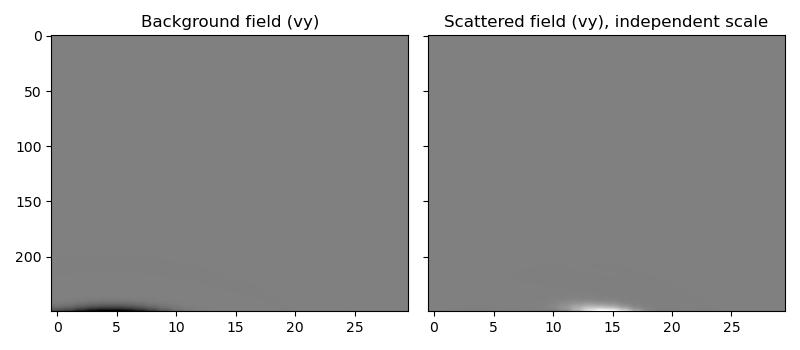

Born Modelling with the Elastic Wave Equation
==============================================

.. note::

   Stability: **experimental** -- the label records that this propagator has
   never appeared in a release, so ``0.1.0`` is the first time real use meets
   its design. It is not a lesser promise: its interface is frozen exactly as
   the other ten propagators' are, calling it emits no warning about its
   maturity, and every other Deepwave promise applies to it unchanged. See
   :doc:`stability`.

This page describes :func:`deepwave.elastic_born`, Born (linearised)
modelling for the isotropic elastic wave equation described in
:doc:`elastic`. It follows the same pattern as :doc:`scalar_born` and
:doc:`acoustic_born` (read those pages first for the general idea of Born
modelling in Deepwave), extended to elasticity's Lamé-parameter/buoyancy
model and full stress tensor.

Minimal example
----------------

:func:`deepwave.elastic_born` takes the same background model as
:func:`deepwave.elastic` plus a scattering perturbation, here a localised
change in the shear modulus ``dmu``:

.. code-block:: python

    import torch
    import deepwave

    vp = 1500 * torch.ones(40, 40)
    vs = 1000 * torch.ones(40, 40)
    rho = 2200 * torch.ones(40, 40)
    lamb, mu, buoyancy = deepwave.vpvsrho_to_lambmubuoyancy(vp, vs, rho)
    dmu = torch.zeros(40, 40)
    dmu[20, 20] = 0.3 * float(mu[20, 20])  # a small shear-modulus perturbation

    out = deepwave.elastic_born(
        lamb, mu, buoyancy, grid_spacing=5, dt=0.001,
        dmu=dmu,
        source_amplitudes_y=deepwave.wavelets.ricker(25, 200, 0.001, 0.05).reshape(1, 1, -1),
        source_locations_y=torch.tensor([[[5, 20]]]),
        sc_receiver_locations_y=torch.tensor([[[35, 20]]]),
        pml_width=10,
        pml_freq=25,
    )
    out.sc_receiver_amplitudes_y  # the scattered (Born) vertical velocity, shape [1, 1, 200]

The recipe below expands this into a full example with a plot and a gradient.

Derivation
----------

:func:`deepwave.elastic` solves the isotropic velocity-stress system built
from the Lamé parameters :math:`\lambda`, :math:`\mu` and buoyancy
:math:`B = 1/\rho`. Perturbing the model,
:math:`\lambda \to \lambda + \delta\lambda`,
:math:`\mu \to \mu + \delta\mu`, :math:`B_i \to B_i + \delta B_i`, and
splitting the fields into background and first-order scattered parts
(:math:`\mathbf{v} = \bar{\mathbf{v}} + \delta\mathbf{v}`,
:math:`\sigma = \bar\sigma + \delta\sigma`) gives, at zeroth order, the
ordinary background elastic system, and at first order a scattered system
that is **the same isotropic elastic operator as the background field**,
driven by virtual sources built entirely from the background field's own
strain-rate and stress-divergence terms times the scattering models
(:math:`\delta\lambda`, :math:`\delta\mu`, :math:`\delta B_i`). As with
:doc:`acoustic_born`, each scattering perturbation lives at the same
staggered node as the model parameter it perturbs, so no interpolation of
the scattering models themselves is required.

Because both fields obey the identical isotropic elastic operator, every
result already established for :func:`deepwave.elastic` (staggered-grid
layout, C-PML/M-PML absorbing boundaries, the IVM free-surface, per-field
image parity) transfers unchanged to each field of the Born pair
independently -- this is a direct analogy, not a separate physics
derivation. See :doc:`elastic_born_derivation` for the full discrete
derivation, including the coupled forward update, the scattered-only and
full two-field adjoints, and the second-order (Hessian-vector product,
forward-mode ``jvp``) structure.

Implementation
--------------

Deepwave's elastic Born propagator simultaneously simulates two coupled
elastic fields on the same staggered grid and with the same boundary
handling (including ``mpml_fraction`` and free-surface faces) as
:func:`deepwave.elastic`:

1.  **Background field** :math:`(\bar{\mathbf{v}}, \bar\sigma)`: propagates
    in the background model ``lamb``/``mu``/``buoyancy`` exactly as
    :func:`deepwave.elastic` would.
2.  **Scattered field** :math:`(\delta\mathbf{v}, \delta\sigma)`: propagates
    in the same background model, driven by virtual sources built from the
    background field's strain-rate and stress-divergence terms times the
    scattering models ``dlamb``/``dmu``/``dbuoyancy``.

For a small perturbation, the sum of the background and scattered outputs
approximates the output of the regular :func:`deepwave.elastic` propagator
run with the perturbed model
``lamb + dlamb``/``mu + dmu``/``buoyancy + dbuoyancy``.

**Inputs and outputs**

The propagator takes the same background model as :func:`deepwave.elastic`
(``lamb``, ``mu``, ``buoyancy``) plus the scattering perturbations
``dlamb``, ``dmu``, ``dbuoyancy``, applied to that background model.
Receiver data can be recorded from both fields independently: the
``sc_receiver_locations_*`` arguments record the scattered field (the elastic
Born data, the basis of elastic LSRTM/FWI gradients), and the optional
``bg_receiver_locations_*`` arguments record the background field. See
:func:`deepwave.elastic_born`'s signature below for the full set of
per-component source/receiver arguments, doubled for the background/
scattered pair as in :func:`deepwave.elastic`.

Alongside the receiver data, the output carries the final background and
scattered wavefields plus one opaque ``auxiliary_state`` holding both fields'
absorbing-boundary memory variables. Passing the whole output back in as
``initial_state`` continues the propagation in a later call (see
:doc:`usage`).

.. _elastic-born-recipe:

Recipe: background and scattered fields
----------------------------------------

A small, self-contained recipe demonstrating :func:`deepwave.elastic_born`:
build a background model from vp/vs/rho with
:func:`deepwave.vpvsrho_to_lambmubuoyancy`, add a localised mu (shear
modulus) scattering perturbation, and compare the background and scattered
receiver gathers a single coupled call produces::

    lamb, mu, buoyancy = deepwave.vpvsrho_to_lambmubuoyancy(vp, vs, rho)
    dmu = (0.3 * mu * gaussian_blob).requires_grad_()

    out = elastic_born(
        lamb, mu, buoyancy, dx, dt,
        dmu=dmu,
        source_amplitudes_y=source_amplitudes,
        source_locations_y=source_locations,
        sc_receiver_locations_y=sc_receiver_locations,
        bg_receiver_locations_y=sc_receiver_locations,
        pml_freq=freq,
        max_vel=max_vel,
    )

The scattered field is orders of magnitude weaker than the background field
it rides on top of, for a scattering perturbation this small, but is
clearly present as its own distinct arrival pattern (shown here on its own,
independently normalised, colour scale) and is fully differentiable with
respect to ``dmu`` -- the basis of elastic LSRTM/FWI gradients (see
:doc:`example_acoustic_born` for a full LSRTM inversion loop in the
simpler variable-density acoustic case)::

    loss = out.sc_receiver_amplitudes_y.pow(2).sum()
    loss.backward()
    # dmu.grad is now populated and finite.

`Full recipe code <https://github.com/ar4/deepwave/blob/master/docs/example_elastic_born_recipe.py>`_

Specifying sources and receivers
^^^^^^^^^^^^^^^^^^^^^^^^^^^^^^^^

The channel-keyed mapping form is the canonical way to specify a
survey::

    out = deepwave.elastic_born(
        ...,
        sources={"pressure_rate": (amplitudes, source_locations)},
        receivers={"p": receiver_locations},
        bg_receivers={"p": receiver_locations},
    )

This propagator's source channels are ``pressure_rate``, ``z``, ``y``, ``x`` and its
receiver channels are ``p``, ``z``, ``y``, ``x`` (the ``z`` channel is absent in 2-D).
``"pressure_rate"`` names the quantity the scalar source injects; see
:doc:`units`. ``"p"`` is still accepted there, with a
:class:`deepwave.DeepwaveFutureWarning`, and is removed in ``0.4.0``.
It is unchanged as a *receiver* channel name.
``receivers=`` means the **scattered** receivers and ``bg_receivers=`` the
background ones, matching the order of the returned tuple (background
first, scattered second) and the ``sc_``/``bg_`` flat spellings. The
recorded data comes back as ``out.receivers[channel]`` and
``out.bg_receivers[channel]``.

The equivalent flat ``source_amplitudes_*``/``source_locations_*``/
``sc_receiver_locations_p`` keywords are equally permanent and
produce bit-identical results; giving one channel in both forms
raises. See :doc:`usage` for the full vocabulary.

