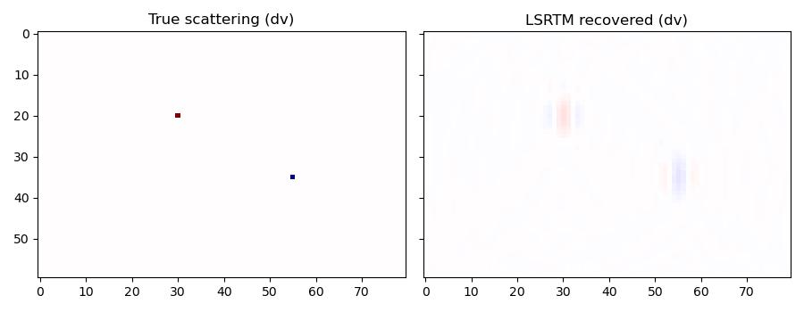

LSRTM with the variable-density acoustic Born propagator
==========================================================

This is the :func:`deepwave.acoustic_born` analogue of
:doc:`example_lsrtm`, which uses :func:`deepwave.scalar_born`. It uses a
small self-contained model (no external data download) with two point
scatterers on top of a smoothly-varying background velocity, and inverts
for the velocity scattering perturbation.

As in the scalar case, we first estimate the direct arrivals by forward
modelling through the smooth background (migration) velocity with the
regular, non-Born :func:`deepwave.acoustic` propagator, and subtract them
from the "observed" data (here itself synthetic, generated by forward
modelling through the true model) to get the scattered data that Born
modelling should reproduce::

    background = acoustic(
        v_bg, rho, dx, dt,
        source_amplitudes_volume_rate=source_amplitudes,
        source_locations_volume_rate=source_locations,
        sc_receiver_locations_p=sc_receiver_locations,
        pml_freq=freq,
        max_vel=float(v_true.max()),
    ).sc_receiver_amplitudes_p
    observed_scattered = observed - background

We then invert for the scattering perturbation ``dv`` with LBFGS, exactly
as :doc:`example_lsrtm` does for ``scalar_born``, but through
:func:`deepwave.acoustic_born`::

    dv = torch.zeros(ny, nx, device=device, requires_grad=True)
    optimiser = torch.optim.LBFGS([dv])
    loss_fn = torch.nn.MSELoss()

    for _epoch in range(n_epochs):
        def closure():
            optimiser.zero_grad()
            out = acoustic_born(
                v_bg, rho, dx, dt,
                dv=dv,
                source_amplitudes_volume_rate=source_amplitudes,
                source_locations_volume_rate=source_locations,
                sc_receiver_locations_p=sc_receiver_locations,
                pml_freq=freq,
                max_vel=float(v_true.max()),
            )
            loss = 1e8 * loss_fn(
                out.sc_receiver_amplitudes_p, observed_scattered
            )
            loss.backward()
            return float(loss.item())

        optimiser.step(closure)

With only a handful of LBFGS iterations and a modest source/receiver
aperture the recovered image is a smeared, migration-style approximation
of the two true scatterers rather than a pixel-perfect recovery -- the same
qualitative behaviour :doc:`example_lsrtm` shows with its own few-iteration
budget -- but both the location and the sign (polarity) of each scatterer
are recovered correctly:

`Full example code <https://github.com/ar4/deepwave/blob/master/docs/example_acoustic_born.py>`_
