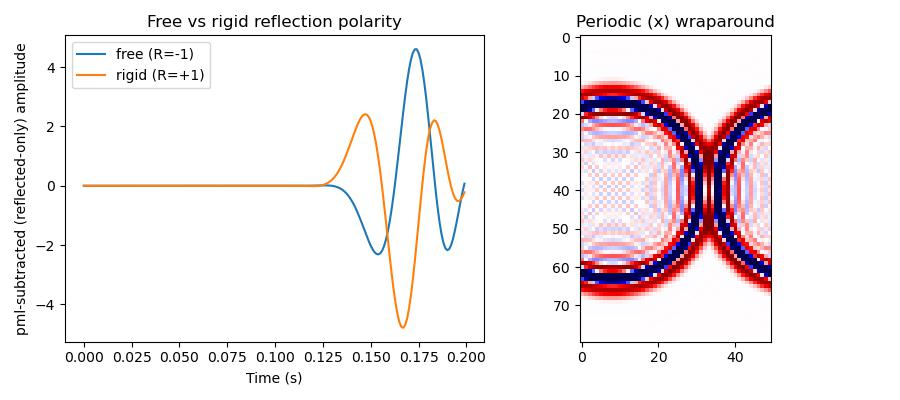

First-class boundary faces (free, rigid, periodic)
======================================================

In addition to the default all-PML (absorbing) edges, every propagator
accepts an explicit ``boundary`` argument that selects a boundary *type* per
face -- ``"pml"`` (absorbing), ``"free"``, ``"rigid"``, or ``"periodic"`` --
rather than only the implicit zero-``pml_width`` reflector. Which of those a
given propagator accepts differs: :func:`deepwave.scalar`, used here, accepts
all four on every face, while the other propagators accept fewer, and a face
one does not accept raises rather than running. See
:ref:`boundary-faces-accepted` for the table, and :doc:`boundaries` for the
full derivation of each condition's reflection coefficient and image formula;
this example demonstrates the two qualitatively distinct behaviours side by
side.

Free vs rigid reflection polarity
------------------------------------

A source (with a co-located receiver) is placed close to one face of a
small homogeneous model. Comparing the receiver trace for a ``"free"`` and
a ``"rigid"`` boundary against a ``"pml"`` (absorbing, effectively
reflection-free) baseline on that same face, and subtracting the baseline
to isolate the reflected arrival, shows the two conditions' opposite
reflection polarity directly::

    def run_trace(boundary, pml_width):
        return scalar(
            v, dx, dt,
            source_amplitudes=source_amplitudes,
            source_locations=source_locations,
            receiver_locations=receiver_locations,
            pml_width=pml_width,
            pml_freq=freq,
            boundary=boundary,
            backend="eager",
        ).receiver_amplitudes.reshape(-1)

    trace_pml = run_trace(None, 15)
    trace_free = run_trace(["pml", "pml", "pml", "free"], [15, 15, 15, 0])
    trace_rigid = run_trace(["pml", "pml", "pml", "rigid"], [15, 15, 15, 0])
    reflected_free = trace_free - trace_pml
    reflected_rigid = trace_rigid - trace_pml

The two lists have to agree -- a named face must have ``pml_width`` 0 -- so
:func:`deepwave.boundaries` will build them together for you, which is the
less error-prone spelling of the same thing::

    boundary, pml_width = deepwave.boundaries(2, width=15, dim1_end="free")
    trace_free = run_trace(boundary, pml_width)

**Contrast with a bare zero width.** Writing ``pml_width=[15, 15, 15, 0]``
and *no* ``boundary`` also produces a reflecting face -- but which condition
it produces is implied rather than stated, it depends on the propagator and
the field component, and it uses an approximate image rather than the exact
one, so it carries a spurious reflection of a few percent above
``accuracy=2``. Deepwave warns once when a face is created that way. See
:ref:`bare-zero-width-face` for the measured coefficient of each propagator.

Periodic wraparound
-----------------------

With ``boundary=["pml", "pml", "periodic", "periodic"]`` (a ``"periodic"``
pair must cover both faces of the same dimension), energy that leaves one
edge re-enters the opposite edge travelling in the same direction, rather
than reflecting or being absorbed. A wavefield snapshot late in the
simulation shows the propagating wavefront visibly wrapping around: the
"bowtie" shape where the two halves of the circular wavefront meet is the
same wavefront re-entering from the opposite side.

The left panel confirms the free surface reflects with inverted polarity
(:math:`R=-1`, starts negative) while the rigid surface reflects with
preserved polarity (:math:`R=+1`, starts positive) -- exactly the opposite
signs of the *same* magnitude reflection, as :doc:`boundaries` derives. The
right panel's periodic boundary shows the wrapped wavefront re-emerging
from the opposite edge of the domain.

`Full example code <https://github.com/ar4/deepwave/blob/master/docs/example_boundary_faces.py>`_
