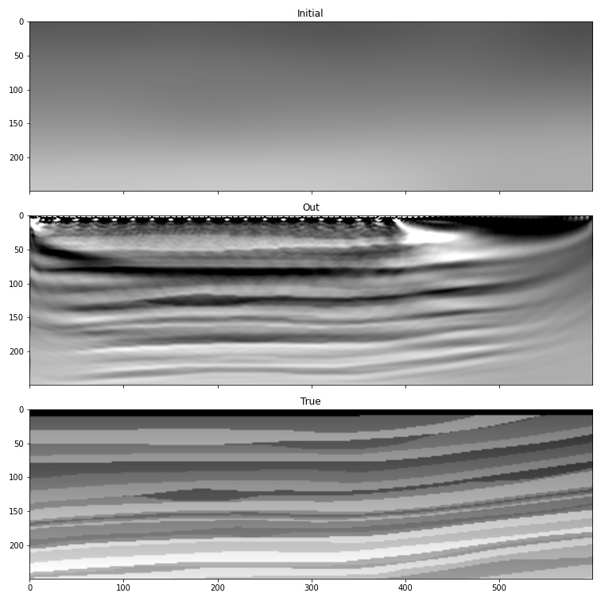

Further reducing memory consumption with checkpointing
======================================================

The best ways to reduce memory requirements are to :doc:`use batches of shots <example_rtm>`, or to :doc:`compress and/or store intermediate data on disk <example_storage>`. An alternative means of reducing memory requirements, at the cost of increased computation (and code complexity), is to use checkpointing.

Calculating gradients with respect to the velocity model requires access to the forward wavefield, sampled at at least the Nyquist frequency, during backpropagation. Deepwave achieves this by storing snapshots of the forward wavefield in memory. Storing these snapshots is usually responsible for most of Deepwave's memory requirements.

PyTorch's `checkpoint <https://pytorch.org/docs/stable/checkpoint.html>`_
utility calls the specified function with the provided input arguments, and
saves only those input arguments rather than the function's internal
snapshots, reducing memory consumption. During backpropagation, each
checkpointed function runs again when needed, and it is this second run
that saves the snapshots for that segment. Dividing the forward propagation
into five time segments and checkpointing each one therefore gives the same
result as not using checkpoints within floating-point round-off, since
segmentation can change the order of floating-point operations, while only
ever needing to store
snapshots for one fifth of the time steps at a time. The saving in memory
costs more computation, however, because the forward propagation is now
done twice: once for all segments up front, as usual, and again for each
segment during backpropagation.

You do not have to arrange any of that yourself. Every Deepwave propagator
takes a ``checkpoint_segments`` argument: passing ``checkpoint_segments=5``
splits the propagation into five contiguous time segments, threads each
segment's final wavefields (including the absorbing boundary's memory
variables, carried opaquely in ``auxiliary_state``) into the next as its
initial state, and wraps every segment except the last in PyTorch's
``checkpoint``. The last segment is deliberately not checkpointed: its
history is needed immediately, so recomputing it would cost time and save no
memory. What comes back is the ordinary
:class:`~deepwave.PropagatorOutput` of the whole run -- the same receiver
amplitudes, the same ``info``, the same final state that the unsegmented
call returns -- so the only line of an inversion that changes is the
propagator call itself. As in :doc:`the increasing frequency FWI example
<example_fwi>`, a function constrains the velocity model to a desired range
and lowpass filters the amplitudes, but, to keep this example simple, only
one cutoff frequency is used::

    for epoch in range(n_epochs):
        def closure():
            optimiser.zero_grad()
            v = model()
            out = scalar(
                v,
                dx,
                dt,
                source_amplitudes=source_amplitudes,
                source_locations=source_locations,
                receiver_locations=receiver_locations,
                pml_freq=freq,
                max_vel=max_vel,
                checkpoint_segments=n_segments,
            )
            receiver_amplitudes = filt(taper(out.receiver_amplitudes))
            loss = 1e6 * loss_fn(receiver_amplitudes, observed_data)
            loss.backward()
            return loss

        optimiser.step(closure)

A complication that ``checkpoint_segments`` handles for you is that Deepwave
may need a smaller time step than the one you specify, to satisfy the `CFL
condition
<https://en.wikipedia.org/wiki/Courant%E2%80%93Friedrichs%E2%80%93Lewy_condition>`_.
When this happens, Deepwave upsamples the source amplitudes internally (and
then downsamples the receiver amplitudes) with a global FFT. Upsampling a
segment of the source amplitudes on its own does not give the same result as
upsampling all of the time samples together, so a hand-rolled segmentation
has to upsample the source before dividing it into segments. A segmented run
does this for you: it works out the time step interval needed to satisfy the
CFL condition (resolving an omitted ``max_vel`` once through the propagator's
preparation), upsamples the whole source once, drives each segment at
the internal time step, and downsamples the assembled receiver amplitudes
once at the end. The segmented result therefore matches an unsegmented call,
and the observed data needs no resampling.
``model_gradient_sampling_interval`` is scaled internally at the same time, so
that snapshots of the forward wavefield are still only stored at the rate the
user's ``dt`` needs, rather than at the finer internal rate.

If you set ``model_gradient_sampling_interval`` yourself, every segment must
be a whole number of sampling periods long. Each segment restarts the
sampling phase at 0, so a boundary that splits a sampling period would sample
the model gradient at the wrong steps. Rather than leave that trap set, a
misaligned split raises ``DeepwaveValueError`` in the forward pass, naming the
offending segment, listing the segment lengths, and suggesting a segment count
that divides evenly (``nt=300`` with
``model_gradient_sampling_interval=4`` works at ``checkpoint_segments=5``,
whose segments are 60 steps each, and fails at ``checkpoint_segments=7``,
whose first segment is 43). The check is skipped when no model gradient will
be computed, since there is then nothing for the interval to sample.

The output is different to the previous example, but this is not because we used checkpointing (which should not affect the result), but rather because we only used the data up to 10 Hz.

Checkpointing is probably only worth considering if you do not have enough
memory to run backpropagation on even one shot at a time. Otherwise it is
likely more efficient to divide the input into batches, run them one at a
time, and accumulate the gradient over them, as in :doc:`the RTM example
<example_rtm>`; even then, :doc:`compression or disk storage
<example_storage>` might be preferable.

The general driver
------------------

``checkpoint_segments=`` is a shorthand: it builds a
:func:`deepwave.checkpointing.run_segments` call and returns its combined
output. Reach for ``run_segments`` directly when you want something the
shorthand cannot express -- segments of unequal length (``seg_lengths=``, for
instance so that a boundary falls on a particular step), a
``segment_callback`` that sees each segment's output as it completes, a purely
streaming run that never retains the per-segment receiver traces
(``combine=False``), or the segment auxiliary states parked on another device
between segments (``checkpoint_device="cpu"``). This example's propagator
call, written out longhand, is::

    from deepwave.checkpointing import run_segments

    out = run_segments(
        scalar,
        [v],
        dx,
        dt,
        {"source_amplitudes": source_amplitudes},
        n_segments=n_segments,
        checkpoint=True,
        source_locations=source_locations,
        receiver_locations=receiver_locations,
        pml_freq=freq,
        max_vel=max_vel,
    )

Note the two spellings: ``checkpoint_segments`` on a propagator is the
*number* of segments, while ``run_segments`` takes that number as
``n_segments`` and a separate boolean ``checkpoint`` that decides whether to
wrap the segments in ``torch.utils.checkpoint`` at all. Segmenting without
checkpointing is useful in its own right (it is how
:func:`deepwave.checkpointing.snapshots` and
:func:`deepwave.wavefields.measure` work), but it saves no memory.

The driver's generic calling convention -- models as a positional sequence,
source amplitudes as a name-to-tensor mapping -- is what lets one
implementation drive any propagator, and is also why it is the less
comfortable of the two forms for an everyday inversion.

If you need custom per-segment logic beyond that, you can drive the segments
in your own loop, calling the propagator once per segment and wrapping each
call in ``torch.utils.checkpoint.checkpoint`` yourself. In that case the
resampling is yours to do, since no single segment's call can see the rest of
the trace: upsample the source amplitudes before chunking them and downsample
the assembled receiver amplitudes at the end, as shown in the
:ref:`Gradient checkpointing <gradient-checkpointing>` section of the usage
documentation.

`Full example code <https://github.com/ar4/deepwave/blob/master/docs/example_checkpointing.py>`_
