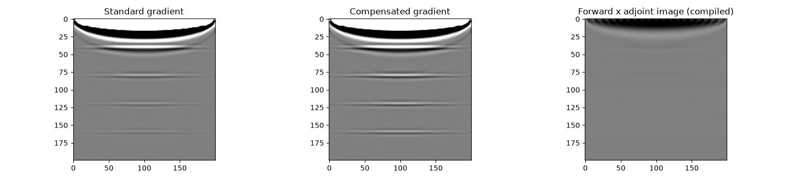

Custom imaging condition
========================

This example demonstrates how to use callbacks to implement a custom imaging condition. In seismic imaging, the "imaging condition" is the operation that combines the forward-propagating source wavefield and the backward-propagating receiver wavefield to produce an image of the subsurface. In Full Waveform Inversion (FWI), this image is the gradient of the objective function. The standard imaging condition is a cross-correlation of the two wavefields. This can result in a gradient that is much stronger in areas of high illumination (e.g. near the sources) than in poorly illuminated areas (e.g. deeper in the model or in shadow zones).

To counteract this, we can apply "illumination compensation", where the gradient is divided by an "illumination map". This map estimates the amount of source energy that reaches each point in the model. Dividing the gradient by this map boosts the gradient in poorly illuminated regions, which can help the inversion to converge more quickly and produce a more accurate final model.

We will implement a simple source-side illumination compensation using callbacks. First, we calculate the standard gradient for comparison. Then, we record illumination with a forward callback and scale the completed PyTorch gradient. The `forward_callback` is used to create the illumination map by summing the squared wavefield over time and shots. After ``.backward()``, we divide ``v.grad`` by this map. This is an optimisation preconditioner, not the derivative of the original objective. A small value is added to the illumination map before division to ensure stability.

::

        # Calculate the gradient with illumination compensation
        illumination = None

        def forward_callback(state):
            global illumination
            if illumination is None:
                illumination = (state.get_wavefield("wavefield_0", view="inner").detach()**2).sum(dim=0)
            else:
                illumination += (state.get_wavefield("wavefield_0", view="inner").detach()**2).sum(dim=0)

        out = deepwave.scalar(
            v,
            dx,
            dt,
            source_amplitudes=source_amplitudes,
            source_locations=source_locations,
            receiver_locations=receiver_locations,
            forward_callback=forward_callback,
            callback_frequency=1,
        )
        torch.nn.MSELoss()(
            out.receiver_amplitudes, out_true.receiver_amplitudes
        ).backward()
        with torch.no_grad():
            v.grad /= illumination + 1e-3 * illumination.max()

The forward callback accumulates squared wavefields over shots and callback times, using ``view="inner"`` so the map matches the model shape. The final scaling runs after ``.backward()``, when source-related contributions and the derivative of model padding have reached ``v.grad``. An internal backward callback, even at ``state.step == 0``, sees an intermediate accumulator and cannot implement this complete-gradient operation. For an automatic transformation during autograd, use the standard PyTorch tensor gradient hooks.

True forward x adjoint imaging conditions
-----------------------------------------

The illumination example above only needs the *forward* wavefield (recorded in the forward callback) and the completed model gradient. A true imaging condition -- reverse-time migration (RTM), a Poynting-vector image, or any energy norm -- needs the forward wavefield and the adjoint wavefield *at the same time step*, combined inside the backward pass.

``scalar`` can provide this on both its backends, but only when you ask: pass ``backward_callback_needs_forward_wavefield=True``. The default compiled C/CUDA backend does not normally retain the raw forward wavefield -- to keep the backward pass cheap it stores the pre-multiplied gradient-correlation kernel ``2*v*dt**2*laplacian(forward)`` and correlates that with the adjoint field instead -- and the flag opts it into allocating a second, full checkpoint buffer that reconstructs the raw forward wavefield during backward. That roughly doubles the compiled backend's backward-pass storage cost (see :doc:`/troubleshooting`'s memory section for how ``storage_mode``/``storage_compression`` reduce it; note that ``storage_compression=True`` makes the forward field the callback sees a dequantised approximation rather than the propagated field), which is why it is opt-in rather than automatic: a callback that only inspects the adjoint field should not pay for a field it never reads. Without the flag, ``role="forward"`` raises a ``NotImplementedError`` naming it, and ``state.has_forward_wavefield`` is ``False``.

The pure-PyTorch eager backend (``backend="eager"``) reaches it by a different route: it obtains the time-coincident adjoint field for free (it is the autograd gradient w.r.t. each step's wavefield tensor) and, with the same flag, retains the forward field alongside it. The retention is not cheaper there -- its snapshot covers every wavefield, the absorbing boundary's memory variables included -- so the flag costs more on the eager backend than on the compiled one. In a ``backward_callback`` you get the adjoint field from ``state.get_wavefield(name)`` and the forward field from ``state.get_wavefield(name, role="forward")``, on either backend::

        rtm_image = torch.zeros(ny, nx)

        def imaging_callback(state):
            forward = state.get_wavefield("wavefield_0", view="inner", role="forward")
            adjoint = state.get_wavefield("wavefield_0", view="inner")
            rtm_image.add_((forward * adjoint).sum(dim=0))

        out = deepwave.scalar(
            v, dx, dt,
            source_amplitudes=source_amplitudes,
            source_locations=source_locations,
            receiver_locations=receiver_locations,
            backward_callback=imaging_callback,
            backward_callback_needs_forward_wavefield=True,
            callback_frequency=1,
        )
        torch.nn.MSELoss()(
            out.receiver_amplitudes, out_true.receiver_amplitudes
        ).backward()

When PyTorch invokes the propagator's backward node with an undefined adjoint,
``get_wavefield`` returns a zero tensor for that adjoint. PyTorch may also
prune an unused backward node entirely; in that case no backward callback is
invoked. Do not rely on a callback to count steps of a pruned graph.

This accumulates the zero-lag cross-correlation ``sum_t forward(t) * adjoint(t)``. The opt-in forward field is available at the exact matching callback boundary when ``callback_frequency`` is a multiple of ``model_gradient_sampling_interval``; an unaligned schedule is rejected before stepping. With lossless storage and otherwise matching settings it reproduces the corresponding forward callback field. A zero-lag image is not the velocity gradient: the derivative of the discrete operator includes the spatial stencil, source scaling, PML terms and model padding. Use autograd for that gradient. A coarse Laplacian-weighted image can resemble its interior structure, but correlation alone does not validate the gradient or the callback timing.

The image below compares the standard gradient (left), the illumination-compensated gradient (middle), and the forward x adjoint image from the default compiled backend (right).

`Full example code <https://github.com/ar4/deepwave/blob/master/docs/example_custom_imaging_condition.py>`_
