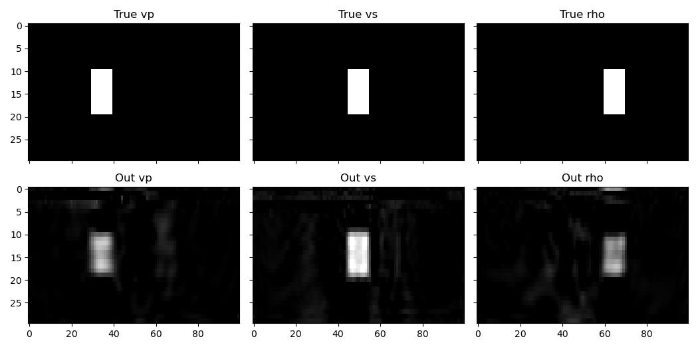
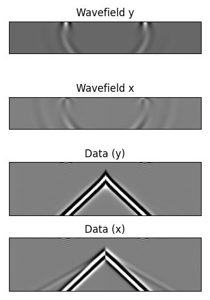
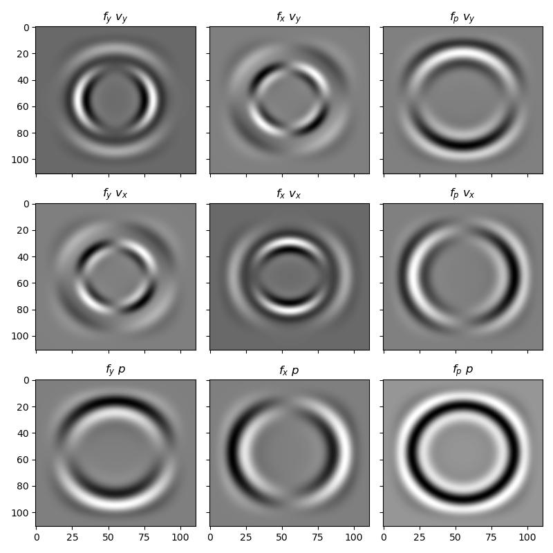

Elastic propagation and FWI
===========================

This example runs elastic forward propagation and a simple elastic FWI, a
natural next step after the scalar examples once you need shear-wave physics
or a free surface. The elastic propagator has three model parameters,
compared with the scalar propagator's one (wavespeed) and the scalar Born
propagator's two (wavespeed and scattering potential). The extra parameters
make elastic inversion harder to study, because crosstalk between the
parameters compounds the difficulties already present in scalar inversion.
Deepwave's ease of experimenting with different model parameterisations and
loss functions makes it well suited to trying out ideas to address that, but
this example sticks to a simple forward propagation and inversion to show
the basics.

One popular way to parameterise elastic propagation is with :math:`v_p`,
:math:`v_s`, and :math:`\rho` (the p and s wavespeeds and the density).
Another uses :math:`\lambda`, :math:`\mu`, and buoyancy (the two Lamé
parameters and the reciprocal of density). Deepwave internally uses the
latter, and provides functions to convert between the two parameterisations.
This example uses :math:`v_p`, :math:`v_s`, and :math:`\rho` instead, to
demonstrate that you can parameterise the model however you like and still
use PyTorch's end-to-end forward and backward propagation to update your own
model parameters.

We begin by setting up the model (both background and true, the latter of which we will use to generate the "observed" data) and acquisition::

    device = torch.device('cuda' if torch.cuda.is_available()
                          else 'cpu')
    ny = 30
    nx = 100
    dx = 4.0

    vp_background = torch.ones(ny, nx, device=device) * 1500
    vs_background = torch.ones(ny, nx, device=device) * 1000
    rho_background = torch.ones(ny, nx, device=device) * 2200

    vp_true = vp_background.clone()
    vp_true[10:20, 30:40] = 1600
    vs_true = vs_background.clone()
    vs_true[10:20, 45:55] = 1100
    rho_true = rho_background.clone()
    rho_true[10:20, 60:70] = 2300

    n_shots = 8

    n_sources_per_shot = 1
    d_source = 12
    first_source = 8
    source_depth = 2

    n_receivers_per_shot = nx-1
    d_receiver = 1
    first_receiver = 0
    receiver_depth = 2

    freq = 15
    nt = 200
    dt = 0.004
    peak_time = 1.5 / freq

    # source_locations
    source_locations = torch.zeros(n_shots, n_sources_per_shot, 2,
                                   dtype=torch.long, device=device)
    source_locations[..., 0] = source_depth
    source_locations[:, 0, 1] = (torch.arange(n_shots) * d_source +
                                 first_source)

    # receiver_locations
    receiver_locations = torch.zeros(n_shots, n_receivers_per_shot, 2,
                                     dtype=torch.long, device=device)
    receiver_locations[..., 0] = receiver_depth
    receiver_locations[:, :, 1] = (
        (torch.arange(n_receivers_per_shot) * d_receiver +
         first_receiver)
        .repeat(n_shots, 1)
    )

    # source_amplitudes
    source_amplitudes = (
        (deepwave.wavelets.ricker(freq, nt, dt, peak_time))
        .repeat(n_shots, n_sources_per_shot, 1).to(device)
    )

This creates a model where each of the three parameters is constant except
for a box, in a different location for each parameter. We use eight shots,
with sources and receivers both spread over the top surface. Deepwave treats
both spatial dimensions equally, so the model and the source/receiver
locations could equally have been transposed to put depth along dimension 1
instead of dimension 0. We are now ready to generate data using the true
model::

    observed_data = elastic(
        *deepwave.vpvsrho_to_lambmubuoyancy(vp_true, vs_true,
                                                   rho_true),
        dx, dt,
        source_amplitudes_y=source_amplitudes,
        source_locations_y=source_locations,
        receiver_locations_y=receiver_locations,
        pml_freq=freq,
    ).receiver_amplitudes_y

This is similar to how the scalar propagator is called, but with two differences.

The first is that we pass the three elastic model parameters. We are parameterising the model with :math:`v_p`, :math:`v_s`, and :math:`\rho`, but Deepwave wants us to provide them as :math:`\lambda`, :math:`\mu`, and buoyancy, so we convert them. Deepwave provides a function to do this, which we use here, but you can also create your own conversion function if you parameterise your model in some other way.

The elastic propagator can have sources and receivers oriented in each of the spatial dimensions. In this example we are only going to use sources and receivers that are oriented in the first (y) dimension. We could also provide `receiver_locations_x` if we wanted receivers that record particle velocity in the second dimension, for example.

Now let's try starting from the background models (constant, without the boxes) and see if we can obtain something close to the true model when we invert with the true observed data::

    vp = vp_background.clone().requires_grad_()
    vs = vs_background.clone().requires_grad_()
    rho = rho_background.clone().requires_grad_()
    optimiser = torch.optim.LBFGS([vp, vs, rho])
    loss_fn = torch.nn.MSELoss()

    # Run optimisation/inversion
    n_epochs = 20

    for epoch in range(n_epochs):
        def closure():
            optimiser.zero_grad()
            out = elastic(
                *deepwave.vpvsrho_to_lambmubuoyancy(vp, vs, rho),
                dx, dt,
                source_amplitudes_y=source_amplitudes,
                source_locations_y=source_locations,
                receiver_locations_y=receiver_locations,
                pml_freq=freq,
            ).receiver_amplitudes_y
            loss = 1e20*loss_fn(out, observed_data)
            loss.backward()
            return loss

        optimiser.step(closure)

This just used a standard inversion with the LBFGS optimiser, but the result looks quite good.

The gradients flowed end-to-end, back into the `vp`, `vs`, and `rho`
parameters. There is a little crosstalk between the parameters, though.
Perhaps a different model parameterisation, or a different loss function,
would do better?

Another interesting aspect of the elastic wave equation is that it can
produce **ground-roll**, caused by a free surface on the model. Deepwave's
elastic propagator implements a free surface with the `improved vacuum
method <https://doi.org/10.1190/geo2011-0067.1>`_, so a free surface is
created here by setting the property models above the surface to zero. The
PML width on that edge is also set to zero, since no wave reaches that edge
and so it does not need to be absorbing, which avoids unnecessary
computation::

    vp[0] = 0
    vs[0] = 0
    rho[0] = 0
    out = deepwave.elastic(
        *deepwave.vpvsrho_to_lambmubuoyancy(vp, vs,
                                                   rho),
        grid_spacing=2, dt=0.004,
        source_amplitudes_y=(
            deepwave.wavelets.ricker(25, 50, 0.004, 0.06)
            .reshape(1, 1, -1)
        ),
        source_locations_y=torch.tensor([[[0, nx//2]]]),
        receiver_locations_y=x_r_y,
        receiver_locations_x=x_r_x,
        pml_width=[0, 20, 20, 20]
    )

The same principle can be used to create a free surface of any shape. The following example demonstrates this by creating a model with a complex free surface (including voids) and recording the wavefield over time. The resulting animation shows the wave interacting with the complex free surface.

The elastic propagator supports three types of sources: body forces in the y and x dimensions (:math:`f_y` and :math:`f_x`), and pressure sources (:math:`f_p`). We can compare these by looking at the resulting particle velocity in the y and x dimensions (:math:`v_y` and :math:`v_x`) and the pressure field (:math:`-(\sigma_{yy}+\sigma_{xx})/2`, denoted :math:`p`).

`Full example inversion code <https://github.com/ar4/deepwave/blob/master/docs/example_elastic.py>`_

`Full example ground-roll code <https://github.com/ar4/deepwave/blob/master/docs/example_elastic_groundroll.py>`_

`Full example complex free surface code <https://github.com/ar4/deepwave/blob/master/docs/example_elastic_complex_freesurface.py>`_

`Full example source code <https://github.com/ar4/deepwave/blob/master/docs/example_elastic_source.py>`_
