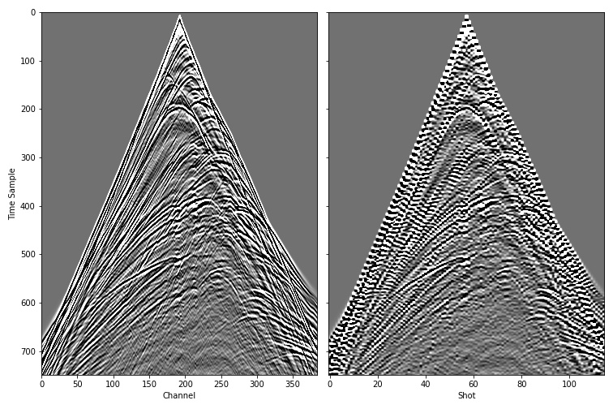

Forward modelling with Marmousi velocity model
==============================================

This example loads the Marmousi 1 :math:`v_p` (P-wave velocity) model,
specifies source and receiver locations, and uses Deepwave to perform
forward modelling: propagating the sources through the model to generate
synthetic receiver data. It is a good starting point if you have completed
:doc:`quickstart` and want to see the scalar propagator used on a
realistic model.

First, we need to import the necessary packages::

    import torch
    import matplotlib.pyplot as plt
    import deepwave
    from deepwave import scalar

We then choose which device we wish to run on, specify the size of the model, and load it::

    from get_marmousi import load_vp

    device = torch.device('cuda' if torch.cuda.is_available()
                          else 'cpu')
    ny = 751
    nx = 2301
    dx = 4.0
    v = load_vp().to(device)

``load_vp`` is in ``docs/get_marmousi.py``, the script described below. It
reads ``marmousi_vp.bin`` from the current directory and checks that it is
in the layout Deepwave 0.1.0 writes, so that every Marmousi example fails
in the same recognisable way when the file is missing or stale rather than
each rolling its own :func:`torch.from_file` call.

Dimension 0 is depth and dimension 1 is horizontal position, the convention
this documentation uses throughout (see :ref:`axis-convention`).

The file that ``marmousi_vp.bin`` above needs to exist for this to work,
plus ``marmousi_data.bin`` used by the later Marmousi examples (RTM, LSRTM,
FWI, joint migration inversion, custom imaging condition, and the two
fuller distributed-execution examples), are not shipped with Deepwave. This
is not an oversight: the original Marmousi model was created by the
Institut Francais du Petrole (IFP) and has been distributed academically
for decades (including from `the Geoazur WIND project
<https://www.geoazur.fr/WIND/bin/view/Main/Data/Marmousi>`_, its most
commonly cited current home) without IFP ever publishing redistribution
terms for it -- unlike its later elastic descendant, Marmousi2/AGL Elastic
Marmousi, which is a different, larger dataset explicitly released by SEG's
open-data initiative under CC BY 4.0. Because that permission has not been
confirmed for the model these examples use, Deepwave does not host or
redistribute a copy itself; instead, get it directly from the original
source and let Deepwave generate the synthetic data locally::

    python docs/get_marmousi.py

Run this once, from whichever directory you will run the Marmousi examples
from (that is where it writes its output, and where ``load_vp``
above looks for it). It downloads the Marmousi 1 :math:`v_p` model from the
Geoazur WIND project above, verifies it against a recorded SHA-256
checksum, transposes it into the ``751 x 2301`` depth-first little-endian
``float32`` layout this page's code expects and writes that out as
``marmousi_vp.bin``, then runs this very example's forward-modelling
recipe at full size to generate ``marmousi_data.bin``. Generating the full
115-shot dataset can take a while on CPU; pass ``--smoke`` for a small,
fast version of both files if you just want to try the pipeline out. If you
downloaded ``marmousi_vp.bin`` before Deepwave 0.1.0, it is in the older
untransposed layout and must be regenerated: the examples detect this and
tell you so rather than silently propagating through a rotated model. See
``docs/get_marmousi.py``'s own docstring for the full details, including
the citation to give the model in any resulting publication:
Bourgeois et al. (1991), "Marmousi, model and data".

If you only want to check that this example runs, setting
``DEEPWAVE_SMOKE=1`` (see :ref:`running-the-examples`) replaces the
downloaded model with a generated stand-in of the same shape and velocity
range, so no download is needed. The stand-in is not Marmousi, and nothing
in the resulting figures is worth interpreting.

Next we specify where to place the sources and receivers, and what the
source wavelets should be. Deepwave can propagate batches of shots
simultaneously to improve computational performance; the shots do not
interact with each other, and the results are identical to propagating
them individually. Shots propagated together are assumed to have the same
number of sources and receivers, with locations given as Tensors of shape
``[shot, source, space]`` and ``[shot, receiver, space]`` respectively, and
source amplitudes as a Tensor of shape ``[shot, source, time]``. Many
applications use only one source per shot, so the source dimension is
often of unit length, but Deepwave supports multiple sources per shot::

    n_shots = 115

    n_sources_per_shot = 1
    d_source = 20  # 20 * 4m = 80m
    first_source = 10  # 10 * 4m = 40m
    source_depth = 2  # 2 * 4m = 8m

    n_receivers_per_shot = 384
    d_receiver = 6  # 6 * 4m = 24m
    first_receiver = 0  # 0 * 4m = 0m
    receiver_depth = 2  # 2 * 4m = 8m

    freq = 25
    nt = 750
    dt = 0.004
    peak_time = 1.5 / freq

    # source_locations
    source_locations = torch.zeros(n_shots, n_sources_per_shot, 2,
                                   dtype=torch.long, device=device)
    source_locations[..., 0] = source_depth
    source_locations[:, 0, 1] = (torch.arange(n_shots) * d_source +
                                 first_source)

    # receiver_locations
    receiver_locations = torch.zeros(n_shots, n_receivers_per_shot, 2,
                                     dtype=torch.long, device=device)
    receiver_locations[..., 0] = receiver_depth
    receiver_locations[:, :, 1] = (
        (torch.arange(n_receivers_per_shot) * d_receiver +
         first_receiver)
        .repeat(n_shots, 1)
    )

    # source_amplitudes
    source_amplitudes = (
        deepwave.wavelets.ricker(freq, nt, dt, peak_time)
        .repeat(n_shots, n_sources_per_shot, 1)
        .to(device)
    )

Like the rest of this documentation, this example uses dimension 0 as depth
and dimension 1 as horizontal position, with the source and receiver
locations matching that choice. That is a documentation convention, not a
requirement: Deepwave attaches no physical meaning to any axis and treats
both spatial dimensions equally, so the model and its locations could
equally have been transposed. See :ref:`axis-convention`.

That is all the setup forward modelling needs, so we are ready to call
Deepwave. To keep the results as accurate as possible, we specify 8th order
accurate spatial finite differences::

    out = scalar(v, dx, dt, source_amplitudes=source_amplitudes,
                 source_locations=source_locations,
                 receiver_locations=receiver_locations,
                 accuracy=8,
                 pml_freq=freq)

The `pml_freq` parameter is optional: if you omit it, Deepwave infers it from the peak of the source amplitudes' spectrum, which for the Ricker wavelet above is the ``freq`` we built it with. Passing it, as here, is still recommended for anything you publish, since an inferred value makes the absorbing boundary depend on the wavelet (see :ref:`pml-freq`). You can see that the source and receiver Tensors that we provided were also optional. You can instead (or in addition) provide initial wavefields for Deepwave to propagate.

Note that ``source_depth`` and ``receiver_depth`` above (2 cells, 8 m) place
the sources and receivers inside the physical model, close to its top edge.
The default 20-cell :term:`PML` is padding outside that model. Its material
values are extended from the model's edge cells, so differentiation through
that extension adds contributions to the velocity gradient at those cells (see
:doc:`example_large_edge_gradient`). See :doc:`boundaries` for the full
explanation of what the PML does, and for when you might instead want a
source/receiver-free absorbing margin or a reflective (rigid/free) edge.

The number of time steps to propagate for (and thus the length of the output receiver data) is specified by the length of the source amplitude. If you are propagating without a source term, then you can instead specify it using the `nt` keyword parameter.

Finally, we will plot one common shot gather and one common receiver gather of the generated data, and then save the data to disk for use in later examples::

    receiver_amplitudes = out.receiver_amplitudes
    vmin, vmax = torch.quantile(receiver_amplitudes[0],
                                torch.tensor([0.05, 0.95]).to(device))
    _, ax = plt.subplots(1, 2, figsize=(10.5, 7), sharey=True)
    ax[0].imshow(receiver_amplitudes[57].cpu().T, aspect='auto',
                 cmap='gray', vmin=vmin, vmax=vmax)
    ax[1].imshow(receiver_amplitudes[:, 192].cpu().T, aspect='auto',
                 cmap='gray', vmin=vmin, vmax=vmax)
    ax[0].set_xlabel("Channel")
    ax[0].set_ylabel("Time Sample")
    ax[1].set_xlabel("Shot")
    plt.tight_layout()

    receiver_amplitudes.cpu().numpy().tofile('marmousi_data.bin')

This example did not need them, but if the output receiver amplitudes
contain undesirable wraparound artefacts (where high amplitudes at the end
of a trace cause artefacts at the beginning of the trace), the Deepwave
propagator options `freq_taper_frac` and `time_pad_frac` should help. See
:doc:`usage` for more on them.

`Full example code <https://github.com/ar4/deepwave/blob/master/docs/example_forward_model.py>`_
