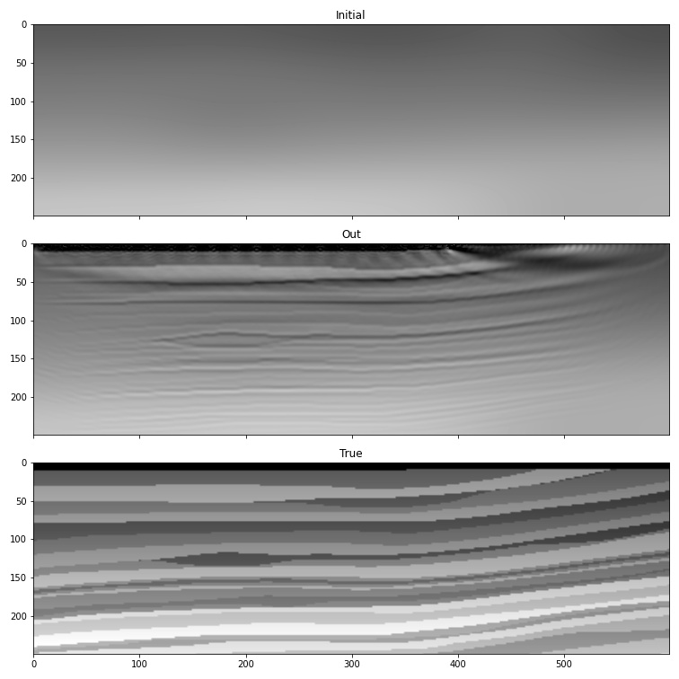
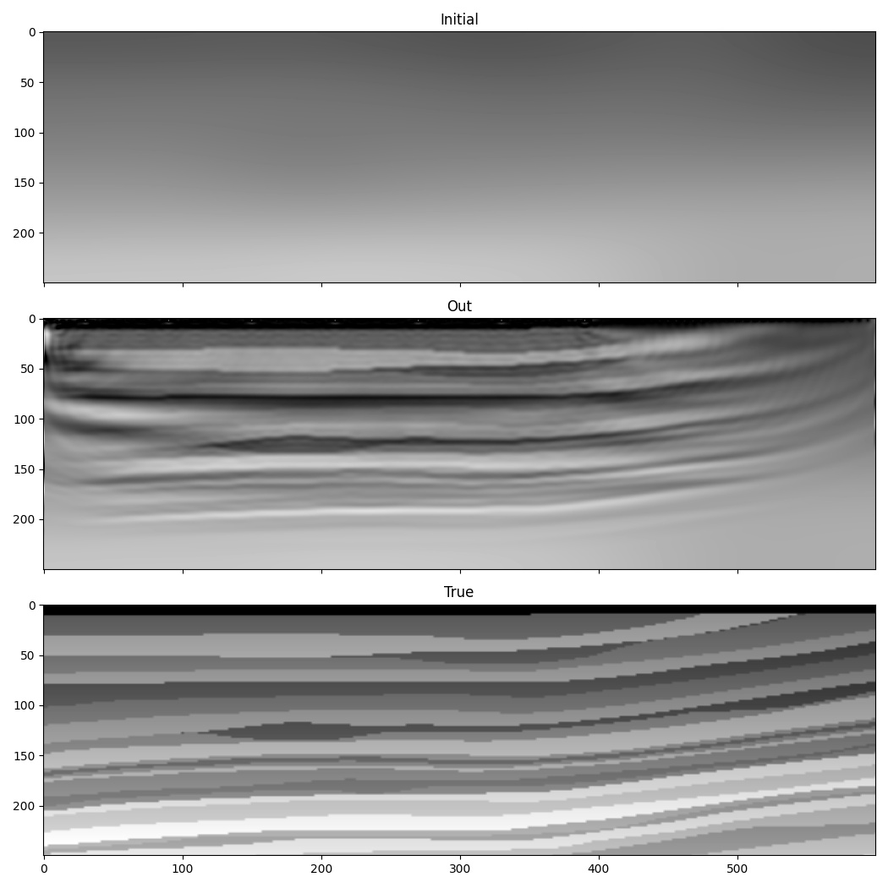

Full-Waveform Inversion (FWI)
=============================

This example runs :term:`full-waveform inversion <FWI>` (FWI) on the Marmousi
model, using the source, receiver, and observed-data setup from
:doc:`example_forward_model`. FWI inverts for a model that matches the whole
recorded dataset, including refracted arrivals, rather than just the arrival
times used by traveltime tomography.

.. note::

   This page needs the Marmousi files, which have to be downloaded (see
   :doc:`examples`). If you would rather run a complete FWI right now,
   :doc:`example_fwi_generated` is the same workflow on a model the script
   generates itself, and it goes into more detail on choosing the step size
   in physical terms, on why ``max_vel`` and ``pml_freq`` should be passed
   explicitly and kept fixed across iterations, and on what the survey's
   illumination does and does not let you recover. Come back here for
   constrained velocities and the multi-scale frequency progression.

We continue using the Marmousi model, but, because of the computational cost
of running many iterations of FWI, we work on only a portion of it::

    import torch
    from scipy.ndimage import gaussian_filter
    import matplotlib.pyplot as plt
    import deepwave
    from deepwave import scalar
    from get_marmousi import load_data, load_vp

    device = torch.device('cuda' if torch.cuda.is_available()
                          else 'cpu')
    dx = 4.0
    # The 751 x 2301 Marmousi model, read from marmousi_vp.bin in the
    # current directory and checked for the depth-first layout.
    v_true = load_vp()

    # Select portion of model for inversion
    ny = 250
    nx = 600
    v_true = v_true[:ny, :nx]

We smooth the true model to create the initial guess of the wavespeed that
inversion will attempt to improve. We also load the data generated in
:doc:`the forward modelling example <example_forward_model>` to serve as the
target observed data::

    v_init = (torch.tensor(1/gaussian_filter(1/v_true.numpy(), 40))
              .to(device))
    v = v_init.clone()
    v.requires_grad_()

    n_sources_per_shot = 1
    d_source = 20  # 20 * 4m = 80m
    first_source = 10  # 10 * 4m = 40m
    source_depth = 2  # 2 * 4m = 8m

    d_receiver = 6  # 6 * 4m = 24m
    first_receiver = 0  # 0 * 4m = 0m
    receiver_depth = 2  # 2 * 4m = 8m

    freq = 25
    dt = 0.004
    peak_time = 1.5 / freq

As the model is now smaller, we also need only the portion of the observed
data that covers this section of the model. ``load_data`` takes the first
``n_shots`` shots, ``n_receivers_per_shot`` receivers and ``nt`` time
samples of ``marmousi_data.bin``::

    n_shots = 20
    n_receivers_per_shot = 100
    nt = 300
    observed_data = load_data(v_true, n_shots,
                              n_receivers_per_shot, nt).to(device)

We set up the sources and receivers as before, inside the physical model
and close to the surrounding PML, as in :doc:`example_forward_model`.
See :doc:`boundaries` and
:doc:`example_large_edge_gradient` for what that implies for the gradient
near the surface -- one of the two problems this example addresses below::

    # source_locations
    source_locations = torch.zeros(n_shots, n_sources_per_shot, 2,
                                   dtype=torch.long, device=device)
    source_locations[..., 0] = source_depth
    source_locations[:, 0, 1] = (torch.arange(n_shots) * d_source +
                                 first_source)

    # receiver_locations
    receiver_locations = torch.zeros(n_shots, n_receivers_per_shot, 2,
                                     dtype=torch.long, device=device)
    receiver_locations[..., 0] = receiver_depth
    receiver_locations[:, :, 1] = (
        (torch.arange(n_receivers_per_shot) * d_receiver +
         first_receiver)
        .repeat(n_shots, 1)
    )

    # source_amplitudes
    source_amplitudes = (
        (deepwave.wavelets.ricker(freq, nt, dt, peak_time))
        .repeat(n_shots, n_sources_per_shot, 1).to(device)
    )

We are now ready to run the optimiser to perform iterative inversion of the
wavespeed model, using code very similar to what would train a typical
PyTorch neural network. Two differences stand out. The learning rate (1e9)
is much larger, to bring the gradient values into a range that makes good
progress each iteration. The gradients are also clipped to their 98th
percentile magnitude, to stop a small number of points (such as those near
the sources) from taking very large steps.

Without momentum, clipping bounds each cell's update by the learning rate
times the clipping threshold. The ``momentum=0.9`` used below accumulates
past clipped gradients, so that product is not a bound on later updates.
Monitor the actual velocity changes when choosing the learning rate: changes
of a few metres per second are a useful starting scale against a model whose
velocities span hundreds. This is also why a
learning rate carried over from a different dataset is meaningless: the
gradient's magnitude depends on the source amplitude, the number of shots,
and the loss function. See :ref:`the discussion in the one-file FWI example <fwi-step-size>`
for the same reasoning applied with ``Adam``, where the learning rate is
directly that velocity change::

    # Setup optimiser to perform inversion
    optimiser = torch.optim.SGD([v], lr=1e9, momentum=0.9)
    loss_fn = torch.nn.MSELoss()

    # Run optimisation/inversion
    n_epochs = 250
    v_true = v_true.to(device)

    for epoch in range(n_epochs):
        optimiser.zero_grad()
        out = scalar(
            v, dx, dt,
            source_amplitudes=source_amplitudes,
            source_locations=source_locations,
            receiver_locations=receiver_locations,
            pml_freq=freq,
        )
        loss = loss_fn(out.receiver_amplitudes, observed_data)
        loss.backward()
        torch.nn.utils.clip_grad_value_(
            v,
            torch.quantile(v.grad.detach().abs(), 0.98)
        )
        optimiser.step()

The result is an improvement in the accuracy of the estimated wavespeed
model. The sources do not cover a portion of the surface on the right, which
is why the result is worse there.

The low wavenumber information (the layer velocities) is still missing from
the lower part of the model, however. This is probably caused by
cycle-skipping, a common issue in seismic inversion where the inversion gets
stuck in a local minimum.

So this simple version runs into two problems. The first is that velocity
values in particular cells can grow or shrink too far during inversion,
causing instability. This happens because the gradient values are large
near the sources and receivers, so the optimiser takes large steps there
(see :doc:`example_large_edge_gradient` for why the PML causes this, and a
reflective/rigid surface as an alternative fix); gradient clipping addresses
it above. The second problem is **cycle-skipping**: when a modelled arrival
is shifted from its target counterpart by more than half a wavelength, the
inversion can get stuck in a local minimum (see also :doc:`example_gsot` for
a loss function designed to be more robust to this). The rest of this
example makes two changes to address both problems.

One way to resolve the problem of extreme velocity values is to constrain
the velocities to a desired range. Because PyTorch chains operators together
and backpropagates through them automatically, a function that generates the
velocity model gives a convenient and robust way to enforce that range. The
velocity model becomes an object that stores a tensor of the same shape as
the model. Its `forward` method applies the sigmoid function to that stored
tensor, giving a value between 0 and 1 for each cell, which is then scaled
to the desired range. The `logit` function, the inverse of `sigmoid`, sets
the stored tensor's initial value so that it starts from the chosen initial
velocity model::

    class Model(torch.nn.Module):
        def __init__(self, initial, min_vel, max_vel):
            super().__init__()
            self.min_vel = min_vel
            self.max_vel = max_vel
            self.model = torch.nn.Parameter(
                torch.logit((initial - min_vel) /
                            (max_vel - min_vel))
            )

        def forward(self):
            return (torch.sigmoid(self.model) *
                    (self.max_vel - self.min_vel) +
                    self.min_vel)

    model = Model(v_init, 1000, 2500).to(device)

The tensor the optimiser is given to optimise is now the tensor inside this
object, not the velocity model itself. During backpropagation, the gradient
of the loss with respect to the velocity model is further backpropagated to
give the gradient with respect to that stored tensor, which is what gets
updated at each step.

The second change targets cycle-skipping. A common remedy is to use only the
low frequencies in the data at first, then gradually raise the maximum
frequency used. This example progresses from a cutoff frequency of 10 Hz in
the early iterations to 30 Hz in the final iterations. To keep the example
simple, the frequency filter is applied to the output of wave propagation.
(A more sophisticated implementation would filter the source
amplitudes instead, since a lower frequency source allows a larger grid cell
spacing, reducing computational cost.) The filter is a 6th order Butterworth
filter, applied as a chain of second-order sections using the `biquad`
function from `torchaudio` and `butter` from `scipy`::

    for cutoff_freq in [10, 15, 20, 25, 30]:
        sos = butter(6, cutoff_freq, fs=1/dt, output='sos')
        sos = [torch.tensor(sosi).to(observed_data.dtype).to(device)
               for sosi in sos]

        def filt(x):
            return biquad(biquad(biquad(x, *sos[0]), *sos[1]), *sos[2])
        observed_data_filt = filt(observed_data)
        optimiser = torch.optim.LBFGS(model.parameters(),
                                      line_search_fn='strong_wolfe')
        for epoch in range(n_epochs):
            def closure():
                optimiser.zero_grad()
                v = model()
                out = scalar(
                    v, dx, dt,
                    source_amplitudes=source_amplitudes,
                    source_locations=source_locations,
                    receiver_locations=receiver_locations,
                    max_vel=2500,
                    pml_freq=freq,
                    time_pad_frac=0.2,
                )
                out_filt = filt(taper(out.receiver_amplitudes))
                loss = 1e6*loss_fn(out_filt, observed_data_filt)
                loss.backward()
                return loss

            optimiser.step(closure)

Two things about this code are worth noting.

The first is the switch to the LBFGS optimiser, used here because it works
differently from other PyTorch optimisers. The loss and gradient calculation
must be placed inside a function, called `closure` in this example, which is
passed to the optimiser's `step` method. This pattern also works with other
optimisers, so it is a reasonable default way to write the training loop.

A second LBFGS-related change is the `1e6` scaling applied to the loss.
PyTorch's LBFGS uses absolute tolerances on the gradient and on changes in
the loss and parameters. A small unscaled gradient can therefore cause
early termination. Scaling the loss changes the gradient and loss-change
tests; it does not directly rescale the parameter-change test. Adjusting
``tolerance_grad`` and ``tolerance_change`` is another option.
Scaling the loss also scales the gradient, so an optimiser whose step size
depends directly on the gradient (such as gradient descent) would need its
learning rate reduced by the same factor to keep the step sizes unchanged.
A new optimiser is created each time the
filter frequency changes, because an optimiser that uses the history of
previous iterations, such as LBFGS, can be confused by such a large change
if reused.

The second is a handful of other tweaks: specifying the maximum velocity for
the wave propagator and the fraction of time padding to use (see
:doc:`usage` for what they do), and applying a taper function to the data
(see the `full code
<https://github.com/ar4/deepwave/blob/master/docs/example_fwi.py>`_ for its
definition). These are included to show that they are possible, and because
they help to make the data cleaner and so may reduce artefacts.

``max_vel`` and ``pml_freq`` earn their place for a second reason, beyond
keeping the discretisation fixed across iterations
(:ref:`fwi-fixed-numerical-parameters`): they remove setup dependencies that
Deepwave does not differentiate. An inferred ``max_vel`` depends on the
model and sets the absorbing profiles and internal time step. An inferred
``pml_freq`` depends on the source spectrum. Passing both as fixed values
removes those omitted derivative paths, but does not by itself make the
model gradient exact. At this example's ``dt``, CFL substepping still makes
the default compiled model gradient a sampled approximation. Exact
derivatives of the fixed discrete call require effective gradient stride
one and lossless storage; see :ref:`gradient-guarantees` for the conditions
and a recipe that explicitly resamples coarse data around a finer call.

The results, especially the improved recovery of the low wavenumber features
in the deeper part of the model, suggest that these changes address some of
the problems seen in the simple version above.

Even so, this remains a simplified implementation of FWI, unlikely to be
sufficient for inverting real or even non-inverse-crime data. It is not a
recipe for how to perform FWI, but a demonstration of what is possible and a
base to build on. Faster convergence and greater robustness in more
realistic situations can be achieved with modifications such as a more
sophisticated loss function. Because Deepwave is built on PyTorch, such
ideas are quick to try: PyTorch automatically backpropagates through any
differentiable operation applied to Deepwave's output (or input), so only
the forward action of a new loss function needs to be written.

`Full example code <https://github.com/ar4/deepwave/blob/master/docs/example_fwi.py>`_
