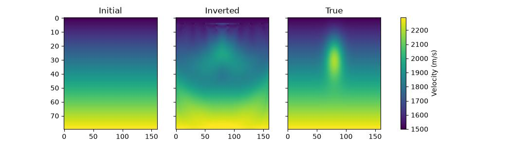

FWI in one file
===============

This page is a complete :term:`full-waveform inversion <FWI>` with nothing
to download: the script builds its own "true" velocity model, generates the
observed data from it, and inverts for the model starting from a smooth
guess. Copy ``docs/example_fwi_generated.py`` into a file and run it. It
needs Deepwave, PyTorch and ``matplotlib``, and takes a few minutes on a
CPU or under a minute on a GPU. Setting ``DEEPWAVE_SMOKE=1`` (see
:ref:`running-the-examples`) shrinks it to seconds, for checking that it
runs at all.

:doc:`example_fwi` does the same thing on the Marmousi model, and goes on
to the two problems that a first attempt at FWI runs into: velocities
running away, and cycle-skipping. Start here, then read that.

The model and the survey
------------------------

Dimension 0 is depth and dimension 1 is horizontal position, the convention
used throughout this documentation (see :ref:`axis-convention`). Lengths are
in metres, times in seconds, velocities in metres per second. The background
velocity rises linearly with depth; the feature to be recovered is a fast,
roughly circular anomaly 300 m across, centred 280 m down::

    ny = 80          # cells in depth
    nx = 160         # cells horizontally
    dx = 10.0        # m, the same spacing in both dimensions
    dt = 0.002       # s

    depth = torch.arange(ny, dtype=torch.float32).reshape(ny, 1) * dx
    horizontal = torch.arange(nx, dtype=torch.float32).reshape(1, nx) * dx
    v_background = (1500.0 + 1.0 * depth).repeat(1, nx)

    radius = 150.0
    anomaly_depth = 0.35 * ny * dx
    distance = torch.sqrt((depth - anomaly_depth)**2 +
                          (horizontal - nx * dx / 2)**2)
    v_true = (v_background +
              400.0 * torch.exp(-((distance / radius)**2))).to(device)
    v_init = v_background.to(device)

The starting model is the correct background without the anomaly. That is
deliberate: FWI refines a model that is already kinematically close, and
starting further away is what brings on cycle-skipping.

Eight shots are fired along the surface and recorded by receivers along the
surface. ``source_amplitudes`` has shape ``[shot, source, time]``; the
location tensors have shape ``[shot, source_or_receiver, dimension]``, and
the dimension column is ordered ``[depth, horizontal]`` to match the model::

    n_shots = 8
    n_receivers_per_shot = nx // 2
    freq = 12.0      # Hz, the dominant frequency of the source wavelet
    nt = 600         # time samples, so 1.2 s recorded

    source_locations = torch.zeros(n_shots, 1, 2, dtype=torch.long,
                                   device=device)
    source_locations[..., 0] = 2
    source_locations[:, 0, 1] = torch.linspace(nx * 0.1, nx * 0.9,
                                               n_shots).long()

    receiver_locations = torch.zeros(n_shots, n_receivers_per_shot, 2,
                                     dtype=torch.long, device=device)
    receiver_locations[..., 0] = 2
    receiver_locations[:, :, 1] = (
        torch.arange(n_receivers_per_shot) * 2).repeat(n_shots, 1)

    source_amplitudes = (
        deepwave.wavelets.ricker(freq, nt, dt, 1.5 / freq)
        .repeat(n_shots, 1, 1).to(device)
    )

.. _fwi-fixed-numerical-parameters:

Numerical parameters, fixed for every iteration
-----------------------------------------------

Pass ``max_vel`` and ``pml_freq`` explicitly, and keep them the same in
every call::

    max_vel = 3000.0
    pml_freq = freq

    def propagate(v):
        return scalar(
            v, dx, dt,
            source_amplitudes=source_amplitudes,
            source_locations=source_locations,
            receiver_locations=receiver_locations,
            max_vel=max_vel,
            pml_freq=pml_freq,
        ).receiver_amplitudes

Left out, Deepwave infers both: ``max_vel`` from the model, ``pml_freq``
from the peak of the source amplitudes' spectrum. That is convenient for a
single run, but during an inversion the model changes every iteration, so
an inferred ``max_vel`` changes with it -- and ``max_vel`` sets the internal
time step and scales the PML profiles. Two iterations would then be solving
slightly different discrete problems, and the difference would appear in the
gradient as if it were physics. Fixing both keeps the discretisation
constant, so that the only thing changing between iterations is the model.

``max_vel`` must be at least the fastest velocity the model reaches at
*any* point during the inversion, not just its starting value, since the
model is what is being changed; 3000 m/s here leaves room above the true
maximum of about 2290 m/s. See :doc:`accuracy` for what ``max_vel`` does
and :ref:`pml-freq` for ``pml_freq``.

.. _fwi-step-size:

Choosing the step size in metres per second
-------------------------------------------

The gradient of a data misfit with respect to velocity has awkward units,
and a magnitude that depends on the source amplitude, the number of shots,
and the loss function. A learning rate carried over from another problem
therefore means nothing. It is much easier to think about the step as a
velocity update: *how many metres per second should the fastest-moving cell
move in one iteration?*

``Adam`` divides each cell's gradient by a running estimate of its own
magnitude, so its learning rate is roughly that velocity change per cell
per iteration::

    max_update = 10.0  # m/s per iteration
    optimiser = torch.optim.Adam([v], lr=max_update)

Against a model whose velocities span hundreds of metres per second, a few
metres per second per iteration makes visible progress in tens of
iterations while keeping each update a small perturbation of the model the
gradient was computed for. Too large and the inversion oscillates or
diverges; too small and it stalls. Scale it with the size of the correction
you expect, not with the model's absolute velocities.

With plain ``SGD`` the gradient's magnitude stays in the step, so the same
reasoning is applied in two parts: clip the gradient to a percentile of its
own magnitude, then set the learning rate to the update you want divided by
that clipping threshold. :doc:`example_fwi` does it that way.

Illumination, and why the top of the model is masked
----------------------------------------------------

The cells immediately around a source or a receiver receive a
disproportionate share of the gradient, and left alone they grow a bullseye
artefact at every source and receiver position. Zeroing the gradient over
the top few rows removes that, and costs nothing here because the anomaly
is deeper::

    gradient_mask = torch.ones(ny, 1, device=device)
    gradient_mask[:4] = 0.0

    for epoch in range(n_epochs):
        optimiser.zero_grad()
        loss = loss_fn(propagate(v), observed_data)
        loss.backward()
        v.grad *= gradient_mask
        optimiser.step()

See :doc:`example_large_edge_gradient` for why the gradient behaves that
way near the PML and the surface, and for other ways of handling it.

The result
----------

Over 200 iterations the data misfit falls by about two orders of magnitude
and the model root-mean-square error falls from 66.5 to 58.8 m/s. The
anomaly comes back in the right place with the right sign, but only part of
its amplitude, and smeared vertically.

That is what the survey supports, not a defect of the inversion. Every
source and receiver is at the surface, so the top of the model is crossed by
many ray paths at many angles and the bottom by few at almost the same
angle. Vertical smearing is the signature of narrow angular coverage;
the corners beyond the outermost sources are barely updated at all because
no ray reaches them. Before blaming the optimiser for a feature that will
not resolve, ask whether anything in the recorded data constrains it.
Widening the survey, recording for longer, adding lower frequencies, or
putting receivers in a borehole all change what can be recovered -- and
none of them is a change to how the inversion is written.

Two other caveats worth stating plainly. The observed data here is
generated with the same propagator the inversion uses, which makes this an
"inverse crime": there is no modelling error at all, so the inversion has an
easier time of it than it would with recorded data. And the misfit is a
plain mean-squared error on the raw traces, which is the most
cycle-skipping-prone choice there is; see :doc:`example_gsot` and
:doc:`example_fwi_recipes` for alternatives.

Where to go next
----------------

* :doc:`example_fwi` -- the same inversion on the Marmousi model, plus
  constrained velocities and a multi-scale frequency progression.
* :doc:`example_rtm` -- migration rather than inversion: one gradient with
  respect to a scattering potential.
* :doc:`example_fwi_recipes` -- optimal-transport and other misfits, deep
  priors, and uncertainty estimates, each a short addition to this loop.
* :doc:`example_parameterisation` -- inverting for something other than
  velocity directly.
* :doc:`troubleshooting` -- when an inversion diverges, stalls, or produces
  a model full of artefacts.

`Full example code <https://github.com/ar4/deepwave/blob/master/docs/example_fwi_generated.py>`_
