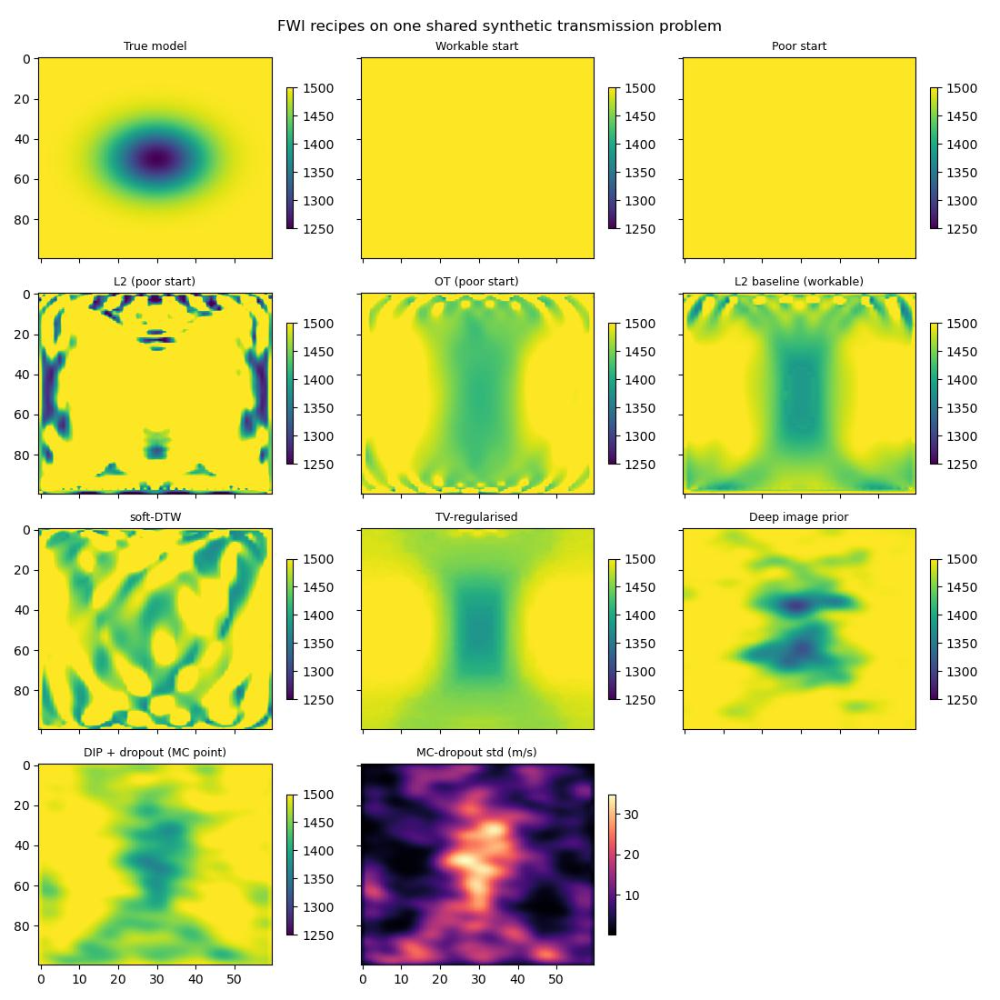

FWI Recipes: Exotic Misfits, Deep Priors, and Uncertainty
=========================================================

Competing differentiable-FWI packages often advertise a long list of
"batteries-included" features: optimal-transport and soft-DTW misfit
functions, deep-image-prior network reparameterisation, and dropout-based
uncertainty quantification. The point of this example is that, because
Deepwave is *just* a differentiable forward modelling operator that plugs
into the stock PyTorch ecosystem, each of those features is a short recipe
rather than a new API surface. You compose them; Deepwave does not need to
provide them.

To keep the comparison honest, every recipe shares **one** small,
self-contained 2-D synthetic problem. The true model is a constant
1500 m/s background with a Gaussian low-velocity anomaly (down to
~1250 m/s). The acquisition is a cross-hole transmission geometry: eight
sources down the left edge, thirty receivers down the right edge, so the
wave transmits *through* the anomaly and its arrival time carries the
signal. From this single problem we derive two homogeneous starting
models:

* a **poor** start (1600 m/s everywhere — too fast, so the whole
  transmitted wavetrain is time-shifted) that exposes cycle-skipping. It
  drives the optimal-transport recipe, where plain least-squares fails and
  transport-based misfits recover.
* a **workable** start (the correct 1500 m/s background, so only the
  anomaly is unknown) that drives the soft-DTW, deep-image-prior,
  dropout-uncertainty, and regularisation recipes, which are about
  ill-posedness and prior information rather than cycle-skipping.

The script runs every recipe end-to-end, prints a metrics table (model
RMSE in m/s and a common L2 data misfit per recipe), and writes one
comparison figure. Each recipe below shows only its core excerpt; see the
full script for the shared setup and plotting.

Recipe 1: the L2 baseline
-------------------------

The reference against which everything else is judged is ordinary
least-squares FWI: optimise the velocity pixels directly to minimise the
mean-squared error between predicted and observed traces. In Deepwave this
is the loop you have already seen in the other examples::

    def invert_pixels(loss_fn, v_start, n_epochs=60, lr=6.0):
        v = v_start.clone().requires_grad_()
        opt = torch.optim.Adam([v], lr=lr)
        for _ in range(n_epochs):
            opt.zero_grad()
            loss_fn(forward(v)).backward()
            opt.step()
        return v.detach()

From the *workable* start this recovers the anomaly well, and it is the
yardstick for the regularisation recipes. From the *poor* start the same
L2 loss cycle-skips badly (see Recipe 2).

Recipe 2: optimal-transport (Wasserstein) misfit
------------------------------------------------

The classic cure for cycle-skipping is a misfit that measures *time
shift*, not just amplitude mismatch. Optimal transport does exactly this:
the Wasserstein-2 distance between two signals, viewed as mass
distributions over time, grows like the squared shift between them — a
convex penalty far less prone to the spurious local minima that trap L2
(`Engquist & Froese 2014
<https://doi.org/10.4310/CMS.2014.v12.n5.a7>`_; `Métivier et al. 2016
<https://doi.org/10.1088/0266-5611/32/11/115008>`_).

Two subtleties matter, and the example handles both explicitly:

* **Signed data.** Transport needs non-negative mass, but seismograms
  swing positive and negative. We map each trace to an *energy density*
  over time, ``p(t) = a(t)^2 / sum_t a(t)^2``. Squaring makes the mass
  non-negative and emphasises energetic arrivals; normalising makes each
  trace a probability measure, so predicted and observed mass match
  (balanced OT). The price is that squaring discards polarity — this is a
  phase-insensitive, envelope-like comparison.
* **The ground cost is squared time distance**, so a shifted arrival costs
  approximately ``shift^2``.

.. literalinclude:: example_fwi_recipes.py
   :language: python
   :pyobject: energy_density

For the transport distance itself the example uses `geomloss
<https://www.kernel-operations.io/geomloss/>`_ when it is installed (an
*optional* dependency included in ``deepwave[examples]``, not required by
Deepwave itself), falling back to a pure-torch implementation
otherwise. The import is guarded so the script runs either way::

    try:
        from geomloss import SamplesLoss

        HAVE_GEOMLOSS = True
    except ImportError:
        HAVE_GEOMLOSS = False

**Why the fallback exists, and what it is.** ``geomloss`` runs happily
CPU-only here with its ``"tensorized"`` backend, so it is the default.
But most Deepwave users will not have it installed, and for 1-D
distributions we do not need a general entropic solver at all: the
**squared** Wasserstein-2 distance between two 1-D densities is the squared L2
distance between their quantile (inverse-CDF) functions (`Métivier et al.
2016 <https://doi.org/10.1088/0266-5611/32/11/115008>`_). That is a few
lines of pure PyTorch. The example approximates that integral using sampled,
linearly interpolated quantiles; it has no entropic regularisation, but it
still has interpolation and quadrature error.

The interpolation is essential for inversion. Indexing a constant time axis
with ``torch.searchsorted`` alone disconnects the loss from the predicted
amplitudes. Here ``searchsorted`` selects a bracket, and the interpolated
value retains a gradient through the CDF samples:

.. literalinclude:: example_fwi_recipes.py
   :language: python
   :pyobject: _quantile

The complete fallback uses the example's pooling factor and time axis:

.. literalinclude:: example_fwi_recipes.py
   :language: python
   :pyobject: cdf_wasserstein

Both paths tell the same story. From the poor start, L2 cycle-skips into a
model that is *worse* than the starting guess, whereas the
transport-based misfit relaxes the arrival-time mismatch and recovers a
model close to the truth. The metrics table quantifies the gap.

Recipe 3: a compact soft-DTW misfit
-----------------------------------

Soft dynamic time warping (`Cuturi & Blondel 2017
<https://arxiv.org/abs/1703.01541>`_) is a second time-shift-tolerant
misfit. It is the classic dynamic-time-warping recursion with the hard
``min`` replaced by a log-sum-exp *soft* minimum (temperature ``gamma``),
which makes it smooth and differentiable. Unlike the energy-density OT
above it keeps polarity. The whole thing is about forty lines of
pure PyTorch::

    def soft_dtw(x, y, gamma=0.1):
        """Soft-DTW discrepancy between batches of 1-D series (B, T)."""
        n, t_len = x.shape
        dist = (x.unsqueeze(2) - y.unsqueeze(1)) ** 2  # (B, T, T)
        big = x.new_full((n,), 1e10)
        prev = [x.new_zeros(n)] + [big] * t_len  # previous row, j = 0..T
        for i in range(1, t_len + 1):
            curr = [big]  # j = 0 boundary is +inf
            for j in range(1, t_len + 1):
                neighbours = torch.stack(
                    [prev[j], curr[j - 1], prev[j - 1]]
                )
                soft_min = -gamma * torch.logsumexp(
                    -neighbours / gamma, dim=0
                )
                curr.append(dist[:, i - 1, j - 1] + soft_min)
            prev = curr
        return prev[t_len]

The dynamic program is ``O(T^2)`` per trace pair, so the example
subsamples the traces in time and space and compares per-trace *normalised*
waveforms (shape, not amplitude). We accumulate the cost matrix one row at
a time into small per-cell tensors rather than assigning into one big
tensor in place; that keeps the autograd graph cheap to backprop, which
matters because the misfit is evaluated every FWI iteration.

**Two honesty caveats.** The script prints soft-DTW against a
progressively time-shifted Ricker wavelet, next to L2. L2 *oscillates* —
a larger shift can score *lower* than a smaller one, which is exactly
cycle-skipping — whereas soft-DTW is a monotone bowl that grows with the
shift. But (1) raw soft-DTW is **not a true metric**: the soft minimum is
biased below the hard minimum, so the values carry a negative offset and
``D(x, x) != 0``. The non-negative *soft-DTW divergence* of `Blondel et
al. 2020 <https://arxiv.org/abs/2010.08354>`_ subtracts the self-terms to
fix this; we keep the raw form for brevity and simply note the minimum
still sits at zero shift. And (2) the clean bowl only appears at fine
enough sampling — coarsely subsampling a shifted wavelet reintroduces
discretisation jumps.

Recipe 4: deep-image-prior reparameterisation
---------------------------------------------

Instead of optimising velocity pixels, we can optimise the *weights of a
small CNN* that maps a fixed random latent to a velocity perturbation
(`Ulyanov et al. 2018 <https://arxiv.org/abs/1711.10925>`_; for FWI
specifically, `Wu & McMechan 2019
<https://doi.org/10.1190/geo2018-0224.1>`_). The convolutional structure
biases the recovered model towards smooth, spatially-coherent
perturbations — implicit regularisation with no explicit penalty term::

    class DeepImagePrior(torch.nn.Module):
        def __init__(self, dropout=0.0):
            super().__init__()
            self.register_buffer(
                "latent", torch.randn(1, 8, ny // 4, nx // 4)
            )
            self.net = torch.nn.Sequential(
                torch.nn.Conv2d(8, 16, 3, padding=1),
                torch.nn.ReLU(),
                torch.nn.Dropout2d(dropout),
                torch.nn.Upsample(scale_factor=2, mode="bilinear"),
                torch.nn.Conv2d(16, 16, 3, padding=1),
                torch.nn.ReLU(),
                torch.nn.Dropout2d(dropout),
                torch.nn.Upsample(scale_factor=2, mode="bilinear"),
                torch.nn.Conv2d(16, 1, 3, padding=1),
            )

        def forward(self):
            perturbation = 100.0 * self.net(self.latent)[0, 0]
            v = v_start_workable + perturbation
            return torch.clamp(v, 1000.0, 1700.0)  # keep it physical

Deepwave sees ``model()`` as just another tensor in the graph; autograd
carries the gradient from the data misfit back through the forward
modelling and into the CNN weights. On this problem the implicit smoothness
of the CNN pays off twice over: the recovered model is both visibly cleaner
than the pixel baseline (far fewer stray artefacts) *and* lower in model
RMSE, as the metrics table shows.

Three small choices keep the training stable — and they matter far more for
the noisy dropout variant in Recipe 5 than here. (1) The output head is a
*linear* convolution, not a bounded ``tanh``: a saturating output hands the
optimiser a flat, zero-gradient region it can fall into and never climb
back out of (a uniform, useless model). (2) The velocity is
``torch.clamp``\ ed to a physical band, so a noisy update cannot push the
model to negative or wildly dispersive velocities; clamp only stops the
gradient on pixels that are actually out of range (never during normal
training here), so it does not recreate the tanh trap. (3) The training
loop clips the gradient norm, a cheap guard against a single large step.

Recipe 5: dropout uncertainty (a heuristic proxy)
-------------------------------------------------

Add dropout to the deep-image-prior CNN and keep it *active at inference*.
Monte-Carlo dropout (`Gal & Ghahramani 2016
<https://arxiv.org/abs/1506.02142>`_) approximates a Bayesian posterior,
so the spread of many stochastic forward passes gives a cheap per-pixel
uncertainty map::

    dip_mc.train()  # keep dropout ON
    with torch.no_grad():
        samples = torch.stack([dip_mc() for _ in range(30)])
    dip_mc_std = samples.std(0)

**Be honest about what this is.** It is a *proxy*: the spread reflects the
sensitivity of this particular network and prior, not the true posterior
curvature of the inverse problem. It tends to light up where the CNN is
least constrained, which is suggestive but not a calibrated posterior. For
a physics-grounded alternative, Deepwave supports second-order derivatives
through the scalar propagator, so you can form Hessian-vector products and
study the true curvature of the misfit — see :doc:`example_hessian`.

One practical subtlety worth flagging: dropout injects gradient noise, and
that noise is exactly what makes the stability choices in Recipe 4 earn
their keep. Left unbounded it will send some stochastic passes to negative
or wildly dispersive velocities; behind a saturating ``tanh`` it will get
stuck at a uniform model instead. The linear-plus-clamp output head and the
gradient clipping are what tame it, so the dropout run here uses the
*identical* architecture and optimiser as Recipe 4 (only ``dropout=0.1``
added), lands a point estimate on par with the plain deep-image-prior
model, and still produces a well-spread uncertainty map.

Recipe 6: TV and Tikhonov regularisation
----------------------------------------

Finally, the classic explicit penalties, in a few lines of torch. Total
variation (the sum of gradient magnitudes) favours piecewise-smooth models
with sharp edges; a Tikhonov penalty (squared gradient) favours globally
smooth models. Add the penalty to the data misfit and let autograd carry
its gradient::

    def total_variation(v):
        return (v[1:, :] - v[:-1, :]).abs().mean() + (
            v[:, 1:] - v[:, :-1]
        ).abs().mean()

    def tv_loss(pred, v):
        return l2_loss(pred) + 3.0 * total_variation(v)

Because the penalty is a pure function of the model tensor, it needs no
special support from Deepwave — it is one extra term in the objective. TV
noticeably cleans up the speckle that the pixel baseline leaves around the
anomaly.

Results
-------

Running the whole script prints a table like the following (exact numbers
vary a little with the BLAS/thread configuration). Model RMSE is against
the true model in m/s; the data misfit is the common L2 data MSE, so it is
comparable across recipes even when the *inversion* used a different loss.

.. code-block:: text

    recipe              model RMSE   data misfit
    workable start           56.05     2.898e-01
    poor start              134.78     3.660e-01
    L2 baseline              49.28     1.450e-03
    L2 (poor start)         223.42     1.126e-01
    OT (poor start)          70.99     8.614e-02
    soft-DTW                 76.22     1.872e-01
    DIP                      35.08     3.152e-03
    DIP+dropout              39.81     1.049e-02
    TV-regularised           39.31     9.468e-04

The headline is the optimal-transport row: from the poor start (RMSE
134.78 m/s), the L2 misfit *cycle-skips* to a model far **worse** than
where it began (223.42 m/s), while the transport-based misfit relaxes the
arrival-time mismatch and recovers a much better model (70.99 m/s). Among
the workable-start recipes, the deep image prior (35.08 m/s) and TV
(39.31 m/s) both beat the plain-pixel L2 baseline (49.28 m/s) by trading a
little data-fit for a cleaner, more physical model. Soft-DTW here (76.22
m/s) does *not* beat the L2 baseline — a useful honesty check: on a
workable start where there is no cycle-skipping to cure, a shift-tolerant
misfit gives up amplitude precision for no benefit. Its value is on the
*poor* start, exactly like OT.

The dropout point estimate lands near the plain deep-image-prior model (as
you would expect — it is the same architecture), but that is not really the
recipe's product: its value is the per-pixel uncertainty *map* (bottom-right
panel of the figure), which is largest where the data constrain the model
least.

`Full example code
<https://github.com/ar4/deepwave/blob/master/docs/example_fwi_recipes.py>`_
