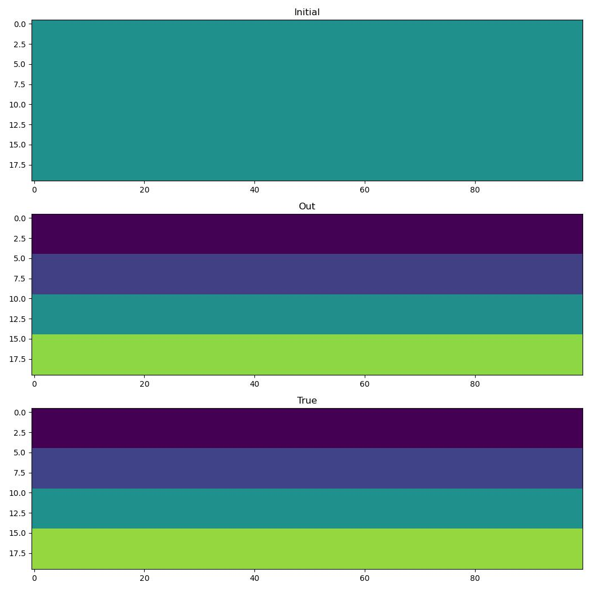

Generated model
===============

This example generates a velocity model from a small number of parameters,
using a PyTorch module placed before wave propagation in the computational
graph, and inverts for those parameters directly. It is useful when the
quantity you want to invert for is not the model itself, but something the
model is built from (here, four layer velocities), because Deepwave's output
is differentiable with respect to anything upstream of the model, not just
the model's own cells.

The function below generates a layered velocity model. Given a list of the
velocities of the different layers, it expands them into the full model
that Deepwave propagates through::

    class Model(torch.nn.Module):
        """A layered model generator.

        Inputs:
            layer_thickness:
                The number of cells thick each layer is in the first
                dimension
            nx:
                The number of cells of the model in the second dimension
        """
        def __init__(self, layer_thickness, nx):
            super().__init__()
            self.layer_thickness = layer_thickness
            self.nx = nx
            
        def forward(self, x):
            """Generate model.

            Inputs:
                x:
                    A Tensor of layer velocities.

            Returns:
                A layered model with the specified velocities.
            """
            return (
                x.reshape(-1, 1).repeat(1, self.layer_thickness)
                .reshape(-1, 1).repeat(1, self.nx)
            )

Let's pick some velocities to use in our "true" model::

    layer_thickness = 5
    nx = 100
    m = Model(layer_thickness, nx)

    x_true = torch.tensor([1500.0, 1600.0, 1750.0, 1920.0])
    v_true = m(x_true)

Setting up the sources and receivers works the same way as in the other
examples (see the full code, linked at the bottom, for that part). Using
this model, we generate observed data, then start from an initial guess and
optimise it to find a model that produces recordings matching the observed
data::

    # Generate "true" observed data
    observed_data = \
        deepwave.scalar(v_true, dx, dt,
                        source_amplitudes=source_amplitudes,
                        source_locations=source_locations,
                        receiver_locations=receiver_locations,
                        pml_freq=freq).receiver_amplitudes

    # Start from initial guess (all layers 1750) and try to invert
    x_init = 1750.0 * torch.ones(4)
    x = x_init.clone().requires_grad_()
    opt = torch.optim.Adam([x], lr=10.0)
    loss_fn = torch.nn.MSELoss()

    def closure():
        opt.zero_grad()
        v = m(x)
        y = deepwave.scalar(v, dx, dt,
                            source_amplitudes=source_amplitudes,
                            source_locations=source_locations,
                            receiver_locations=receiver_locations,
                            pml_freq=freq).receiver_amplitudes
        loss = loss_fn(y, observed_data)
        loss.backward()
        return loss

    for i in range(100):
        opt.step(closure)

The vector `x` being inverted for is just a Tensor of four numbers. Gradients
flow back through the full-sized velocity model and on into those four
numbers, so each iteration computes the derivative of the loss with respect
to each of them. The optimiser (Adam, here) then knows how to change them to
reduce the loss.

The output is [1502.6620, 1595.3390, 1746.9484, 1914.4209], which is pretty close to the true values, as we can see:

`Full example code <https://github.com/ar4/deepwave/blob/master/docs/example_generated_model.py>`_
