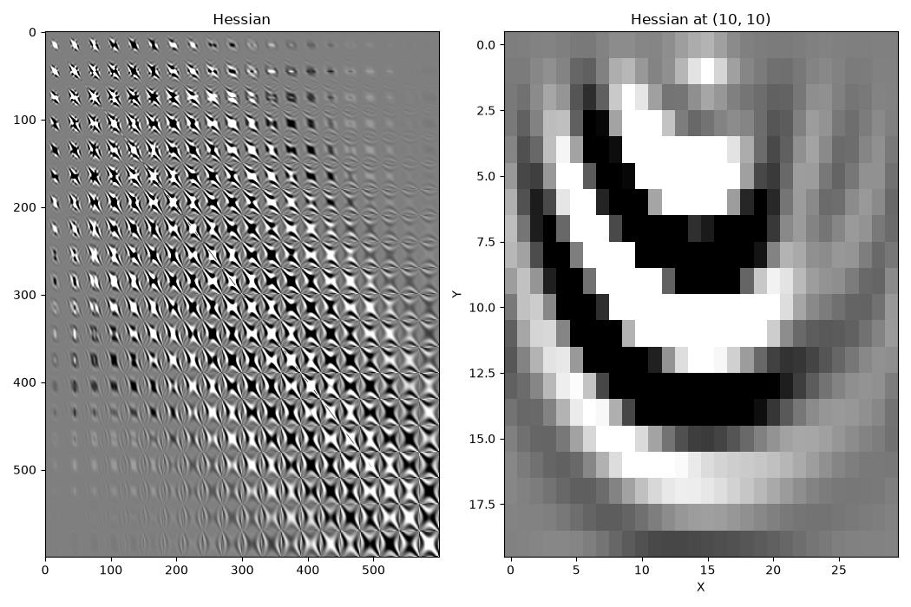
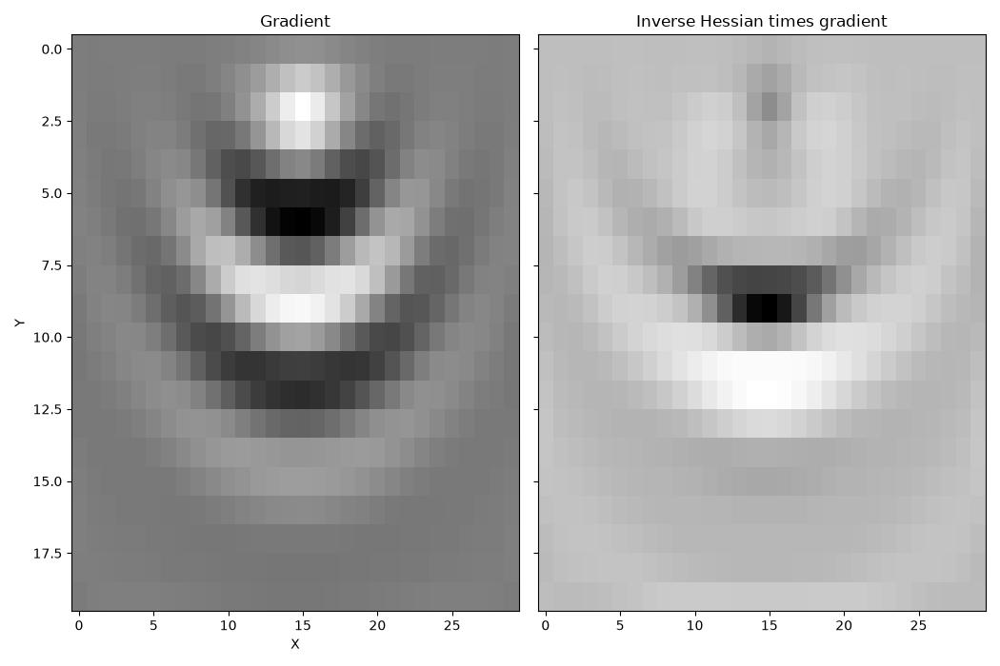
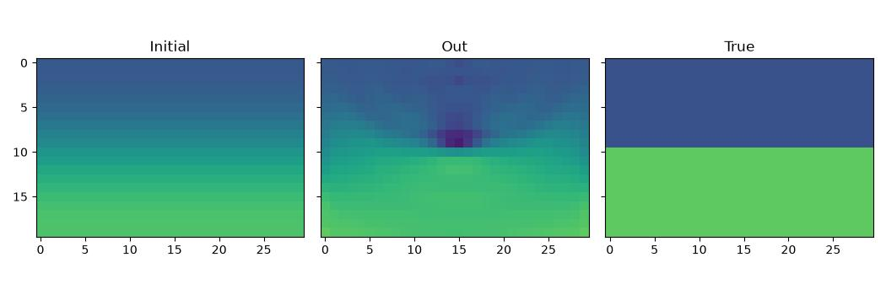

Hessian
=======

Deepwave supports backpropagating up to two times through the ``scalar``,
``acoustic`` and ``elastic`` propagators; the "Second-order (create_graph)"
column of the :doc:`capability matrix <capabilities>`, which is generated by
probing the propagators, is the authority on which propagators and backends
that covers today. One advantage of this is that it makes it possible to calculate Hessian
matrices, which are used in optimisation methods such as `Newton-Raphson
<https://en.wikipedia.org/wiki/Newton%27s_method_in_optimization>`_. This
example demonstrates that.

The compiled second derivative requires ``out.info.step_ratio == 1`` and
``model_gradient_sampling_interval == 1`` with lossless storage. Here
``dt=0.0008``, ``dx=4`` and fixed ``max_vel=2000`` satisfy that condition;
the source is sampled at this rate for the same physical duration. Fixing
``pml_freq=25`` also keeps the numerical configuration fixed during
differentiation. A larger public ``dt`` that triggers CFL substepping is
not supported by the native Hessian path.

After setting up a simple two layer model with a single shot, we can calculate the gradient and Hessian of a loss function based on the output receiver data, with respect to the velocity model, using::

    def wrap(v):
        d = deepwave.scalar(
            v,
            grid_spacing=dx,
            dt=dt,
            source_amplitudes=source_amplitudes,
            source_locations=source_locations,
            receiver_locations=receiver_locations,
            pml_width=[0, 20, 20, 20],
            pml_freq=freq,
            max_vel=2000,
        ).receiver_amplitudes
        return loss_fn(d, d_true)

    hess = torch.autograd.functional.hessian(wrap, v).detach()
    grad = torch.autograd.grad(wrap(v), v)[0].detach()

The Hessian describes the effect that changing the velocity model at a point will have on the gradient at all points in the model.

By taking these second-order effects into account, multiplying the gradient by the inverse of the Hessian gives a better estimate of how the model should be updated to reduce the loss function. The gradient has a high amplitude around the source, but after applying the inverse Hessian, the gradient amplitudes around the source are down-weighted in favour of amplitudes near the reflector.

We can use this improved update direction to optimise our velocity model using the Newton-Raphson method::

    for epoch in range(3):
        hess = torch.autograd.functional.hessian(wrap, v).detach()
        grad = torch.autograd.grad(wrap(v), v)[0].detach()
        eig0 = eigsh(hess.cpu().numpy().reshape(v.numel(), v.numel()),
                     k=1,
                     which="SA")[0].item()
        tau = max(-1.5 * eig0, 0)
        L = torch.linalg.cholesky(
            hess.reshape(v.numel(), v.numel()) +
            tau * torch.eye(v.numel()))
        h = torch.cholesky_solve(grad.reshape(-1, 1).neg(),
                                 L).reshape(ny, nx)
        v = (v.detach() + h).requires_grad_()

Although the result is quite good after just three iterations, the high computational cost of the Hessian (both runtime and memory) means that in many cases it might be better to use more iterations of a method that only uses the gradient.

`Full example code <https://github.com/ar4/deepwave/blob/master/docs/example_hessian.py>`_
