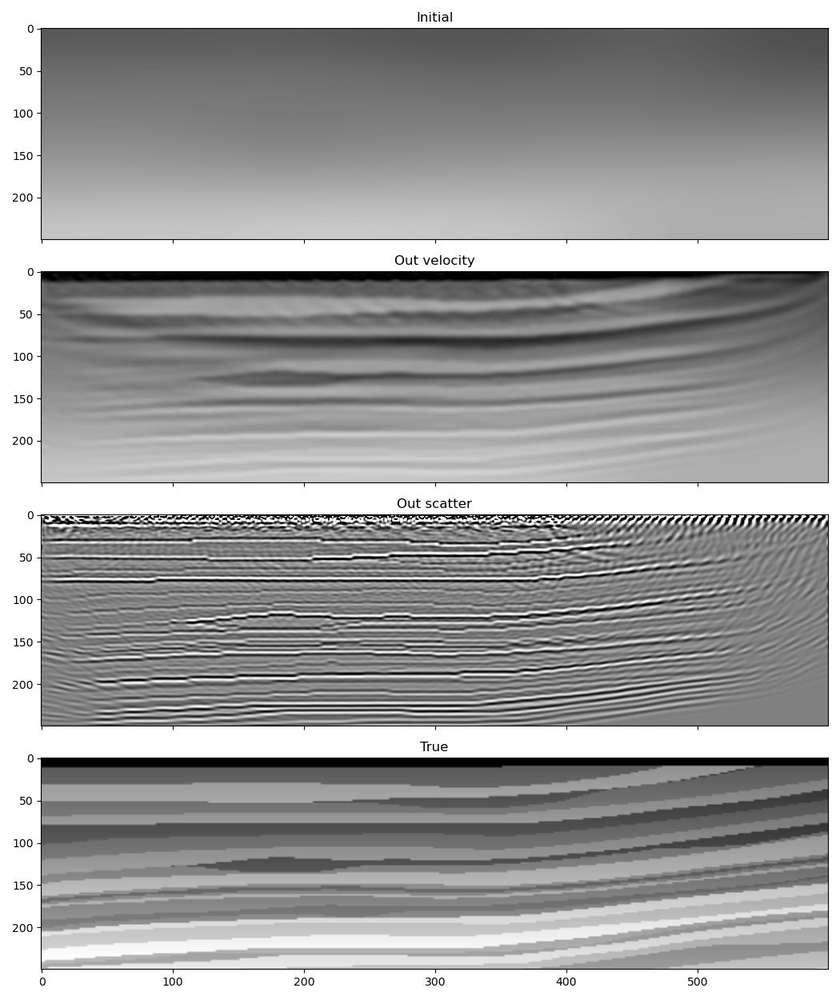

Joint Migration Inversion
=========================

Previous examples have looked at inverting for velocity models by using the regular `scalar` wave propagator to perform FWI. Another example used the Born propagator `scalar_born` to obtain a scattering model (also known as a migrated image) with LSRTM. It is also possible to use Deepwave's Born propagator to invert for the velocity model, and even to do so at the same time as inverting for the image.

Why this is harder than it looks
---------------------------------

It is tempting to just put both models in a single optimiser, as in::

    optimiser = torch.optim.LBFGS([v, scatter], lr=1)

and let PyTorch's automatic differentiation sort out the rest. Deepwave's
``scalar_born`` gradients with respect to both the velocity model and the
scattering model, including the re-scattering term that couples them, have
been verified against finite differences to about eight digits of
agreement, on both the CPU and CUDA backends. So the gradients themselves
are not the issue.

The issue is *conditioning*. The scattering model directly controls high-wavenumber reflectivity, so a small change to it can fit the data almost immediately, while the velocity model can only be updated with a smooth (low-wavenumber) correction that takes many iterations to bend travel times enough to reduce the misfit. In practice the scattering model's gradient ends up several times larger in magnitude than the velocity model's. When both models share one optimiser and one learning rate, the scattering
model absorbs essentially all of the data residual in the first few steps
and the loss drops quickly. The velocity model is then left with a
vanishingly small effective step size: it stalls, and may never move in
any noticeable way. This is not a bug in Deepwave's gradients, it is what naturally happens when two parameters with very different gradient scales share a single update rule.

The fix: warmup, then joint updates with separate optimisers
--------------------------------------------------------------

We address this the same way you would address any badly-conditioned joint optimisation problem: give each model its own optimiser (and thus its own learning rate, tuned to its own units and gradient scale), and avoid asking the velocity model to make large decisions before the scattering model has settled down.

Concretely, we:

* Use `Adam` rather than `LBFGS`, with a separate optimiser instance for `v` and for `scatter`. This means each model gets a learning rate that is appropriate for its own units and gradient scale, rather than one that is a compromise between the two.
* Normalise the loss by the observed data's energy (``observed_data.pow(2).mean()``) instead of multiplying by an arbitrary constant like ``1e10``. This keeps the loss, and therefore the raw gradient magnitudes, on a predictable scale that doesn't depend on the (somewhat arbitrary) choice of source amplitude or receiver spacing.
* Begin with a short "migration" warmup of a few epochs in which only `scatter` is updated and `v` is left untouched -- the same idea used in the :doc:`LSRTM example <example_lsrtm>`. This lets the scattering model capture the bulk of the reflectivity using the (still smooth, inaccurate) starting velocity model, before the velocity model is allowed to move at all.
* Switch to joint updates after the warmup, but decay the velocity model's learning rate over the course of the joint stage. Early on, when the model is far from correct, we want the velocity update to be able to take a large step; later, as the model approaches the truth, a large step risks overshooting or cycle-skipping, so we shrink it.

The setup is the same as in previous FWI examples, other than the addition of the scattering model. We record receiver data at the receiver locations in both the background wavefield and the scattered wavefield, and then sum these together before comparing with the true data. This causes our predicted data to include both scattered and non-scattered waves. Our :doc:`RTM <example_rtm>` example only recorded from the scattered wavefield. The recording therefore did not include direct or refracted waves and so we needed to mask the data before computing the misfit with the true data. By also recording from the background wavefield in this example we avoid having to do that.

We create separate optimisers for the velocity model and the scattering model, and precompute the data energy used to normalise the loss::

    optimiser_v = torch.optim.Adam([v], lr=v_lr)
    optimiser_s = torch.optim.Adam([scatter], lr=scatter_lr)
    loss_fn = torch.nn.MSELoss()
    observed_data_energy = observed_data.pow(2).mean()

Inside the loop over epochs we smooth the velocity and sharpen the scattering model before passing them to the propagator, just as before. This ensures that the optimiser is only able to make low wavenumber updates to the velocity model and high wavenumber updates to the scattering model. During the warmup epochs we skip the `v` optimiser's step so that only `scatter` is updated; during the joint epochs we decay the velocity learning rate and update both models::

    for epoch in range(n_epochs):
        warmup = epoch < n_warmup_epochs
        if not warmup:
            decay_step = epoch - n_warmup_epochs
            for group in optimiser_v.param_groups:
                group["lr"] = v_lr * (v_lr_decay**decay_step)

        optimiser_v.zero_grad()
        optimiser_s.zero_grad()
        # Remove high wavenumbers from the velocity model
        v_smooth = (
            torchvision.transforms.functional.gaussian_blur(
                v[None], [11, 11]
            ).squeeze()
        )
        # Remove low wavenumbers from the scattering model
        scatter_sharp = scatter - (
            torchvision.transforms.functional.gaussian_blur(
                scatter[None], [11, 11]
            ).squeeze()
        )
        out = scalar_born(
            v_smooth, dx, dt,
            dv=scatter_sharp,
            source_amplitudes=source_amplitudes,
            source_locations=source_locations,
            sc_receiver_locations=receiver_locations,
            bg_receiver_locations=receiver_locations,
            pml_freq=freq,
        )
        loss = (
            loss_fn(
                out.sc_receiver_amplitudes + out.bg_receiver_amplitudes,
                observed_data,
            )
            / observed_data_energy
        )
        loss.backward()
        if not warmup:
            optimiser_v.step()
        optimiser_s.step()

PyTorch and Deepwave take care of calculating the gradients correctly; it is the two-stage, two-optimiser schedule above that keeps those gradients from being wasted on the wrong model. When the optimisation is finished we calculate `v_smooth` and `scatter_sharp` one last time and then use these as our final models.

`Full example code <https://github.com/ar4/deepwave/blob/master/docs/example_joint_migration_inversion.py>`_
