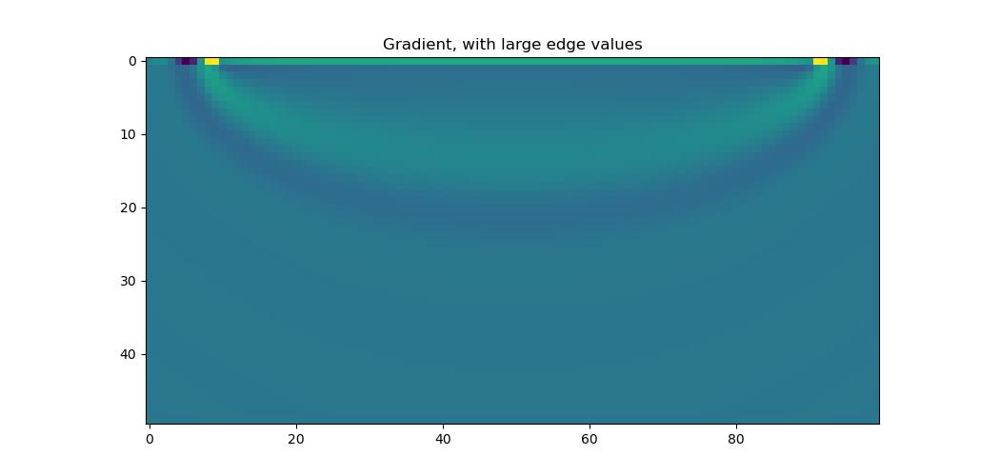
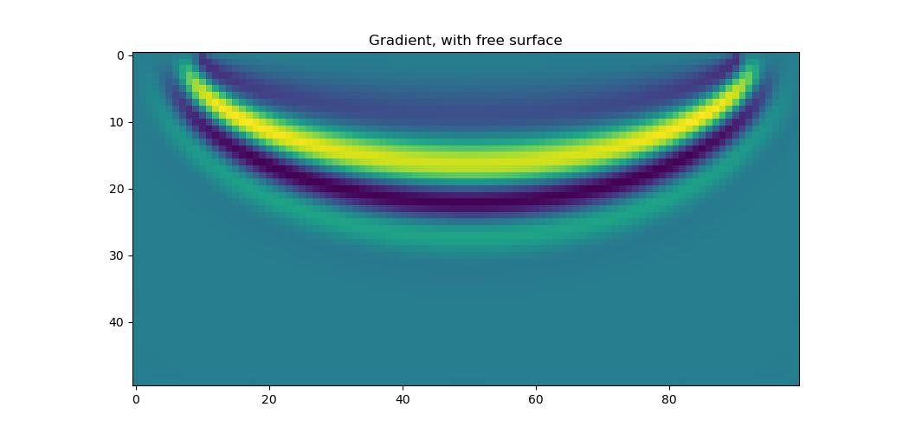
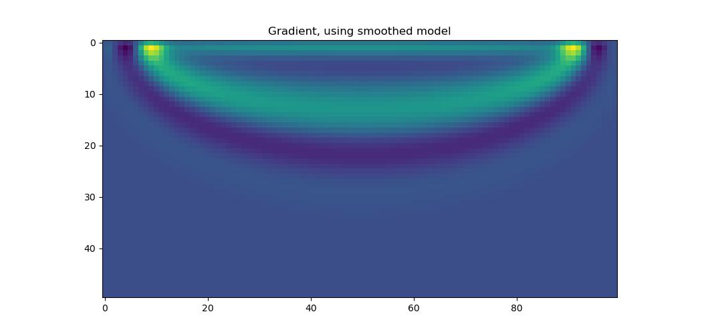
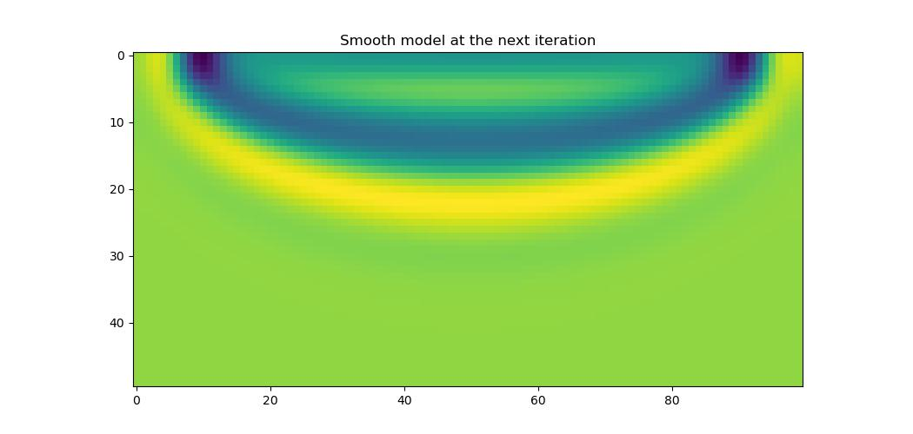

Large gradients at edges
========================

In certain circumstances, the gradient Deepwave calculates for cells at the
edge of the model is much larger than for other cells. This example shows
when that happens, explains why, and, since it is usually undesirable,
proposes some ways to avoid it::

    source_amplitudes=deepwave.wavelets.ricker(25, 200, 0.004,
                                               0.06).reshape(1, 1, -1)
    source_locations=torch.tensor([[[0, 10]]])
    receiver_locations=torch.tensor([[[0, 90]]])

    v_true = 1500 * torch.ones(50, 100)
    v = 1600 * torch.ones(50, 100)
    v.requires_grad_()

    out_true = deepwave.scalar(
        v_true, grid_spacing=4, dt=0.004,
        source_amplitudes=source_amplitudes,
        source_locations=source_locations,
        receiver_locations=receiver_locations
    ).receiver_amplitudes

    out = deepwave.scalar(
        v, grid_spacing=4, dt=0.004,
        source_amplitudes=source_amplitudes,
        source_locations=source_locations,
        receiver_locations=receiver_locations
    ).receiver_amplitudes

    torch.nn.MSELoss()(out, out_true).backward()

It is a simple setup, with one source on the left and one receiver on the
right, both at the top surface. We generate "true" data with a velocity of
1500 m/s, then generate data using a model with a velocity of 1600 m/s.
Calculating the MSE loss between the two and backpropagating gives the
gradient of the loss with respect to the velocity model, stored in
`v.grad`. Plotting it shows a line of high amplitudes, one cell thick, at
the top surface.

This is caused by the absorbing PML boundary. For the calculated gradient
to be fully correct, Deepwave includes the effect of the PML in the
gradient calculation. Some waves travel into the PML region and reach the
receiver without being fully attenuated, so there is a non-zero gradient in
the PML region: changing the velocity there would affect these waves and so
change the recorded data. Deepwave uses the velocity at the edge of the
model as the velocity throughout the PML, so these gradients from the PML
region are all assigned to the cells at the model's edge. That is what
produces the one-cell-thick layer of large gradients there.

There are several ways to reduce this effect. One, already seen in
:doc:`a previous FWI example <example_fwi>`, is gradient clipping, which
avoids large gradients at a small number of cells. A better solution is a
rigid surface at the top of the model: setting the PML width there to zero
turns it into a reflective surface. This avoids the problem entirely, since
there is then no PML region there for waves to travel through, and so no
contribution to the gradient from it. The optional `pml_width` parameter
sets the width of the PML on each surface of the model. A reflective top
surface (where the source and receiver are) with a PML width of 20 cells on
the other surfaces is therefore `pml_width=[0, 20, 20, 20]`, since the top
is the beginning of the first dimension here. To make the beginning of
the second dimension the reflective surface instead, use
`pml_width=[20, 20, 0, 20]`::

    out_true = deepwave.scalar(
        v_true, grid_spacing=4, dt=0.004,
        source_amplitudes=source_amplitudes,
        source_locations=source_locations,
        receiver_locations=receiver_locations,
        pml_width=[0, 20, 20, 20]  # <--
    ).receiver_amplitudes

    out = deepwave.scalar(
        v, grid_spacing=4, dt=0.004,
        source_amplitudes=source_amplitudes,
        source_locations=source_locations,
        receiver_locations=receiver_locations,
        pml_width=[0, 20, 20, 20]  # <--
    ).receiver_amplitudes

    torch.nn.MSELoss()(out, out_true).backward()

The gradient now has the familiar "banana" shape.

If a reflective surface is not wanted, there are other options. One is to
pad the top of the model, moving the sources and receivers further from the
surface so that fewer waves pass through the PML region. Tapering the
velocity in the padded region to a smaller value, further from the actual
model, improves this further, bending waves towards the PML and making
them less likely to reach the receivers. Another is to parameterise the
model so that a single layer of high amplitudes is not possible, for
example by applying a differentiable smoothing function (such as
convolution with a Gaussian) to the model before passing it to Deepwave.
The gradient that comes out of Deepwave still has the row of large
amplitudes, but this gets smoothed out when it is further backpropagated
through the smoothing function::

    out_true = deepwave.scalar(
        v_true, grid_spacing=4, dt=0.004,
        source_amplitudes=source_amplitudes,
        source_locations=source_locations,
        receiver_locations=receiver_locations
    ).receiver_amplitudes

    # Smooth model
    v_smooth = (
        torchvision.transforms.functional.gaussian_blur(
            v[None], [11, 11]
        ).squeeze()
    )

    out = deepwave.scalar(
        v_smooth,  # <-- Pass smoothed model to Deepwave
        grid_spacing=4, dt=0.004,
        source_amplitudes=source_amplitudes,
        source_locations=source_locations,
        receiver_locations=receiver_locations
    ).receiver_amplitudes

    torch.nn.MSELoss()(out, out_true).backward()

Note that it is `v` that has `requires_grad=True`, so the gradients get backpropagated through the smoothing.

Applying the gradient and then the smoothing function to the model, to get the model that will be passed to Deepwave at the next iteration, we see that the result is smooth, as we desire.

`Full example code <https://github.com/ar4/deepwave/blob/master/docs/example_large_edge_gradient.py>`_
