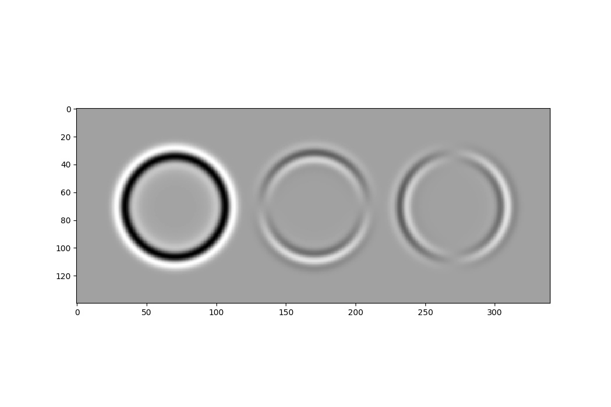
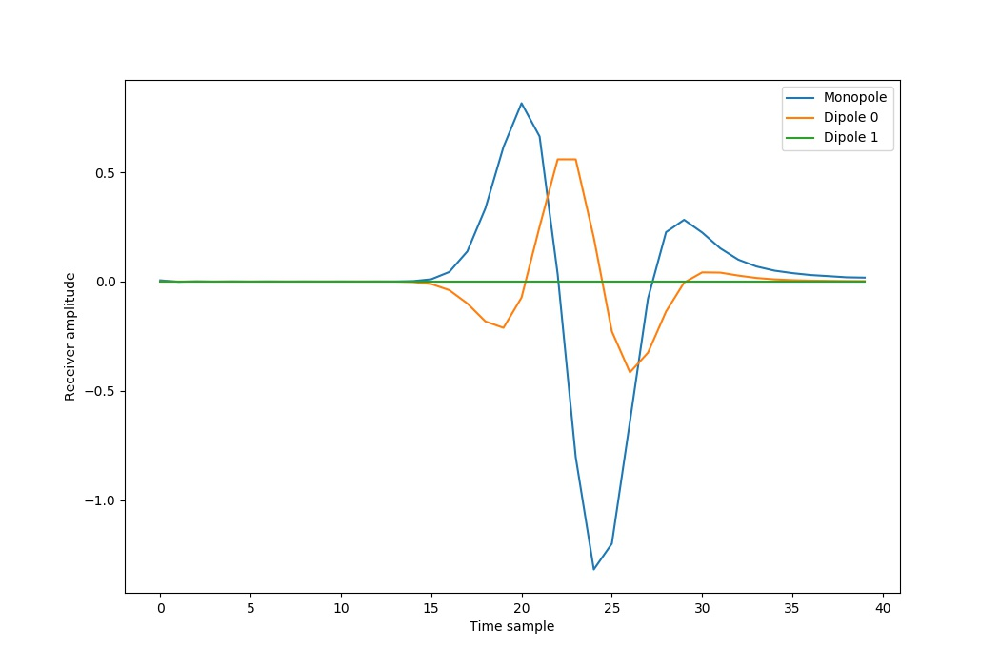
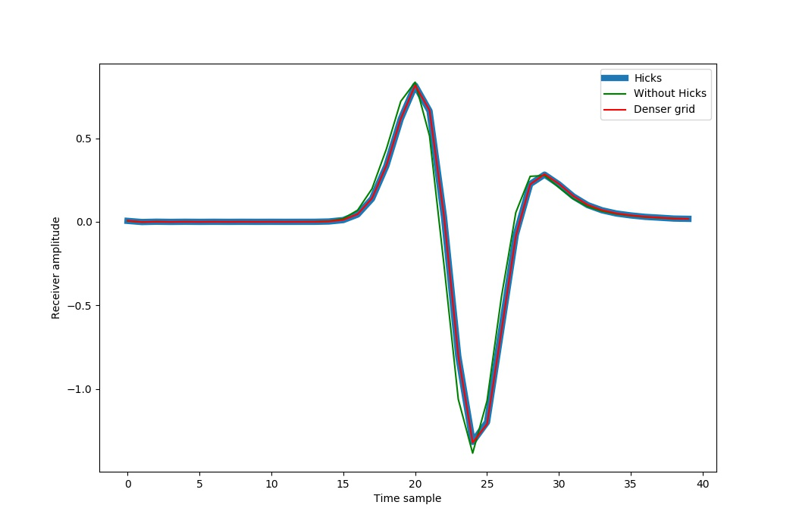
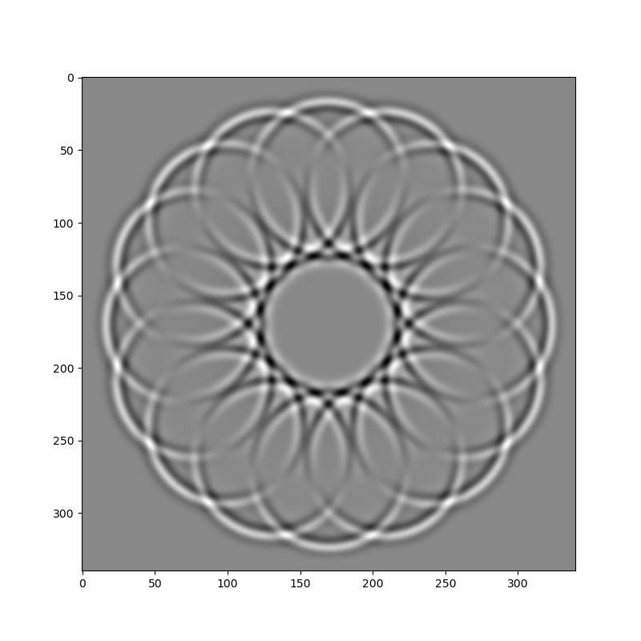

Location interpolation and dipoles
==================================

All of our examples so far have used monopole sources and receivers located on grid points. To make it easier to also use dipoles and points that are not on grid points, Deepwave provides an implementation of `a proposal by Hicks <https://doi.org/10.1190/1.1451454>`_. In this example we will see how to use it.

Previous examples only used Tensors containing locations as integer numbers
of grid cells from the origin. Specifying positions with floating point
numbers instead allows more arbitrary positions, which is especially useful
with larger grid cells (used to reduce computational cost), since the
desired location may then no longer land on a grid point. Sources can only
be added to, and receiver data can only be recorded from, a discretised
wavefield on grid points, however. The Hicks method resolves this by
converting a point at an arbitrary position into an array of points at
grid cell locations; with an appropriate weighting, this array produces an
effect similar to a point source at the original, arbitrary location.

After setting up the model in a typical way, the interesting part of this
example is how the source and receiver locations are specified. For the
sources, we create three sources in a line, none of them located on a grid
point: a monopole, a dipole oriented in the first dimension, and a dipole
oriented in the second dimension. Passing these to a `Hicks` object gives
the locations and amplitudes of the array of grid-point sources that
together approximate the three desired sources::

    source_locations = torch.zeros(1, 3, 2, device=device)
    source_locations[..., 0] = ny / 2 + 0.5
    source_locations[..., 1] = torch.arange(3) * nx / 3 + nx / 6 + 0.5
    source_monopole = torch.zeros(1, 3, dtype=torch.bool, device=device)
    source_monopole[0, 0] = True
    source_monopole[0, 1] = False
    source_monopole[0, 2] = False
    source_dipole_dim = torch.zeros(1, 3, dtype=torch.int,
                                    device=device)
    source_dipole_dim[0, 2] = 1
    hicks_source = deepwave.Hicks(
        source_locations,
        monopole=source_monopole,
        dipole_dim=source_dipole_dim
    )
    hicks_source_locations = hicks_source.get_locations()
    hicks_source_amplitudes = hicks_source.source(source_amplitudes)

Similarly, we create three receivers, again a monopole and dipoles oriented in each dimension, all at the same non-grid point location above the first (monopole) source::

    receiver_locations = torch.zeros(1, 3, 2, device=device)
    receiver_locations[..., 0] = source_locations[0, 0, 0] - ny / 8
    receiver_locations[..., 1] = source_locations[0, 0, 1]
    receiver_monopole = torch.zeros(1, 3, dtype=torch.bool,
                                    device=device)
    receiver_monopole[0, 0] = True
    receiver_monopole[0, 1] = False
    receiver_monopole[0, 2] = False
    receiver_dipole_dim = torch.zeros(1, 3, dtype=torch.int,
                                      device=device)
    receiver_dipole_dim[0, 2] = 1
    hicks_receiver = deepwave.Hicks(
        receiver_locations,
        monopole=receiver_monopole,
        dipole_dim=receiver_dipole_dim
    )
    hicks_receiver_locations = hicks_receiver.get_locations()

We can then simply pass these arrays of sources and receivers to the Deepwave propagator as usual::

    out = scalar(v, dx, dt, source_amplitudes=hicks_source_amplitudes,
                 source_locations=hicks_source_locations,
                 receiver_locations=hicks_receiver_locations,
                 pml_freq=freq)

In the wavefield of the final time step of this propagation, we can see the three types of source.

The `source` function of the `Hicks` object converted the amplitudes of the
original point sources into amplitudes for the array of grid-centred
sources. The `receiver` function does the reverse for receivers: it
converts the amplitudes recorded at the array of grid-centred receiver
locations into the amplitudes that would have been recorded by receivers
at the desired, non-grid-centred locations::

    receiver_hicks_amplitudes = out.receiver_amplitudes
    receiver_amplitudes = hicks_receiver.receiver(
        receiver_hicks_amplitudes
    )

Plotting these, we see how the three different types of receivers respond differently to the arrivals from the monopole source, even though all three receivers are located in the same place:

To verify the accuracy of the Hicks method, we perform the same propagation
twice more: once with the source and receiver locations rounded to a grid
point, and once on a grid with half the grid cell spacing, so that the
desired locations land exactly on grid points there. Halving the grid
spacing in both dimensions also means the source amplitudes must be
multiplied by four to produce a similar effect on the wavefield::

    out2 = scalar(v, dx, dt,
                  source_amplitudes=source_amplitudes,
                  source_locations=source_locations.long(),
                  receiver_locations=receiver_locations.long(),
                  pml_freq=freq)

    v = torch.ones(2 * ny, 2 * nx, device=device) * 1500
    out3 = scalar(v, dx / 2, dt,
                  source_amplitudes=source_amplitudes*4,
                  source_locations=(source_locations*2).long(),
                  receiver_locations=(receiver_locations*2).long(),
                  pml_freq=freq)

Simply rounding to grid points changes the result noticeably in this case,
while the Hicks method approximates the denser-grid result well:

The approximation may not be as good close to the point (such as within the array), so, if you are performing optimisation, you may wish to apply a mute to receivers that are close to sources when using the Hicks method.

Finally, it is important to note that if your desired non-grid-point locations are near an edge of the model, you might need to extend the model (such as by using `torch.nn.functional.pad` with `mode='replicate'`). This is because the array of grid-centred points produced by the Hicks method will surround the desired location and so some might be positioned outside the current model. If you do this, and extend the edge at the beginning of a dimension, then you will also need to shift the locations to account for the shift in origin of the model. For example, suppose you want a point at `[0.1, 1.1]`, using the default
Hicks halfwidth of 4. You would need to pad the beginnings of both
dimensions, by three and two cells respectively, so that all locations are
at least 0::

    source_locations = torch.tensor([[[0.1, 1.1]]])
    hicks = deepwave.Hicks(source_locations)
    hicks_source_locations = hicks.get_locations()
    hicks_source_locations[..., 0] += 3
    hicks_source_locations[..., 1] += 2
    model = torch.nn.functional.pad(model[None], (3, 2),
                                    mode='replicate')[0]

If you specify an edge as being a free surface, however, then the array of points will not extend beyond that edge.

Sources and receivers oriented in arbitrary directions can also be
simulated, by combining two at the same location with weights determined
by the orientation. For example, to make a circle of sources all oriented
away from the centre of the circle, weight the amplitude of the source
oriented in the first dimension by :math:`\sin(angle)`, and the one in the
second dimension by :math:`\cos(angle)`, then combine them with the Hicks
method::

    for l in range(n_source_locations):
        angle = l / n_source_locations * 2 * math.pi
        source_locations[0, l*2:(l+1)*2, 0] = (
            math.sin(angle) * radius + cy
        )
        source_locations[0, l*2:(l+1)*2, 1] = (
            math.cos(angle) * radius + cx
        )
        source_amplitudes[0, l*2] *= math.sin(angle)
        source_amplitudes[0, l*2+1] *= math.cos(angle)

    source_monopole = torch.zeros(n_shots, n_sources_per_shot,
                                  dtype=torch.bool, device=device)
    source_dipole_dim = torch.zeros(n_shots, n_sources_per_shot,
                                    dtype=torch.int, device=device)

    source_dipole_dim[0, 1::2] = 1  # every second source is x-orientated
    hicks_source = deepwave.Hicks(
        source_locations,
        monopole=source_monopole,
        dipole_dim=source_dipole_dim,
    )

    hicks_source_locations = hicks_source.get_locations()
    hicks_source_amplitudes = hicks_source.source(source_amplitudes)

`Full example dipole/location interpolation code <https://github.com/ar4/deepwave/blob/master/docs/example_location_interpolation.py>`_

`Full example circle of sources code <https://github.com/ar4/deepwave/blob/master/docs/example_location_interpolation_circle.py>`_