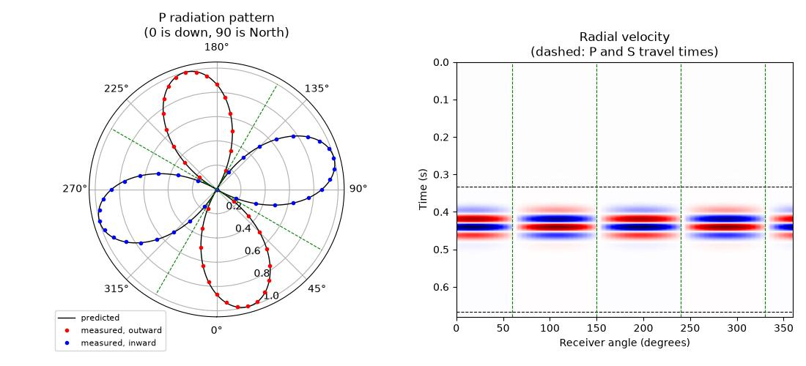

Earthquake (moment tensor) sources
=====================================

Deepwave's elastic propagator takes body forces: you tell it how hard to
push, in which direction, and where. Earthquake seismologists do not
describe a source that way. They describe it with a **moment tensor**.
This page shows how to turn a moment tensor into the body forces Deepwave
wants. No new Deepwave function is needed. The recipe is ordinary user
code, and it is verified here against the radiation pattern that theory
predicts.

What a moment tensor is
--------------------------

An earthquake is slip on a fault: two blocks of rock slide past each
other. Nothing pushes the Earth from outside, so the source exerts no net
force. What it does exert is pairs of opposing forces. A pair of opposing
forces is called a **couple**.

The **moment tensor** collects those couples. It is a symmetric
3x3 tensor. Its component :math:`M_{ij}` is the strength of a couple made
of two opposing forces that point along direction :math:`i` and are
separated by a small distance along direction :math:`j`. Because the
tensor is symmetric, :math:`M_{ij} = M_{ji}`, and the source has no net
torque either. Each component has units of force times length (newton
metres in SI).

The **scalar moment**, written :math:`M_0`, is the size of the
earthquake. For slip on a fault it is the shear modulus times the area
that slipped times the average amount of slip. Earthquake magnitudes are
computed from it.

Slip on a plane gives a particular kind of moment tensor called a
**double couple**: two couples of equal strength, at right angles to each
other. An explosion gives a different one: an **isotropic** moment
tensor, equal to :math:`M_0` times the identity, which pushes outwards
equally in all directions. Both appear below.

The orientation of a fault and the direction of slip on it are given by
three angles.

* **Strike** is the compass direction of the fault's horizontal trace,
  measured clockwise from North. The fault dips down to the right of the
  strike direction.
* **Dip** is the angle of the fault plane below horizontal, from 0
  (horizontal) to 90 degrees (vertical).
* **Rake** is the direction the rock slipped, measured within the fault
  plane, anticlockwise from the strike direction. A rake of 0 is
  horizontal (strike slip); 90 is the upper block riding up the fault
  (reverse, or thrust, slip); -90 is the upper block sliding down
  (normal slip).

From strike, dip and rake to the moment tensor
-------------------------------------------------

The relations used here are those of Aki and Richards, *Quantitative
Seismology: Theory and Methods* (W. H. Freeman, 1980). They are written
in a right-handed Cartesian frame whose axes are North, East and Down, so
depth increases along the third axis.

In that frame the unit vector along the slip direction and the unit
vector normal to the fault plane are both fixed by the three angles. The
moment tensor of a shear dislocation is then the symmetric outer product
of the two, scaled by the scalar moment::

    slip = torch.tensor([
        math.cos(rake_rad) * math.cos(strike_rad)
        + math.cos(dip_rad) * math.sin(rake_rad) * math.sin(strike_rad),
        math.cos(rake_rad) * math.sin(strike_rad)
        - math.cos(dip_rad) * math.sin(rake_rad) * math.cos(strike_rad),
        -math.sin(rake_rad) * math.sin(dip_rad),
    ])
    normal = torch.tensor([
        -math.sin(dip_rad) * math.sin(strike_rad),
        math.sin(dip_rad) * math.cos(strike_rad),
        -math.cos(dip_rad),
    ])
    moment_tensor = m0 * (
        torch.outer(slip, normal) + torch.outer(normal, slip)
    )

(the three angles are in radians here). The example also writes out the
six components one by one, in the form the relations are usually quoted
in, and asserts that the two forms agree. That is worth doing once in
your own code: a sign slip in one component is otherwise easy to miss.

Mapping the frame onto Deepwave's grid
------------------------------------------

Deepwave orders its spatial dimensions from slowest to fastest varying:
``(z, y, x)`` in 3-D and ``(y, x)`` in 2-D. It attaches no physical
meaning to them, so you choose what they mean (see :doc:`units`). The
example is a 2-D vertical cross-section, and takes

* Deepwave ``y``, the first dimension, to be Down (depth),
* Deepwave ``x``, the second dimension, to be North.

Selecting the rows and columns of the moment tensor that belong to those
two axes gives the 2-D moment tensor::

    in_plane = [2, 0]  # (Down, North)
    moment_tensor_2d = moment_tensor[in_plane][:, in_plane]

A 2-D simulation carries only motion in the model plane: P waves, and the
S waves whose motion is polarised in that plane (SV waves). The
components of the moment tensor that involve the out-of-plane axis drive
S waves polarised out of the plane (SH waves), which the 2-D simulation
does not model, so they are dropped. To keep every component meaningful, the example chooses a fault
that strikes East-West, so that the North-Down cross-section is
perpendicular to the strike and contains both the slip vector and the
fault normal. Note also that a 2-D source is a *line* source, uniform and
infinite out of the plane, so :math:`M_0` is really a moment per unit
length out of the plane.

From moment tensor to body force couples
--------------------------------------------

A point moment tensor source at position :math:`\mathbf{s}` is equivalent
to the body force density

.. math::

    f_i = -\frac{\partial}{\partial x_j}
          \left(M_{ij}\,\delta(\mathbf{x}-\mathbf{s})\right),

which is the couple description written as mathematics: the force in
direction :math:`i` is a derivative, along direction :math:`j`, of a
point source of strength :math:`M_{ij}`. Three practical consequences
follow.

**Two forces, opposite signs.** A derivative is approximated by a
difference, so each component becomes two point forces straddling the
source position: :math:`+M_{ij}` on the :math:`+j` side and
:math:`-M_{ij}` on the :math:`-j` side.

**Divide by the separation.** A difference only approximates a derivative
after dividing by the step. The example puts the two forces half a cell
either side of the source, so their separation, the lever arm, is one
cell, ``dx``.

**Divide by the cell volume.** Deepwave's velocity sources are force
*densities*, in units of force per volume (see :doc:`units`). A point
force of :math:`F` newtons applied in one cell is a density of
:math:`F` divided by the cell volume. In 2-D that volume is
``dx * dx`` per unit length out of the plane.

The last thing to respect is *where* each force may be applied. On the
staggered grid (see :doc:`elastic`) the field components do not share a
position: the normal stresses and the model parameters sit on the integer
grid points :math:`(y, x)`, while :math:`v_y` sits at
:math:`(y+\frac{1}{2}, x)` and :math:`v_x` at :math:`(y, x+\frac{1}{2})`.
A force in the ``y`` direction is applied to :math:`v_y`, so it can only
act where :math:`v_y` lives.

You do not have to do that bookkeeping by hand. Location arguments given
as floating point numbers are physical positions in grid cells, and
Deepwave removes each component's own half-cell offset for you (see the
section on off-grid sources and receivers in :doc:`usage`).
A position that lands exactly on that component's node is injected
exactly; one that falls between nodes is interpolated with a windowed
sinc. So the four positions can simply be written down as the physical
offsets they are::

    separation = torch.tensor(
        [[0.5, 0.0], [-0.5, 0.0], [0.0, 0.5], [0.0, -0.5]]
    )
    couple_locations = source_position + separation

    weights_y = torch.tensor(
        [moment[0, 0], -moment[0, 0], moment[0, 1], -moment[0, 1]]
    )
    weights_x = torch.tensor(
        [moment[1, 0], -moment[1, 0], moment[1, 1], -moment[1, 1]]
    )
    scale = 1.0 / (lever_arm * cell_volume)

The first two positions are separated along ``y`` and carry the
:math:`M_{yy}` and :math:`M_{xy}` couples; the second two are separated
along ``x`` and carry :math:`M_{yx}` and :math:`M_{xx}`. The same four
positions serve both force directions, with different weights, and both
are passed to :func:`deepwave.elastic` as ordinary sources::

    out = elastic(
        lamb, mu, buoyancy, dx, dt,
        source_amplitudes_y=amplitudes_y,
        source_locations_y=couple_locations,
        source_amplitudes_x=amplitudes_x,
        source_locations_x=couple_locations,
        receiver_locations_y=receiver_locations,
        receiver_locations_x=receiver_locations,
        pml_width=pml_width, pml_freq=freq,
    )

One point about time is easy to overlook. The amplitudes above are
proportional to the moment :math:`M(t)` itself, not to its rate of
change. If you have a moment rate function, integrate it first.

Checking the sign and the scale
-----------------------------------

Getting the sign of the couples backwards turns an explosion into an
implosion, and nothing about the shape of the wavefield will tell you.
The example therefore pins the sign and the scale down independently. It
applies the same recipe to an isotropic moment tensor, which is an
explosion, and compares the result with Deepwave's own explosive source
(the ``pressure_rate`` channel). The body force has an equivalent description
as a *stress glut*: it adds :math:`-M_{ij}\delta(\mathbf{x}-\mathbf{s})`
to the stress. For an isotropic moment tensor :math:`M_0 w(t)`, and since
pressure is minus the mean normal stress, that is a pressure of
:math:`M_0 w(t)` spread over one cell. Deepwave's pressure source is
specified as a pressure *rate* (see :doc:`units`), so the equivalent
amplitude is the time derivative of that,
:math:`M_0 \dot{w}(t)` divided by the cell volume. The two runs agree to
0.3% in amplitude, and in sign.

Verifying the radiation pattern
-----------------------------------

The **radiation pattern** of a source is the way the amplitude it
radiates varies with direction. For P waves in the far field it is the
moment tensor contracted twice with the unit vector
:math:`\boldsymbol{\gamma}` that points from the source to the receiver:
the amplitude is proportional to
:math:`\gamma_i M_{ij} \gamma_j`. For a double couple this equals
:math:`2 M_0 (\boldsymbol{\gamma}\cdot\mathbf{s})
(\boldsymbol{\gamma}\cdot\mathbf{n})`, with :math:`\mathbf{s}` the slip
vector and :math:`\mathbf{n}` the fault normal.

That form makes the classic picture immediate. The pattern has four
lobes. It is positive (the first ground motion is *away* from the source,
a compression) in two opposite quadrants, and negative (the first motion
is *towards* the source, a dilatation) in the other two. It vanishes on
two perpendicular planes, called **nodal planes**, where
:math:`\boldsymbol{\gamma}` is perpendicular to the slip vector or to the
fault normal. Those two planes are the fault plane itself and the plane
perpendicular to the slip, which is called the **auxiliary plane**. P-wave
first motions alone cannot tell you which of the two is the real fault:
this is the classic fault plane ambiguity.

The example measures the pattern. Receivers are placed on a circle around
the source, five P wavelengths away, far enough for the far-field form to
have developed. Both velocity components are recorded at each receiver
and projected onto the source-receiver direction, giving the radial
velocity. Because every receiver is the same distance from the source,
the P arrival has the same shape at all of them and differs only by a
scale factor, which is exactly the radiation pattern. Projecting each
receiver's trace onto the explosion run's waveform, over a window that
opens at the P travel time and closes at the S travel time, therefore
measures the pattern directly, and in absolute units, because the
explosion radiates :math:`M_0` in every direction::

    window = (time >= radius * dx / vp) & (time <= radius * dx / vs)
    reference = radial_explosion[:, window].mean(dim=0)
    measured = (
        (radial_double_couple[:, window] * reference).sum(dim=1)
        / (reference * reference).sum()
    )
    predicted = torch.einsum(
        "ai,ij,aj->a", direction, moment_tensor_2d / m0, direction
    )

The left panel is the measured pattern (points, coloured by whether the
first motion is outward or inward) on top of the prediction (line), with
the predicted nodal directions dashed. The right panel is the radial
velocity recorded around the circle: the polarity of the P arrival
reverses as each nodal direction is crossed, which is the same
information in a different form.

For a fault striking East-West, dipping at 60 degrees, with pure reverse
slip, the measured pattern differs from the prediction by at most 0.006 of
the peak amplitude, the measured amplitude at each of the four predicted
nodal directions is below 0.001 of the peak, and the polarity agrees with
the prediction at every receiver that is not close to a nodal direction
(where the predicted amplitude is above a fifth of the peak, so that
"polarity" means something). The example asserts all of this, so it fails
if the recipe or the propagator stops reproducing the theory.

The residual difference is not noise. It has two causes, and both can be
made smaller. The first is the finite grid: a couple built from two
forces one cell apart is only a second-order accurate approximation of a
derivative. Its size is visible in the comparison with Deepwave's
explosive source, which improves from 1.3% at a grid spacing of 20 m, to
0.3% at 10 m, to 0.07% at 5 m -- a quarter of the error for each halving,
as second-order accuracy predicts. The second is the finite distance to
the receivers: "far field" means infinitely far, and at five wavelengths
the near-field terms have not entirely died away. Moving the circle out
to ten and then fifteen wavelengths reduces the largest difference from
0.006 to 0.004 and then 0.003.

`Full example code <https://github.com/ar4/deepwave/blob/master/docs/example_moment_tensor.py>`_
