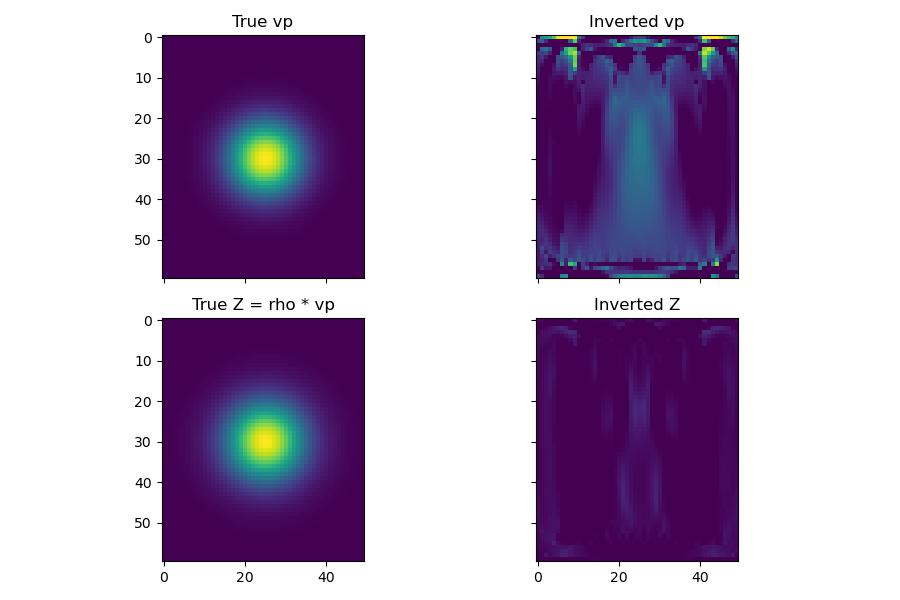
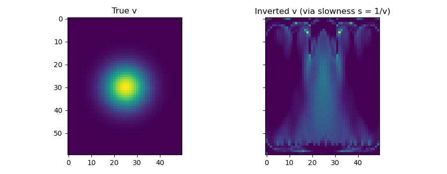

FWI in other parameterisations
===============================

Every Deepwave propagator takes physical model tensors directly (wavespeed,
density, stiffnesses, ...) and every output is differentiable with respect
to them. But the tensor you hand a propagator does not have to be the tensor
you *optimise*. Because propagation is an ordinary PyTorch operation, any
invertible reparameterisation built from plain tensor arithmetic composes
with autograd automatically: build the propagator's native inputs from your
own optimised variables inside the loss, call the propagator, and
``backward()`` chains the gradient through your reparameterisation for free.

This is worth stating explicitly because some other packages advertise
specific parameterisations (e.g. "impedance FWI") as if they needed
dedicated physics or a special API. In Deepwave they don't: **any**
parameterisation -- impedance, log-velocity, slowness, a neural-network
reparameterisation, a physically-constrained transform -- is available via
plain PyTorch, with no propagator-side support required. (See also
:doc:`comparison`, which makes the same point about reparameterisations in
general; this page gives the worked recipe.)

Both sections below run the same small crosswell survey (sources down the
left edge, receivers down the right, so the modelled waves transmit through
the anomaly) and start from a homogeneous model with no knowledge of the
anomaly's location -- a deliberately hard, minimal setup, so the recovered
images are recognisable but not pixel-perfect.

Acoustic: velocity/impedance parameterisation
----------------------------------------------

For the variable-density acoustic propagator, :func:`deepwave.acoustic`
takes ``(vp, rho)``. To instead optimise velocity and **impedance**
:math:`Z = \rho v_p` directly, keep ``vp`` and ``Z`` as the leaf tensors and
rebuild ``rho`` from them every iteration before calling the propagator::

    vp = (1500.0 * torch.ones(ny, nx)).requires_grad_()
    Z = (1500.0 * 2200.0 * torch.ones(ny, nx)).requires_grad_()
    optimizer = torch.optim.Adam(
        [{"params": [vp], "lr": 9.0}, {"params": [Z], "lr": 3500.0}]
    )

    for _epoch in range(n_epochs):
        optimizer.zero_grad()
        rho = Z / vp
        loss = torch.nn.functional.mse_loss(
            run_acoustic(vp, rho), observed_p
        )
        loss.backward()
        optimizer.step()

``rho = Z / vp`` is the entire "impedance equation": a division, not a new
propagator mode. ``vp.grad`` and ``Z.grad`` are exactly what the chain rule
gives for :math:`\partial\text{loss}/\partial v_p` and
:math:`\partial\text{loss}/\partial Z` through that division -- note the two
parameters need very different learning rates because they live on very
different physical scales (velocity in m/s, impedance in Pa*s/m), an
ordinary optimiser-tuning concern rather than anything specific to
reparameterised FWI.

Scalar: slowness parameterisation
-----------------------------------

The same recipe applies to any other invertible transform. For the constant-
density scalar propagator, optimising **slowness** :math:`s = 1/v_p` --the
natural variable in traveltime tomography-- instead of velocity is a one-line
change: keep ``s`` as the leaf tensor and rebuild ``v = 1 / s`` before the
call::

    s = (1.0 / (1500.0 * torch.ones(ny, nx))).requires_grad_()
    optimizer = torch.optim.Adam([s], lr=3e-6)

    for _epoch in range(n_epochs):
        optimizer.zero_grad()
        loss = torch.nn.functional.mse_loss(run_scalar(1.0 / s), observed)
        loss.backward()
        optimizer.step()

A log-velocity parameterisation (``logv = torch.log(v0)``, rebuilding
``v = torch.exp(logv)``) is exactly as simple, and has the added benefit
that ``v`` is guaranteed positive for any ``logv`` -- again, ordinary
PyTorch, not a propagator feature.

`Full example code <https://github.com/ar4/deepwave/blob/master/docs/example_parameterisation.py>`_
