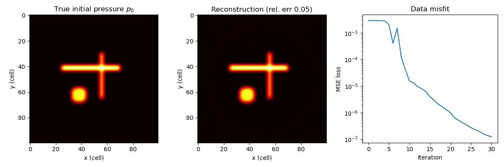

Photoacoustic initial-pressure reconstruction
=============================================

Photoacoustic tomography (PAT) forms an image of an initial pressure
distribution :math:`p_0` -- produced when a short laser pulse is absorbed by,
for example, blood vessels -- from the acoustic waves that pressure launches,
recorded on an array of sensors surrounding the object. This is an
*initial-value* problem rather than a source-driven one: at :math:`t = 0` the
pressure equals :math:`p_0` and its time derivative is zero, and the field
simply evolves from there.

Because Deepwave is differentiable, reconstructing :math:`p_0` is just gradient
descent: we make the initial wavefield a ``requires_grad`` parameter and
minimise the misfit between the modelled and measured sensor data. This example
first synthesises data from a small blood-vessel-like phantom, then reconstructs
the phantom from that data.

The initial-condition convention
--------------------------------

Deepwave's scalar propagator advances a leapfrog scheme that needs the field at
two consecutive time levels: ``wavefield_0`` (step 0) and ``wavefield_m1``
(step -1, one internal time step earlier; see
:doc:`what_deepwave_calculates`). The photoacoustic initial condition is

.. math::

    p(t=0) = p_0, \qquad \left.\frac{\partial p}{\partial t}\right|_{t=0} = 0,

The example approximates rest by setting **both** levels equal to the initial
pressure, ``wavefield_0 = wavefield_m1 = p0``. This sets
:math:`(u_0-u_{-1})/h=0`, where :math:`h` is the internal time step. That
difference is centred at :math:`-h/2`, not at zero: it is a simple start-up
approximation, not an exact imposition of the continuous initial condition.
For a second-order start at zero in the source-free interior, Taylor expansion
instead gives :math:`u_{-1}=p_0+\tfrac12 h^2 c^2\nabla_h^2 p_0`, using the
same spatial stencil and internal step as the propagator. The distinction
matters when comparing with an analytic photoacoustic solution.

Here synthetic observations and reconstruction use the same discrete start,
so the reconstruction demonstrates inversion of that discrete model.
Setting only ``wavefield_0`` (leaving
``wavefield_m1`` at zero) would instead impose a non-zero initial velocity and
model a different physical experiment.

An initial wavefield may be given either at the shape of the model region
being simulated or at the shape of the whole simulation domain, which is that
region plus the PML padding (see the ``wavefield_0`` entry in the :doc:`scalar`
API page). The physical :math:`p_0` here is model-shaped, so it could be passed
directly; we embed it into a zero-padded tensor of the full simulation-domain
shape instead, which makes the region being simulated explicit and leaves no
room for the shape to be read either way::

    def pad_to_sim(p0_inner):
        padded = torch.nn.functional.pad(
            p0_inner, (pml_width, pml_width, pml_width, pml_width))
        return padded.unsqueeze(0)

Setup
-----

We use a homogeneous soft-tissue/water medium (:math:`c = 1500` m/s) on a
0.5 mm grid, with a ring of receivers around a blurred vessel phantom. Note
that ``pml_freq`` is pinned to the ~1 MHz content of the problem rather than
left to be inferred: this simulation is driven by an initial wavefield, not by
source amplitudes, so there is no source spectrum for Deepwave to infer from
(see :ref:`pml-freq` and :doc:`ultrasound`)::

    ny, nx = 100, 100
    dx = 0.5e-3          # 0.5 mm cells
    c = 1500.0
    v = torch.full((ny, nx), c)
    pml_width = 20
    dt = 5e-8            # 50 ns
    nt = 520

The phantom is blurred so that its features span several cells; this keeps
:math:`p_0` band-limited (at least ~6 cells per wavelength, avoiding grid
dispersion) and keeps the linear reconstruction well-conditioned. The receiver
ring uses floating-point locations, which Deepwave automatically interpolates
onto the grid with Hicks interpolation::

    n_receivers = 64
    ring_radius = 40.0
    angles = torch.arange(n_receivers) * (2 * torch.pi / n_receivers)
    receiver_locations = torch.stack(
        [ny / 2 + ring_radius * torch.cos(angles),
         nx / 2 + ring_radius * torch.sin(angles)], dim=1).unsqueeze(0)

Forward modelling and reconstruction
------------------------------------

The forward operator propagates an initial pressure and returns the recorded
data::

    def forward(p0_inner):
        wavefield = pad_to_sim(p0_inner)
        out = scalar(v, dx, dt,
                     receiver_locations=receiver_locations,
                     wavefield_0=wavefield, wavefield_m1=wavefield,
                     nt=nt, pml_width=pml_width, pml_freq=1e6, accuracy=4)
        return out.receiver_amplitudes

    observed = forward(p0_true).detach()

The map :math:`p_0 \mapsto \text{data}` is linear, so LBFGS converges rapidly.
We start the reconstruction from zero::

    p0_est = torch.zeros(ny, nx, requires_grad=True)
    optimiser = torch.optim.LBFGS([p0_est], lr=1.0, max_iter=40,
                                  history_size=20,
                                  line_search_fn="strong_wolfe")

    def closure():
        optimiser.zero_grad()
        loss = torch.nn.functional.mse_loss(forward(p0_est), observed)
        loss.backward()
        return loss

    optimiser.step(closure)

In about 30 iterations (~25 s on a CPU) the data misfit falls by four orders of
magnitude and the reconstruction reaches a relative error of about 5%:

For a real experiment you would use a heterogeneous sound-speed model, a
realistic sensor geometry (see :doc:`ultrasound` for the transducer helpers),
and possibly regularisation or a limited-view sensor arrangement; the
differentiable-reconstruction pattern shown here stays the same.

`Full example code <https://github.com/ar4/deepwave/blob/master/docs/example_photoacoustic.py>`_
