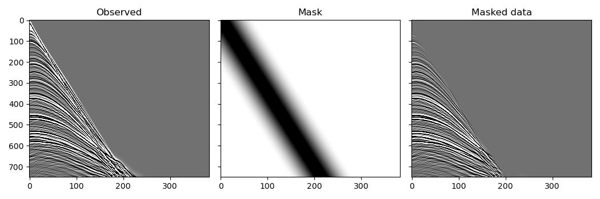
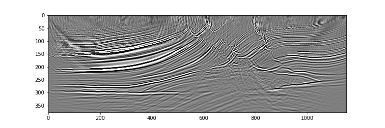

Reverse-Time Migration (RTM)
============================

:term:`Reverse-time migration <RTM>` forms an image of subsurface
reflectivity by combining a source wavefield propagated through a background
model with receiver data propagated by the adjoint. A common **imaging
condition** sums their zero-lag cross-correlation over time. Coherent
arrivals can highlight reflectors, but acquisition geometry, the source
wavelet and modelling errors also affect the image.

This example uses the adjoint of the Born operator instead. Define a velocity
perturbation ``dv`` that starts at zero, compare its modelled scattered data
with observations, and differentiate that misfit with respect to ``dv``.
The negative gradient is a migration image in this parameterisation.
Its correlation includes the derivative of the discrete wave equation:
spatial stencil and velocity factors, source scaling, PML terms and model
padding. It is not simply the product of the two raw wavefields. See
:doc:`example_custom_imaging_condition` for a raw correlation image and
illumination compensation, and :doc:`operator_contract` for the derivative.

For a fixed Born map ``B`` and loss ``||B dv - d||^2 / N``, the gradient
at ``dv = 0`` is ``-2 B.T d / N``. With a data mute ``M``, as below, it is
``-2 B.T M.T M d / N``. These are discrete adjoint identities under the
conditions in :ref:`gradient-guarantees`; compiled model gradients with CFL
substepping or a larger sampling interval approximate the time sum.
Writing the image as a gradient also lets optimisers and regularisers act
on it directly, as :doc:`example_lsrtm` does over multiple iterations.

Born migration and the first FWI update
---------------------------------------

**With** :func:`deepwave.scalar_born`, the route this example takes. The
Born propagator takes a background velocity model ``v_mig`` and a
scattering potential ``dv``, and returns the singly-scattered data that
``dv`` produces. Start from ``dv = 0``, so the modelled scattered data is
zero and the residual is the whole recorded scattered dataset, and take one
gradient::

    scatter = torch.zeros_like(v_mig, requires_grad=True)
    out = scalar_born(
        v_mig, dx, dt,
        dv=scatter,
        source_amplitudes=source_amplitudes,
        source_locations=source_locations,
        sc_receiver_locations=receiver_locations,
        pml_freq=freq,
    )
    loss = torch.nn.MSELoss()(out.sc_receiver_amplitudes, observed_scatter)
    loss.backward()
    # scatter.grad is the RTM image (negated: the gradient points away
    # from the image, and an optimiser step follows it downhill).

**With plain** :func:`deepwave.scalar`, the gradient with respect to velocity
gives the first update direction for :doc:`FWI <example_fwi_generated>`.
Here ``dv`` is a velocity perturbation, so the two routes use the same
linearisation when the background, fixed numerical setup, receiver sampling
and data weighting match. Their gradients agree only when the residuals
also match: for example, when the Born observations are the full observed
data minus the background prediction. A mute alone need not achieve this.

Use ``scalar_born`` to hold the background fixed and solve a linear
least-squares problem for ``dv``. Linearity does not make the inverse
problem well-posed: limited aperture and bandwidth can leave poorly
constrained or unobservable perturbations. Regularisation and a suitable
background remain necessary considerations; see :doc:`example_lsrtm`.

Either way, one call to ``backward()`` on one shot gives that shot's
contribution; the rest of this page is about the two practical problems
that stand between that and an image of the whole Marmousi model.

Muting the direct arrival
-------------------------

Born modelling produces only singly-scattered waves, but the recorded data
also contains the direct arrival, which is far stronger. Trying to explain
it with a scattering potential puts a large artefact in the image.
:doc:`example_lsrtm` handles this by modelling the direct arrival and
subtracting it; here it is muted instead, with a mask that attenuates the
data around the expected direct-arrival time. To avoid introducing high
frequencies into the data with a sharp cut-off, we use a tapered mute for
the mask::

    mask = torch.ones_like(observed_data)
    flat_len = 100
    taper_len = 200
    taper = torch.cos(torch.arange(taper_len)/taper_len * math.pi/2)
    mute_len = flat_len + 2*taper_len
    mute = torch.zeros(mute_len, device=device)
    mute[:taper_len] = taper
    mute[-taper_len:] = taper.flip(0)
    v_direct = 1700
    for shot_idx in range(n_shots):
        sx = (shot_idx * d_source + first_source) * dx
        for receiver_idx in range(n_receivers_per_shot):
            rx = (receiver_idx * d_receiver + first_receiver) * dx
            dist = abs(sx - rx)
            arrival_time = dist / v_direct / dt
            mute_start = int(arrival_time) - mute_len//2
            mute_end = mute_start + mute_len
            if (mute_start > nt):
                continue
            actual_mute_start = max(mute_start, 0)
            actual_mute_end = min(mute_end, nt)
            mask[shot_idx, receiver_idx,
                 actual_mute_start:actual_mute_end] = \
                mute[actual_mute_start-mute_start:
                     actual_mute_end-mute_start]
    observed_scatter_masked = observed_data * mask

Fitting the whole survey in memory
----------------------------------

This example migrates the entire Marmousi model and dataset -- 115 shots --
which would probably not fit in memory if every shot were propagated
simultaneously, as the smaller examples do. Instead we propagate batches of
shots and accumulate the gradients over all the batches before taking a
step with the optimiser. Each time we backpropagate, PyTorch adds to the
existing gradient values. We zero the gradients before this loop and weight
each batch's mean loss by its fraction of the total shot count. With the
same number of receivers and samples per shot, this gives the full-survey
mean loss and gradient, within floating-point rounding. Simply summing
batch means would overweight a smaller final batch and change the update
scale when the batch size changes.
We tell the optimiser to use this gradient to take a step only after the
loop over shot batches has completed, so using batches changes neither the
update nor the final result. A `PyTorch data loader
<https://pytorch.org/docs/stable/data.html>`_ could equally have been used
to split the data into batches, with equivalent results::

    # Create scattering amplitude that we will invert for
    scatter = torch.zeros_like(v_mig)
    scatter.requires_grad_()

    # Setup optimiser to perform inversion
    optimiser = torch.optim.SGD([scatter], lr=1e9)
    loss_fn = torch.nn.MSELoss()

    # Run optimisation/inversion
    n_epochs = 1
    n_batch = 46  # The number of batches to use
    n_shots_per_batch = (n_shots + n_batch - 1) // n_batch
    for epoch in range(n_epochs):
        epoch_loss = 0
        optimiser.zero_grad()
        for batch in range(n_batch):
            batch_start = batch * n_shots_per_batch
            batch_end = min(batch_start + n_shots_per_batch,
                            n_shots)
            if batch_end <= batch_start:
                continue
            s = slice(batch_start, batch_end)
            out = scalar_born(
                v_mig, dx, dt,
                dv=scatter,
                source_amplitudes=source_amplitudes[s],
                source_locations=source_locations[s],
                sc_receiver_locations=receiver_locations[s],
                pml_freq=freq
            )
            loss = (
                loss_fn(out.sc_receiver_amplitudes * mask[s],
                        observed_scatter_masked[s])
            ) * (batch_end - batch_start) / n_shots
            epoch_loss += loss.item()
            loss.backward()
        print(epoch_loss)
        optimiser.step()

Note that ``n_epochs`` is 1: this is migration, not inversion. The single
optimiser step turns the accumulated gradient into the image. Because the
scattering potential starts at zero and the learning rate is a constant,
the image is the negative gradient times the learning rate. Its amplitude
depends on that choice, the loss normalisation, source calibration and
illumination; it is not a calibrated velocity perturbation. Running more
iterations turns it into
:doc:`LSRTM <example_lsrtm>`, which corrects for uneven illumination and
the source wavelet, but which also needs a more careful setup to converge
to something useful.

Batching with this loss weighting gives the full-survey update within
floating-point rounding. For an inversion that runs for many
iterations it might converge faster to instead take a step after every
batch, or after every small number of batches, using randomly selected
shots in each batch. This is the way training is typically done for neural
networks, and is easy to set up here too: as simple as moving
``optimiser.zero_grad()`` and ``optimiser.step()`` inside the loop over
batches in the code above.

Running this example
--------------------

It needs the Marmousi files, ``marmousi_vp.bin`` and ``marmousi_data.bin``,
in the directory it is run from; ``python docs/get_marmousi.py`` produces
both (see :doc:`examples`). Running it with ``DEEPWAVE_SMOKE=1`` set needs
no download: it migrates a small generated stand-in model instead, which
checks that the code runs but produces nothing worth looking at. If you
want a migration you can run immediately and interpret, the
:doc:`one-file FWI example <example_fwi_generated>` is the closest
self-contained relative -- its first iteration's gradient is a velocity
image, with the residual and numerical qualifications described above.

Where to go next
----------------

* :doc:`example_lsrtm` -- iterating instead of taking a single step.
* :doc:`example_custom_imaging_condition` -- replacing the zero-lag
  cross-correlation, and illumination compensation.
* :doc:`example_joint_migration_inversion` -- solving for the background
  velocity and the reflectivity together.
* :doc:`scalar_born` -- what the Born propagator computes, precisely.

`Full example code <https://github.com/ar4/deepwave/blob/master/docs/example_rtm.py>`_
