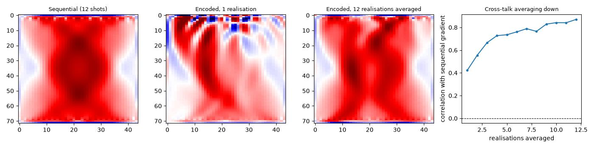

Source encoding for stochastic FWI
====================================

Full-waveform inversion (**FWI**) fits a velocity model by minimising the
misfit between recorded and simulated data. When there are many shots
(one propagation per source position), the ordinary way to do this
propagates every shot separately at every iteration and sums their
contributions to the gradient. That is exact, but it means one
propagation per shot per iteration -- for a survey with hundreds of
shots, hundreds of propagations before the model can be updated even
once.

**Source encoding** is a way to cut that cost to one propagation per
iteration, at the price of extra noise in the gradient. This page builds
it from Deepwave's existing support for several sources in one shot; no
new function is needed.

What source encoding is
---------------------------

Deepwave already lets one shot contain more than one source:
``source_amplitudes`` has shape ``[shot, source, time]`` and
``source_locations`` has shape ``[shot, source, dimension]`` (see
:doc:`quickstart`), so nothing stops several sources, at different
positions, from sharing the same shot and firing in the same
propagation.

Source encoding puts that to use. Instead of propagating each of the
survey's shots on its own, give every source a random **polarity**,
+1 or -1, and place all of them together in a single shot: a
**super-shot**. One propagation of the super-shot produces data that is
(to a linear approximation) the sum of what each individual shot would
have recorded, each scaled by its own random sign. Summing the real,
observed data for the individual shots with those same random signs
produces the matching "observed" super-shot data, so the two can be
compared exactly as an ordinary shot's simulated and observed data are.

The gradient of the misfit between the super-shot's simulated and
"observed" data is a **stochastic gradient**: a cheap, noisy estimate of
the gradient that summing every shot would have given, computed from a
single propagation instead of one per shot.

The noise has a name: **cross-talk**. Superposing several sources means
each one's data sits inside a recording that also contains every other
source's data. The misfit is quadratic, so squaring that sum produces
cross terms between different sources' data on top of the terms that
would appear in the ordinary per-shot sum, and it is those cross terms,
which have no counterpart in the exact gradient, that pollute it.
Cross-talk is the entire cost of the technique.

Building the super-shot
----------------------------

With ``source_locations`` holding one row per shot's source position and
``wavelet`` the common source time function, the super-shot's sources
and the correspondingly-encoded observed data are::

    signs = torch.randint(0, 2, (n_shots,)) * 2 - 1  # +-1, one per source
    encoded_amplitudes = (signs[:, None] * wavelet[None, :]).unsqueeze(0)
    encoded_locations = source_locations[:, 0, :].unsqueeze(0)
    encoded_observed = (
        signs[:, None, None] * observed_data
    ).sum(dim=0, keepdim=True)

    pred = deepwave.scalar(
        v, dx, dt,
        source_amplitudes=encoded_amplitudes,
        source_locations=encoded_locations,
        receiver_locations=receiver_locations[:1],
    ).receiver_amplitudes
    loss = torch.nn.MSELoss()(pred, encoded_observed)

The leading size-1 axis of ``encoded_amplitudes`` and
``encoded_locations`` is the shot axis: this is one shot, containing
``n_shots`` sources, where the example's ordinary FWI recipe would have
used ``n_shots`` shots of one source each. All the sources in the
super-shot are placed at the survey's real source positions and fire at
time zero together, exactly as if they were all really shooting at
once. Every shot shares the same fixed receiver array here, which is
what makes summing their recordings meaningful: sample ``t`` of receiver
``r`` means the same physical thing -- the wavefield at that receiver's
location -- for every shot, so a per-sample sum is well defined.

Why the signs must be redrawn
----------------------------------

Cross-talk is *noise*, not bias: its average over random signs is zero,
because each unwanted cross term between two different sources is, on
average, as likely to come out positive as negative. Averaging encoded
gradients computed from independently redrawn signs therefore averages
the cross-talk down, while the wanted signal, which is the same in every
realisation, keeps adding up. A single realisation is already an
unbiased estimate of the true gradient, but a visibly noisy one; several
realisations, averaged, are a much better one.

In an actual stochastic-FWI run this averaging is free: every optimiser
iteration draws its own random signs anyway, so the sequence of updates
over many iterations does the averaging as a side effect of training,
without ever needing to hold more than one super-shot propagation in
memory at a time. Redrawing the same signs every iteration, rather than
fixing them once, is what turns the noise into something that averages
away instead of a fixed error the optimisation can never correct.

Verifying the gradient
---------------------------

The example builds a small cross-hole model: a homogeneous background
with a Gaussian slow anomaly, sources down one edge and a shared
receiver array down the other. The starting model, from which every
gradient below is computed, is the homogeneous background alone, so a
correct gradient should point towards the anomaly.

It computes the ordinary gradient by looping over the individual shots,
summing their contribution with repeated ``backward()`` calls (gradients
accumulate into a tensor's ``.grad`` across repeated calls, which is
exactly summing per-shot contributions). It then computes the encoded
gradient, once from a single realisation of the random signs and again
averaged over several realisations, and measures the `Pearson
correlation coefficient
<https://en.wikipedia.org/wiki/Pearson_correlation_coefficient>`_
between the flattened ordinary and encoded gradients.

The left three panels are the ordinary (sequential) gradient, a single
encoded realisation, and several encoded realisations averaged; the
rightmost panel plots the correlation against the ordinary gradient as
more realisations are averaged in, which is where the noise reduction
described above is visible directly. At the example's default size, a
single realisation correlates with the ordinary gradient at 0.42, and 12
realisations averaged correlate at 0.87; the correlation is positive
throughout the averaging, not only at the end. A single realisation is
noisy enough that it is not asserted on -- it is normal for it to
correlate only weakly, and it would not be a defect for an individual
run to occasionally correlate close to zero or even slightly negatively
-- but the averaged gradient must, and does, correlate positively and
comfortably with the gradient it is standing in for.

`Full example code <https://github.com/ar4/deepwave/blob/master/docs/example_source_encoding.py>`_
