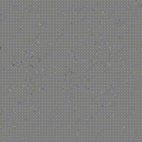

Matching a target final wavefield
=================================

This example optimises the source amplitudes so that the final wavefield of
a propagation matches a target image, rather than optimising the model to
match receiver data as in earlier examples. Deepwave can calculate the
gradient of a loss function with respect to any float tensor input, using
any of the propagation outputs, not just the gradient of the velocity model
with respect to receiver amplitudes. The scalar Born propagator, for
example, supports gradients with respect to the velocity model and the
source, as well as the scattering potential. Multiple inputs and outputs
can be involved simultaneously, so the gradient with respect to several
inputs (say, velocity and source amplitudes) can be calculated for a loss
function involving several outputs (such as receiver amplitudes and the
final wavefield).

We will use this image as a target:

We can load it using::

    target = torchvision.io.read_image(
        'target.jpg',
        torchvision.io.ImageReadMode.GRAY
    ).float()/255
    target = (target[0] - target.mean()).to(device)

Let's create `n_sources_per_shot` sources located at random cells, without more than one at the same location::

    source_locations = torch.zeros(n_shots, n_sources_per_shot, 2,
                                   dtype=torch.long, device=device)
    torch.manual_seed(1)
    grid_cells = torch.cartesian_prod(torch.arange(ny),
                                      torch.arange(nx))
    source_cell_idxs = (
        torch.randperm(len(grid_cells))[:n_sources_per_shot]
    )
    source_locations = (
        grid_cells[source_cell_idxs]
        .reshape(1, n_sources_per_shot, 2).long().to(device)
    )

The next step is to then create the initial source amplitudes and specify that we want to calculate gradients with respect to them::

    source_amplitudes = (
        deepwave.wavelets.ricker(freq, nt, dt, peak_time)
        .repeat(n_shots, n_sources_per_shot, 1).to(device)
    )
    source_amplitudes.requires_grad_()

    optimiser = torch.optim.LBFGS([source_amplitudes])

The optimisation loop is then not very dissimilar to earlier examples. We'll set the PML width to be zero on all sides so that waves reflect from the edges of the model. The loss function measures the difference between the final wavefield and the target image, and also penalises the norm of the source amplitudes to find the minimum norm solution::

    def closure():
        optimiser.zero_grad()
        out = deepwave.scalar(v, dx, dt,
                              source_amplitudes=source_amplitudes,
                              source_locations=source_locations,
                              pml_width=0)
        y = out.wavefield_0[0]
        loss = loss_fn(y, target) + 1e-3*source_amplitudes.norm()
        loss.backward()
        return loss.item()

    for i in range(50):
        optimiser.step(closure)

Lastly, we will save the wave propagation time steps so that we can make them into an animated GIF. The full example code shows two ways of achieving this, and asserts that they agree. The simplest is to use Deepwave's :doc:`callback feature <example_callback_animation>`. The other uses the approach discussed in :doc:`the checkpointing example <example_checkpointing>`: it advances the propagation one user time step at a time and passes each call's output back in as the next call's ``initial_state``::

    inner_dt, step_ratio = deepwave.discretisation.cfl_condition(dx, dx, dt, 2000)
    upsampled_amplitudes = deepwave.discretisation.upsample(
        source_amplitudes.detach(), step_ratio
    )

    out = None
    for i in range(nt):
        chunk = upsampled_amplitudes[..., i*step_ratio:(i+1)*step_ratio]
        out = deepwave.scalar(v, dx, inner_dt,
                              source_amplitudes=chunk,
                              source_locations=source_locations,
                              pml_width=0, pml_freq=freq,
                              initial_state=out)

``initial_state=out`` carries the whole propagator state -- both wavefields, and the PML's auxiliary fields when a PML is in use -- from one chunk into the next, which is what makes the restarted run equivalent to a single call. Two details matter here. The resampling to satisfy the CFL condition is done once, before the loop, rather than being left to each call, so that the chunk boundaries fall on user time steps. And ``pml_freq`` is passed explicitly: when it is omitted Deepwave infers it from the peak of the source amplitudes' spectrum, and each chunk is only a few samples long, so every chunk would infer a different frequency and, with a non-zero ``pml_width``, would get a different absorbing boundary.

Using `FFmpeg <https://ffmpeg.org>`_ to join these individual time steps into an animated GIF (although you could use other tools, such as Matplotlib)::

    ffmpeg -i wavefield_%03d.jpg -framerate 30 example_target_wavefield.gif

we obtain the result:

`Full example code <https://github.com/ar4/deepwave/blob/master/docs/example_target_wavefield.py>`_
