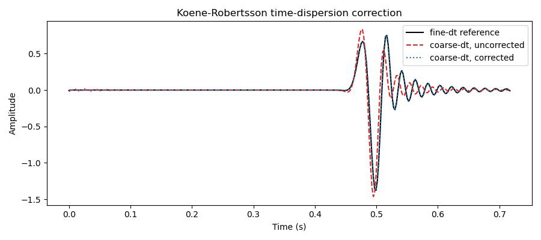

Time-dispersion correction
==========================

Deepwave's propagators step through time with an explicit, second-order-accurate
leapfrog scheme. Being only second order in time, it introduces *temporal
dispersion*: each temporal frequency :math:`\omega` propagates as if it were the
slightly lower :math:`(2/\Delta t)\sin(\omega\Delta t/2)`. Raising the spatial
``accuracy`` order does nothing to this error — it depends only on the time
step. The Koene–Robertsson remappings in :mod:`deepwave.time_dispersion` can
reduce temporal-dispersion error when using a larger ``dt``. Finite-record
correction is approximate and the result depends on the retained band and
windowing. See :doc:`time_dispersion` for the derivation and transform
directions.

The recipe is: pre-transform the source wavelet with
:func:`deepwave.time_dispersion.correct_source` before modelling, and
post-transform the recorded data with
:func:`deepwave.time_dispersion.correct_receivers` afterwards. Both take the
propagator's **internal** time step ``internal_dt = dt / step_ratio`` (the step
that governs the dispersion). Choosing a CFL-stable ``dt`` makes the propagator
run with ``step_ratio == 1``, so ``internal_dt == dt``;
:func:`deepwave.time_dispersion.cfl_internal_dt` returns it from the same inputs
the propagator uses::

    internal_dt = cfl_internal_dt(grid, dt_coarse, v0)

    wavelet_corrected = correct_source(wavelet_coarse, internal_dt)
    rec_corrected = correct_receivers(
        run(dt_coarse, wavelet_corrected), internal_dt
    )

We model the same homogeneous 2-D scalar problem at a coarse time step (near the
CFL limit) and at a six-times-finer reference time step. Using the same
continuous source wavelet for both (band-limited-resampled to the fine grid),
the only difference between the runs is the time step, so the discrepancy is
temporal dispersion. Without correction the coarse-dt trace differs from the
fine-dt reference by a large relative L2 error; applying both corrections brings
it into closer agreement (a more than twenty-fold error reduction in this
example; this case-specific result is not a general accuracy bound)::

    relative L2 error, uncorrected: 0.5453
    relative L2 error, corrected:   0.0226
    improvement factor: 24.1x

`Full example code <https://github.com/ar4/deepwave/blob/master/docs/example_time_dispersion.py>`_
