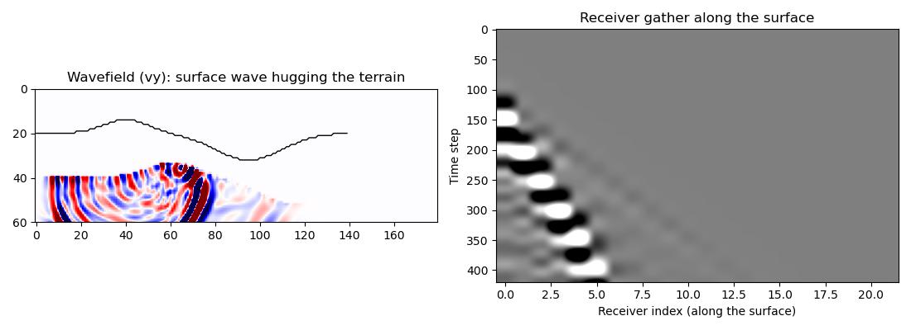

Elastic free-surface topography (surface_method="pm")
==========================================================

Deepwave represents a free surface -- flat or arbitrarily rugged
(staircase) topography -- purely through vacuum cells
(``vp = vs = rho = 0``, equivalently ``lamb = mu = buoyancy = 0``); there
is no separate surface-geometry argument. This example builds a small
hill-and-valley terrain by zeroing the model above a topographic line::

    vacuum = yy < surface.reshape(1, -1)  # everything above the surface
    vp[vacuum] = 0.0
    vs[vacuum] = 0.0
    rho[vacuum] = 0.0

Passing ``surface_method="pm"`` selects the parameter-modified method of
`Cao and Chen (2018) <https://doi.org/10.1190/geo2018-0098.1>`_: in
addition to the vacuum cells, the medium parameters at the solid cells
lying on the discrete surface are modified once, before time stepping, so
the stress-free condition is satisfied adaptively for any Poisson's
ratio -- markedly more accurate than the default improved vacuum method
(IVM) at large Poisson's ratio, at no extra per-time-step cost. See
:doc:`elastic` and :doc:`boundaries` for the full derivation and accuracy
comparison.

A shallow vertical-force source placed directly on the surface generates a
clear Rayleigh-type surface wave that visibly hugs the topography, distinct
from the body waves radiating into the half-space below it. Receivers
placed along the surface (following the terrain, not a flat line) record
its moveout::

    out = elastic(
        lamb, mu, buoyancy, dx, dt,
        source_amplitudes_y=source_amplitudes,
        source_locations_y=source_locations,
        receiver_locations_y=receiver_locations,
        surface_method="pm",
        backend="eager",
        pml_freq=freq,
    )

The left panel's wavefield snapshot shows the surface-wave energy (the
tightly-banded, high-amplitude arcs) tracking the black terrain outline as
it climbs from the source, over the hill, distinct from the more diffuse
body waves spreading into the interior below. The right panel's receiver
gather along the surface shows the corresponding clear moveout.

`Full example code <https://github.com/ar4/deepwave/blob/master/docs/example_topography.py>`_
