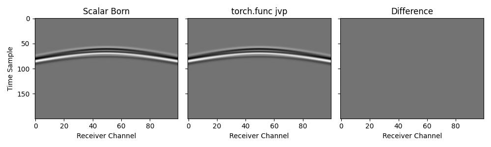
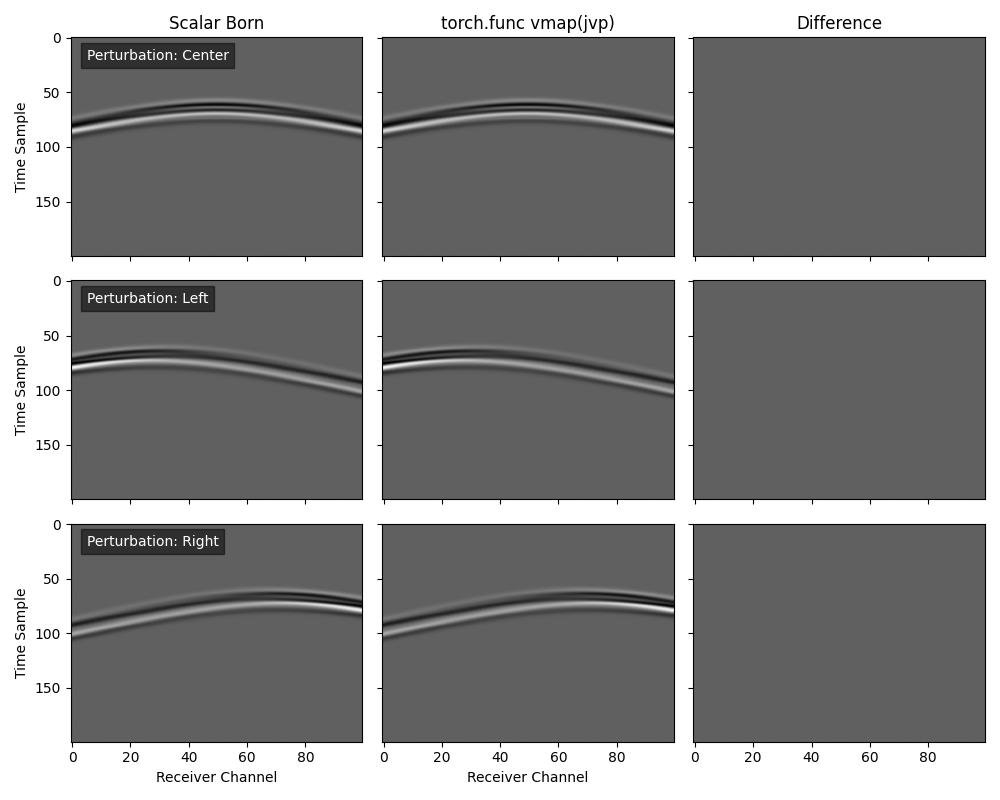

Using torch.func features
=========================

Deepwave supports using `torch.func` features, such as `vmap` (vectorising map) and forward-mode automatic differentiation (AD), to perform batch processing and sensitivity analysis. This allows for functional transformations of the wave propagation.

However, there are significant constraints and performance considerations when using these features with Deepwave:

*   **Property models under vmap:** `vmap` can currently only be applied to property models (e.g., velocity, scattering potential), not to source amplitudes or source/receiver locations. Forward-mode AD is less restricted: the fast-backend `jvp` of `scalar`, `acoustic` and `elastic` additionally accepts tangents on the source amplitudes and the initial wavefields. Floating-point locations can be differentiated through Hicks interpolation in supported configurations; this is separate from support for batching locations under `vmap`. See :doc:`usage` for off-grid locations.
*   **Backend support:** `vmap` requires the pure-Python `backend="eager"` backend (**substantially slower** than the default C/CUDA backend). **Forward-mode AD (`torch.func.jvp` / `torch.autograd.forward_ad`) on the `scalar`, `acoustic` and `elastic` propagators, however, now runs on the fast default C/CUDA backend**: internally it routes the tangents through the Born machinery (the Born scattered field *is* the JVP of the corresponding nonlinear propagator; see :ref:`born-is-jvp` below), so you do **not** need `backend="eager"` for `jvp` of those three. The propagators with no hand-derived Born-based `jvp` rule on the compiled backend -- `scalar_born`, `acoustic_born`, `acoustic_vti`, `viscoacoustic`, `elastic_born` and `elastic_vti` -- do still require `backend="eager"` for `jvp`, and raise an error naming it if you ask for `jvp` on the default backend. The per-propagator jvp column is in :doc:`capabilities`, which is declared in code and checked by conformance probes. With fixed numerical setup, the scalar velocity tangent is linearised through the extension into the PML too; the omitted derivative is the dependence of an inferred ``max_vel`` on the model, as explained below.
*   **max_vel under `vmap`:** `max_vel` has to be given when a model that the maximum wavespeed is computed from is batched by `vmap`, which hides the concrete values it would otherwise be read from (it fixes the CFL time step and the PML profiles, which are one set of numbers for the whole call in any case). The models the maximum *is* read from are listed per propagator in :doc:`capabilities`; batching any other model does not require it. Under every other transform -- `grad`, `jacrev`, `jvp` -- the model's values are readable, so `max_vel` is inferred exactly as it is outside the transform. One combination needs it whatever is batched: under `torch.compile` of a `vmap`\ ped function you must pass `max_vel=` explicitly, because the readability check is skipped while compiling, so omitting it surfaces PyTorch's own "`.item()` on a Tensor ... with vmap" error instead of Deepwave's. Passing it explicitly is still worth doing whenever you want the internal time step pinned across an inversion, transform or no transform.
*   **Native Batching Preferred:** Deepwave already has native support for batched property models. If your goal is simply to propagate a batch of models, the native C/CUDA backend (which handles batch dimensions automatically) will be much faster than using `vmap` with the eager backend. `torch.func` is primarily useful for more advanced use cases.

Forward-Mode AD for Scattering (Jacobian-Vector Product)
--------------------------------------------------------

We can use `torch.func.jvp` to compute the scattered wavefield (the linearised response) due to a perturbation in the velocity model. This is mathematically equivalent to the Born approximation. In this example, we verify that the output of `jvp` applied to the nonlinear `scalar` propagator matches the output of the explicit `scalar_born` propagator.

First, we define a wrapper for the simulation that fixes the arguments we are not differentiating with respect to. We keep `backend="eager"` here because this same wrapper is reused for the `vmap` composition later (`vmap` requires the eager backend). For a *standalone* `jvp` of `scalar` you can drop `backend="eager"` and run on the fast default backend — see :ref:`born-is-jvp` below::

    def forward_sim(v):
        # eager backend so this wrapper can also be used with vmap below,
        # which is also why max_vel is given: vmap hides the velocity values
        # it would otherwise be inferred from.
        return deepwave.scalar(
            v,
            dx,
            dt,
            source_amplitudes=source_amplitudes,
            source_locations=source_locations,
            receiver_locations=receiver_locations,
            pml_freq=freq,
            max_vel=2000,
            backend="eager",
        ).receiver_amplitudes

Then we can calculate the Jacobian-Vector Product. Here `v_bg` is the background velocity model (the point at which we linearise) and `scatter` is the perturbation (the direction in which we differentiate)::

    # Calculate the Jacobian-Vector Product
    # primals = (v_bg,), tangents = (scatter,)
    _, out_jvp = torch.func.jvp(forward_sim, (v_bg,), (scatter,))

.. _born-is-jvp:

Forward-mode AD on the fast backend: ``scalar_born`` *is* the JVP
-----------------------------------------------------------------

``scalar_born`` *is* the exact discrete forward-mode derivative (JVP) of
``scalar`` with respect to the velocity model, and it runs on the fast C/CUDA
backend. This is exactly the relationship that ``torch.func.jvp(scalar, ...)``
now exploits internally: a standalone ``jvp`` of ``scalar`` (without ``vmap``)
runs on the fast default backend, so ``backend="eager"`` is *not*
required. Nor is ``max_vel``: a forward-mode-wrapped model's values are
readable, so the maximum wavespeed is inferred from them exactly as it is
without the transform. It is passed below all the same, to pin the internal
time step. Define a fast-backend wrapper::

    def forward_fast(v):
        return deepwave.scalar(
            v, dx, dt,
            source_amplitudes=source_amplitudes,
            source_locations=source_locations,
            receiver_locations=receiver_locations,
            pml_freq=freq, max_vel=2000,   # no backend="eager"
        ).receiver_amplitudes

Then, for a background model ``v`` and a perturbation direction ``dv``::

    primal, tangent = torch.func.jvp(forward_fast, (v,), (dv,))   # fast backend

agrees, up to floating-point error, with the following call using the same
numerical setup::

    out = deepwave.scalar_born(
        v, dx, dt,
        dv=dv,                       # dv is the tangent direction
        source_amplitudes=source_amplitudes,
        source_locations=source_locations,
        sc_receiver_locations=receiver_locations,
        bg_receiver_locations=receiver_locations,
        pml_freq=freq,
        max_vel=2000,
    )
    bg_receivers = out.bg_receiver_amplitudes
    sc_receivers = out.sc_receiver_amplitudes
    # sc_receivers == tangent   (the forward-mode/Born scattered field)
    # bg_receivers == primal    (the unperturbed scalar field)

on the default (fast) backend. This equivalence holds *including* when the
perturbation overlaps the source cell: ``scalar`` pre-scales each source by
``-v^2 dt^2``, so its derivative contributes an extra scattered point source
``-2 v dv dt^2 f``, and ``scalar_born`` already injects exactly this term via
its second (scattered) source. No separate source argument is needed.

An important qualification is the maximum wave speed. Both the PML
profile's amplitude and the internal time step are built from it, and neither
``scalar_born`` nor ``torch.func.jvp`` linearises that dependence: the maximum
arrives as a Python number, a constant of the call. The Born and JVP paths
agree for matching resolved settings even when both omit this dependence;
their agreement alone does not check it. To interpret either as the
derivative of a call with respect to its model, pin ``max_vel`` and the
other numerical settings. ``torch.func.jvp`` on ``scalar`` warns
when the velocity tangent is non-zero inside the PML *and* ``max_vel`` was
left to be inferred. That warning is conservative: an interior maximum can
also move, so absence of the warning does not establish that the inferred
bound is constant under the perturbation. The
perturbation itself may live anywhere, the outermost cells of the model
included: they are extended outwards to fill the absorbing layer and the
finite-difference halo, on the scattering model as on the background
velocity, so the linearisation is exact there too. This is verified in
``tests/test_scalar_born.py`` (``test_born_is_jvp_of_scalar``,
``test_born_jvp_model_edge``), ``tests/test_born_edge_linearisation.py`` and
``tests/test_scalar_jvp.py``.

So: ``scalar_born`` and ``torch.func.jvp(scalar, ...)`` are two entry points to
the *same* fast-backend linearisation. Use ``scalar_born`` directly for the
explicit, ergonomic RTM/LSRTM tool, and ``torch.func.jvp`` when you want the
``torch.func`` transform API itself -- for example to differentiate with
respect to the source amplitudes or initial wavefields as well as ``v``, or to
compose with ``vmap`` (below; ``vmap`` still requires ``backend="eager"``).

Batched Sensitivity Analysis with vmap
--------------------------------------

If we want to evaluate the scattering response for a batch of different perturbations (e.g., anomalies at different locations), we can combine `vmap` with `jvp`.

We define a function that computes the JVP for a single tangent vector (perturbation), and then use `vmap` to vectorise it over a batch of perturbations::

    # Define a function that takes a single perturbation and returns
    # its JVP
    def get_jvp(tangent):
        # We fix the primal (v_bg) and vary the tangent
        return torch.func.jvp(forward_sim, (v_bg,), (tangent,))[1]

    # Vectorise `get_jvp` over the perturbation input
    out_vmap = torch.func.vmap(get_jvp)(scatter_batch)

.. _reverse-mode-torch-func:

Reverse-mode transforms (``grad``, ``vjp``, ``jacrev``, ``hessian``)
---------------------------------------------------------------------

``torch.func``'s reverse-mode transforms -- :func:`torch.func.grad`,
:func:`torch.func.vjp`, :func:`torch.func.jacrev`, and
:func:`torch.func.hessian`, which is built from them -- require
``backend="eager"`` on every propagator that has a compiled backend.
There is no fast-backend
equivalent of the Born trick that makes ``jvp`` work on the compiled backend:
these transforms differentiate a tensor that does not carry ``requires_grad``
through the forward pass, so the compiled backend's forward saves nothing for
its hand-derived adjoint, and the transform then asks for that adjoint anyway.
Deepwave detects this and raises, naming ``backend="eager"``::

    RuntimeError: deepwave.scalar's backward pass was reached without the
    state that its forward pass saves. On Deepwave's compiled (C/CUDA)
    backend that happens under the reverse-mode torch.func transforms ...
    Re-run the propagator with the pure-PyTorch eager backend,
    backend="eager" ...

On a propagator whose compiled backend has no hand-derived second-order rule
(``scalar_born`` and ``viscoacoustic`` among them) the *second-order* guard is
reached first and reports the same situation in its own words: a reverse-mode
transform runs its backward with grad enabled, which is exactly what that
guard watches for, so the message names double-backward rather than
``torch.func``. The remedy is the same: ``backend="eager"``.

So, with ``backend="eager"``::

    def loss(v):
        return (
            deepwave.scalar(
                v, dx, dt,
                source_amplitudes=source_amplitudes,
                source_locations=source_locations,
                receiver_locations=receiver_locations,
                pml_freq=freq,
                max_vel=2000,
                backend="eager",
            ).receiver_amplitudes ** 2
        ).sum()

    g = torch.func.grad(loss)(v_bg)

None of this affects an ordinary ``.backward()`` or
:func:`torch.autograd.grad`, which are the usual way to get a gradient out of
Deepwave and run on the fast backend: reach for the reverse-mode
``torch.func`` transforms only when you want the functional API itself (to
compose with ``vmap``, say). For Hessian-vector products on the fast backend,
use ``torch.autograd.grad(..., create_graph=True)`` on ``scalar``,
``acoustic`` or ``elastic`` -- see :doc:`example_hessian` and the
"Second-order (create_graph)" column of :doc:`capabilities`.

Returning a whole ``PropagatorOutput`` from a transformed function
------------------------------------------------------------------

The transformed function does not have to reduce to a single tensor.
:class:`deepwave.PropagatorOutput` and :class:`deepwave.AuxiliaryState` are
registered as PyTorch *pytree* nodes, so a transform sees the tensors inside
them: the children of an output are its tuple elements in return order, with
the auxiliary state expanding into the tensors it holds, so the leaves are
exactly the output's tensors. That means the whole output can be mapped,
carried as an auxiliary value, or compiled::

    batched = torch.func.vmap(
        lambda v: deepwave.scalar(
            v, dx, dt,
            source_amplitudes=source_amplitudes,
            source_locations=source_locations,
            receiver_locations=receiver_locations,
            pml_freq=freq, max_vel=2000, backend="eager",
        )
    )(torch.stack([v1, v2]))

    batched.receiver_amplitudes.shape     # (2, n_shots, n_receivers, nt)

    def loss_and_output(v):
        out = deepwave.scalar(v, dx, dt, ..., backend="eager")
        return (out.receiver_amplitudes ** 2).sum(), out

    jacobian, out = torch.func.jacrev(loss_and_output, has_aux=True)(v)

The field names and the ``info`` of a rebuilt output are the ones of the run
that produced it, and its ``auxiliary_state`` keeps the recorded run
parameters that let a later call check it, so an output that has been through
a transform is still usable as ``initial_state=``. ``vmap`` still maps
property models only, so mapping the source amplitudes is refused with its own
message.

`Full example code <https://github.com/ar4/deepwave/blob/master/docs/example_torch_func.py>`_
