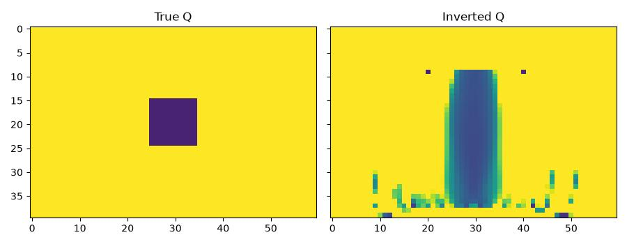

Q (attenuation) inversion with the viscoacoustic propagator
================================================================

:func:`deepwave.viscoacoustic` models a quality factor ``Q`` per grid cell
using generalised-standard-linear-solid (GSLS) relaxation mechanisms (see
:doc:`viscoacoustic`). Passing ``q_n_mechanisms > 1`` together with a
``q_band`` fits several relaxation mechanisms so that ``Q`` is close to
constant across a whole frequency band, rather than exact only at one
reference frequency -- this example uses two mechanisms across a
10-50 Hz band. There is then no single reference frequency, so ``q_freq``
is not given (a single-mechanism call must give it).
The anomalous target ``q=20`` produces an actual
:math:`Q_{\mathrm{eff}}\approx 21.05` at the 25 Hz wavelet frequency in this
two-mechanism fit. The example prints this value using
:func:`deepwave.attenuation.response`; other frequencies have a different
response.

A small crosswell-style survey images a localised low-``Q`` (highly
attenuating) anomaly on top of an otherwise nearly-elastic (high-``Q``)
background, starting from a uniform high-``Q`` guess::

    out = viscoacoustic(
        v, rho, q, dx, dt,
        source_amplitudes_pressure_rate=source_amplitudes,
        source_locations_pressure_rate=source_locations,
        receiver_locations_p=receiver_locations,
        q_n_mechanisms=2,
        q_band=(10.0, 50.0),
        pml_freq=freq,
        max_vel=3000.0,
    )

``Q`` is inverted with ``q = 10 + exp(logq)``, keeping it above 10,
using the same chain-rule reparameterisation pattern
as :doc:`example_parameterisation`. This example also applies the
masked-subregion pattern from :ref:`model-parameterisations`: only a
central region away from the sources and the PML is optimised, since this
small survey's limited illumination there produces inversion artefacts if
the whole model is left free to update::

    invert_mask = (yy > 8) & (xx > 8) & (xx < nx - 8)
    update = torch.zeros((ny, nx), requires_grad=True)

    for _epoch in range(n_epochs):
        optimiser.zero_grad()
        logq = logq_background + torch.where(
            invert_mask, update, torch.zeros_like(update)
        )
        q = 10.0 + torch.exp(logq)
        loss = loss_fn(run(q) / data_scale, observed / data_scale)
        loss.backward()
        optimiser.step()

The pressure-rate wavelet has a peak amplitude of :math:`10^6` Pa/s.
``data_scale`` is the fixed RMS amplitude of the observed data, so loss
normalisation keeps the optimiser's scale independent of the source units.
The fixed ``max_vel`` bounds the **unrelaxed** speed over this example's
allowed Q range; using ``v.max()`` would only bound the relaxed speed.

This small survey recovers a low-Q band near the anomaly's lateral position,
with substantial vertical smearing and additional artefacts. The decrease in
data misfit demonstrates differentiation and optimisation; it does not
establish a unique reconstruction or accurate recovery of the anomaly's
depth extent. A better-resolved inversion needs more illumination and
appropriate regularisation.

`Full example code <https://github.com/ar4/deepwave/blob/master/docs/example_viscoacoustic.py>`_
