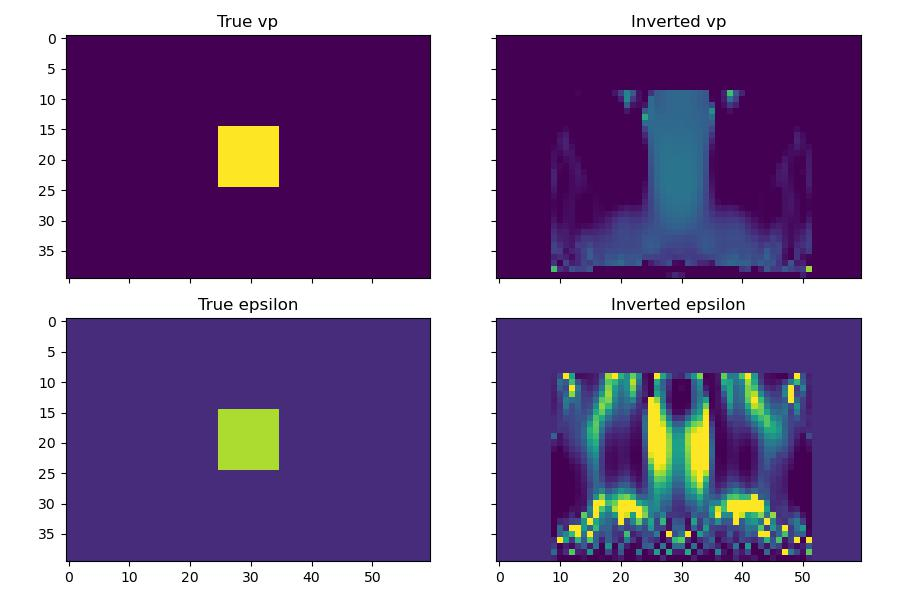

Thomsen-space FWI with the pseudo-acoustic VTI propagator
==============================================================

:func:`deepwave.acoustic_vti` takes VTI stiffnesses (``c11``, ``c13``,
``c33``) directly, but practitioners usually reason and invert in Thomsen
(1986) parameters (``vp``, ``epsilon``, ``delta``) instead. This is exactly
the "converters" case in :ref:`model-parameterisations`:
:func:`deepwave.anisotropy.thomsen_to_cij` is an ordinary differentiable function, so
optimising ``vp``/``epsilon`` directly and rebuilding the stiffnesses each
iteration composes with autograd for free::

    def run(vp, epsilon):
        c11, c13, c33, _, _, buoyancy = thomsen_to_cij(vp, vs, rho, epsilon, delta)
        return acoustic_vti(
            c11=c11, c13=c13, c33=c33, buoyancy=buoyancy, grid_spacing=dx, dt=dt,
            source_amplitudes_sigma_v=source_amplitudes,
            source_locations_sigma_v=source_locations,
            receiver_locations_sigma_v=receiver_locations,
            pml_freq=freq,
        ).receiver_amplitudes_sigma_v

The pseudo-acoustic VTI system additionally requires ``epsilon >= delta``
everywhere, or it is ill-posed (see :doc:`acoustic_vti`). Rather than
clamping ``epsilon`` (which would zero its gradient wherever the clamp is
active), this example reparameterises
``epsilon = delta + softplus(epsilon_free)``, guaranteed ``>= delta`` for
*any* real ``epsilon_free`` while staying smoothly differentiable -- the
same chain-rule pattern again, this time enforcing a physical constraint
rather than converting units.

A small crosswell-style survey inverts for both ``vp`` and ``epsilon``
jointly from a uniform starting guess, using the masked-subregion pattern
from :ref:`model-parameterisations` (as in :doc:`example_viscoacoustic`)
to keep the update within a central region away from the sources/PML:

``vp`` recovers most of the way to the true anomaly, but ``epsilon``
recovers only partially -- a real, well-known trade-off in VTI FWI:
anisotropy parameters need wider propagation-angle diversity than a
narrow-aperture survey like this one provides, while ``vp`` is
comparatively well constrained even at near-vertical incidence.

`Full example code <https://github.com/ar4/deepwave/blob/master/docs/example_vti.py>`_
