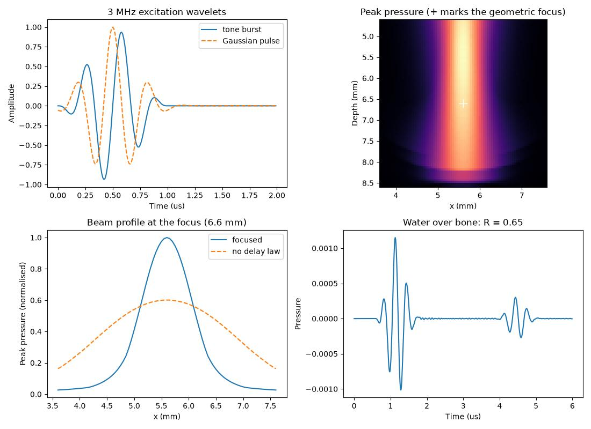

Ultrasound and NDT (coming from k-Wave)
=======================================

Deepwave is used for medical ultrasound, photoacoustics, and non-destructive
testing (NDT) as well as for seismic imaging. The wave physics is the same; what
differs is the length and time *scale* (millimetres and microseconds rather than
metres and seconds), the excitation (tone bursts rather than Ricker wavelets),
and the acquisition (extended transducer elements rather than point sources).
This page collects the Deepwave features and conventions that matter for these
applications, and maps them onto the vocabulary of `k-Wave
<http://www.k-wave.org/>`_, the established ultrasound simulation package, for
readers arriving from there. For a broader tool comparison see
:doc:`comparison`.

Every code block below is an excerpt from one script,
``docs/example_ultrasound.py``, which runs end to end and checks its own
answers. It is written in a single unit system (millimetres, microseconds and
megahertz) from the first line to the last, and it is run in Deepwave's
continuous integration, so this page cannot drift away from something that
works.

Concept mapping from k-Wave
---------------------------

.. list-table::
   :header-rows: 1
   :widths: 30 40

   * - k-Wave
     - Deepwave
   * - ``kgrid`` (``Nx``/``dx``, ``Nt``/``dt``)
     - the model tensor's shape, ``grid_spacing``, ``dt``, and the number of
       time samples (the length of ``source_amplitudes``, or ``nt``)
   * - ``medium.sound_speed``, ``medium.density``
     - the propagator model tensors: ``v`` (scalar), or ``v``/``rho``
       (acoustic), or ``vp``/``vs``/``rho`` (elastic)
   * - ``medium.alpha_coeff`` / ``alpha_power`` (power-law absorption)
     - constant-Q, single-mechanism SLS attenuation via
       :mod:`deepwave.viscoacoustic` (``Q``, ``q_freq``); k-Wave's power-law
       fit is not yet available (see "Honest differences" below)
   * - ``source.p0`` (initial pressure, photoacoustics)
     - the initial wavefields ``wavefield_0`` and ``wavefield_m1`` (see
       :doc:`example_photoacoustic`)
   * - ``source.p`` / ``source.ux`` (time-varying source)
     - ``source_amplitudes`` at ``source_locations``
   * - ``sensor.mask``
     - ``receiver_locations`` (integer cells, or floating-point cells that are
       automatically Hicks-interpolated)
   * - ``kWaveArray`` (transducer element geometry, apodisation, steering)
     - :mod:`deepwave.transducers` (element tessellations, apodisation, focusing
       delays)
   * - ``toneBurst``
     - :func:`deepwave.wavelets.tone_burst` (and
       :func:`~deepwave.wavelets.gaussian_pulse`)
   * - built-in time-reversal reconstruction
     - gradient-descent reconstruction through the differentiable propagator
       (:doc:`example_photoacoustic`)

Choosing units for ultrasound
-----------------------------

Deepwave itself is unit-agnostic: it only ever combines your numbers in
dimensionless groups (the Courant number :math:`c\,\Delta t/\Delta x`, and the
product of frequency and time step). You may therefore work in **any single
consistent system of units** -- the results are identical -- provided every
quantity uses it. The one requirement is consistency: ``grid_spacing``, ``dt``,
the wave speed, and ``pml_freq`` must all refer to the same length and time
units.

For ultrasound scales the cleanest choice is **millimetres, microseconds, and
megahertz**, because it makes the numbers order-unity:

.. list-table::
   :header-rows: 1
   :widths: 24 24 24

   * - Quantity
     - Unit
     - Example value
   * - length / ``grid_spacing``
     - mm
     - ``dx = 0.1`` (100 µm cells)
   * - time / ``dt``
     - µs
     - ``dt = 0.01`` (10 ns)
   * - speed (``v``)
     - mm/µs
     - ``1.5`` (water/soft tissue, = 1500 m/s)
   * - frequency / ``pml_freq``
     - MHz
     - ``3.0`` (a 3 MHz transducer)

In this system a 3 MHz tone burst in water resolves a 0.5 mm wavelength, and
the Courant number on 0.1 mm cells with a 0.01 µs time step is
:math:`1.5\times0.01/0.1 = 0.15`. The equivalent SI setup (metres, seconds,
m/s, hertz) -- ``dx = 1e-4``, ``dt = 1e-8``, ``v = 1500``, ``pml_freq = 3e6``
-- is exactly as valid and is what the worked :doc:`example_photoacoustic`
uses; pick whichever keeps *your* numbers readable.

The example script opens by fixing that system once. It uses 0.05 mm cells
rather than the table's 0.1 mm, buying ten cells per wavelength instead of
five, which is what Deepwave's own resolution check asks for:

.. literalinclude:: example_ultrasound.py
   :end-before: # --- section: wavelets ---

That last division is the only unit conversion in the script.
:mod:`deepwave.transducers` measures positions in **grid cells**, so the speed
it needs is a speed in **cells per unit time**; divide your physical speed by
your cell size and the delays it returns come back in the time unit that
matches your ``dt``. Nothing in the module needs a ``grid_spacing`` of its own.

.. note::

   **You no longer have to set** ``pml_freq`` **by hand at ultrasound
   scales.** When it is not given, Deepwave infers it from the peak of your
   source amplitudes' spectrum, in your own frequency unit -- so a 3 MHz tone
   burst gives ``3.0`` in the MHz system above, or ``3e6`` in SI. Deepwave
   0.0.27 and earlier instead used a fixed ``25``, a seismic dominant
   frequency, which at ultrasound scales is effectively zero: it detuned the
   PML, let the model edges reflect, and made the grid-cells-per-wavelength
   check compare against a kilometre-scale wavelength, so it never fired.
   Wherever the inferred value is anything other than exactly ``25``, Deepwave
   warns once to point out that the numbers differ from that release's; the
   warning is a migration aid and is removed in 0.4.0.

   Still set ``pml_freq`` explicitly for anything you publish, in your chosen
   frequency unit -- ``pml_freq=3.0`` in the MHz system above, or
   ``pml_freq=3e6`` in SI. Inference ties the absorbing boundary to the
   wavelet, so changing the wavelet changes the boundary (see
   :ref:`pml-freq`). The example script sets it explicitly, as its propagator
   calls below show.

Excitation wavelets
-------------------

Ultrasound and NDT transducers are usually driven by a windowed sinusoid (a
"tone burst") or a Gaussian-modulated sinusoid, provided by
:mod:`deepwave.wavelets`:

.. literalinclude:: example_ultrasound.py
   :start-after: # --- section: wavelets ---
   :end-before: # --- section: array ---

``tone_burst``'s ``n_cycles`` trades temporal resolution against bandwidth;
``gaussian_pulse``'s ``bandwidth_frac`` is the fractional -6 dB bandwidth
(scipy's ``gausspulse`` convention). Both match the peak frequency you request,
which is what the two ``print``\ ed numbers above check. Both are documented in
full in the :doc:`wavelets <reference_utilities>` reference.

``nt`` and ``dt`` are keyword-only on every builder except ``ricker``, and
``peak_time`` defaults to the middle of the record (``nt * dt / 2``) on all
four, so that swapping one wavelet for another does not silently move the
source in time. That default is the right one for a plot and for a record you
intend to fill; it is the wrong one when the wavelet is only there to start a
simulation, because it throws away the first half of the run. Pass
``peak_time`` explicitly, as the script does, whenever the excitation should
begin at the front of the record.

Transducer arrays
-----------------

A physical transducer element is an extended aperture, not a point. The k-Wave
answer is ``kWaveArray``; the Deepwave answer is :mod:`deepwave.transducers`,
which tessellates an element into closely spaced points (all positions in grid
cells, consistent with the propagators' location arguments) and returns
per-point apodisation weights. These float locations feed straight into the
propagators, which band-limit-interpolate them onto the grid with Hicks
interpolation automatically.

.. literalinclude:: example_ultrasound.py
   :start-after: # --- section: array ---
   :end-before: # --- section: focus-checks ---

The module provides ``line_element`` and ``arc_element`` (2-D), ``disc_element``
and ``bowl_element`` (3-D focused bowl), ``window_weights``,
``delays_to_focus``, ``apply_delays`` (spectrally exact, differentiable
fractional-delay shifting), :func:`deepwave.transducers.element_source` (which
assembles a builder's points, weights and delay law into the
``(source_amplitudes, source_locations)`` pair a propagator takes), and
``element_receiver_trace`` (weighted integration of an element's receiver
points). Because every step is differentiable, delay laws and apodisation
weights can themselves be optimised.

Prefer ``element_source`` to assembling the source pair by hand. The builders
return ``(locations, weights)``, and applying the weights yourself means
remembering a ``* weights[:, None]`` whose omission does not raise -- it just
quietly gives you a differently apodised, differently shaped beam.

Where the beam actually focuses
-------------------------------

It is worth being precise about what a delay law does and does not buy you,
because it is easy to write a check that looks like it tests focusing and does
not.

.. literalinclude:: example_ultrasound.py
   :start-after: # --- section: focus-checks ---
   :end-before: # --- section: fluid-solid ---

**Laterally**, a focused aperture localises sharply. The peak-pressure
maximum -- the largest pressure magnitude each cell ever sees, which is what a
hydrophone scan reports -- sits on the focal axis to within one cell, and the
-6 dB beam width there is 21 cells, about twice the wavelength times the
f-number. Removing the delay law widens it to 59 cells, roughly half the
120-cell aperture.

**Axially**, it does not, and no assertion should pretend otherwise. The depth
of field of a focused aperture is about :math:`7\lambda F^2` -- around 70 cells
for the :math:`F = 1` aperture in the script -- so the on-axis peak pressure is
nearly flat right through the focal region, and its maximum lies well *in
front* of the geometric focus: 24 cells short of it here, 20% of the focal
length, and only 6% higher there than at the focus itself. That is ordinary
physics, not a Deepwave artefact, and it is visible in the peak-pressure map
below: the bright column is long, and brightest above the white cross. A
time-integrated energy peak behaves the same way, only more so. An assertion
that the peak-pressure maximum lands on the geometric focus would therefore be
false in the axial direction, and one loosened until it passed would be
measuring nothing.

What *is* sharp in the axial direction is the arrival **time**. The delay law's
whole purpose is that every element point's contribution reaches the focus
together, at ``max(range) / c`` after the wavelet's own peak, and the script
checks exactly that: the envelope of the trace recorded at the focal cell peaks
within one cell of travel (:math:`\Delta x / c`, 0.033 µs here) of the
predicted instant. Range is measured by time of flight, not by hunting for an
amplitude maximum -- in ultrasound as in seismic.

Fluid-solid interfaces (water and tissue over bone or rock)
-----------------------------------------------------------

Many ultrasound and seismic problems are *fluid-solid*: a fluid (water, or soft
tissue modelled as a fluid) in contact with a solid that supports shear. Two
common cases are **transcranial ultrasound** (water/soft tissue over the skull
bone) and **ocean-bottom seismic** (a water column over the elastic seabed). The
elastic propagator handles these directly: set the shear velocity ``vs = 0`` in
the fluid region (a fluid has no shear modulus, :math:`\mu = 0`), and a non-zero
``vs`` in the solid. Build the Lamé/buoyancy models with
:func:`deepwave.vpvsrho_to_lambmubuoyancy` as usual:

.. literalinclude:: example_ultrasound.py
   :start-after: # --- section: fluid-solid ---
   :end-before: # --- section: plot ---

Deepwave's elastic parameter preparation evaluates the shear modulus at the
staggered shear-stress nodes by a **harmonic average** of the surrounding cell
values. Because the harmonic mean :math:`2\mu_1\mu_2/(\mu_1+\mu_2)` goes to zero
whenever either input is zero, every shear node that touches a fluid cell carries
exactly zero shear modulus. That is precisely the physical fluid-solid
condition: the interface transmits normal stress but no shear traction, and the
fluid slips freely along the solid. This is imposed automatically; you only have
to set ``vs = 0`` in the fluid.

**What is modelled correctly.** At a fluid-solid interface an incident P wave
splits into a reflected P (back into the fluid), a transmitted P, and -- at
oblique incidence -- a *mode-converted* transmitted S wave in the solid. Deepwave
reproduces the analytic behaviour: at normal incidence the reflection and
transmission match the acoustic-impedance formulas :math:`R=(Z_1-Z_2)/(Z_1+Z_2)`
and :math:`T=2Z_1/(Z_1+Z_2)` (using the solid's P-impedance
:math:`Z_2=\rho_2 v_{p2}`) to a few percent -- which is what the reflection
check above measures, as a magnitude, after undoing the :math:`1/\sqrt{r}`
spreading of a 2-D wave over the two paths' different lengths: 0.654 against
the 0.640 the impedances predict -- and at oblique incidence the
reflected/transmitted-P/transmitted-S energy partition matches the fluid-solid
Zoeppritz solution to ~1-2% (validated in ``tests/test_elastic_fluid_solid.py``).

**Stability and near-interface oscillations.** A water layer over a solid with a
free surface on top (the ocean-bottom, or a water-coupled ultrasound tank
geometry) is **long-run stable** in Deepwave. Unlike the thin-slab-between-two-
free-surfaces case (see :doc:`boundaries`), the water's lower boundary is a
fluid-solid interface rather than a second free surface, so the elastic C-PML
instability condition is not met. If you see *oscillations in traces recorded
near the interface* (as reported in Deepwave issue #116), these are a
near-interface numerical/physical effect -- Scholte interface waves and grid
dispersion -- not a divergence. To reduce them, increase the points per
wavelength near the interface (finer ``grid_spacing`` or higher ``accuracy``),
and avoid placing receivers *on* the interface row itself; place them a cell or
two into the medium you want to record. See :doc:`troubleshooting`.

The figure
----------

The last section of the script plots the two wavelets, the peak-pressure map
around the focus, the focused and unfocused beam profiles at the focal depth,
and the water-over-bone trace:

.. literalinclude:: example_ultrasound.py
   :start-after: # --- section: plot ---

Honest differences from k-Wave
------------------------------

k-Wave is a mature, ultrasound-specialised package, and there are things it does
that Deepwave does not (yet):

* **Numerical method.** Deepwave is a finite-difference code on a regular
  Cartesian grid, so curved boundaries and off-axis transducer surfaces are
  represented by staircased/interpolated points, whereas k-Wave's k-space
  pseudospectral method needs far fewer points per wavelength and has no grid
  dispersion of the same kind. For the same accuracy Deepwave typically needs a
  finer grid.
* **Tissue absorption.** k-Wave natively models power-law frequency-dependent
  absorption, the standard soft-tissue attenuation model. Deepwave provides
  :mod:`deepwave.viscoacoustic`, a constant-Q, single-mechanism
  standard-linear-solid (SLS) propagator: you supply a quality factor ``Q`` at
  a reference frequency ``q_freq`` and get (approximately) constant-Q
  attenuation near that frequency. What is still missing is k-Wave's power-law
  frequency-dependent absorption model itself; fitting a power law over a wide
  band with multiple SLS mechanisms remains future work (roadmap). Until then,
  use a single SLS mechanism tuned near your dominant frequency, or model
  lossless propagation.

What Deepwave offers in return is **full differentiability**: gradients of any
output with respect to the sound-speed/density model, the source wavelet, the
initial pressure, apodisation, and focusing delays, computed to machine
precision through compiled kernels (with true second-order Hessian-vector
products for the scalar propagator). That turns imaging and characterisation
problems -- photoacoustic reconstruction, transcranial aberration correction,
sound-speed tomography, transducer/delay-law design -- into ordinary PyTorch
optimisation, on CPU or GPU, composable with any torch loss or neural network.
k-Wave is not differentiable.

.. note::

   **Precision on long ultrasound runs.** Ultrasound simulations often use many
   thousands of time steps (high sample rates over long records). In float32
   the small per-step rounding errors accumulate, and phase drift can become
   visible late in a long run. If you see this, run in float64 (pass float64
   model/​source tensors) for a reference, or verify that float32 phase error is
   acceptable for your record length; float32 is usually fine for imaging but
   worth checking for quantitative timing measurements. This is the same
   accumulation caveat noted for the eager backend in :doc:`accuracy`.

See also
--------

* :doc:`example_photoacoustic` -- a worked differentiable photoacoustic
  reconstruction.
* :doc:`units` -- the source/receiver amplitude conventions per propagator.
* :doc:`boundaries` -- edge conditions, including the first-class ``boundary``
  selector for free (pressure-release, e.g. a water/air interface),
  rigid, and periodic faces.
* :doc:`comparison` -- how Deepwave compares with k-Wave and other packages.

`Full example code <https://github.com/ar4/deepwave/blob/master/docs/example_ultrasound.py>`_
